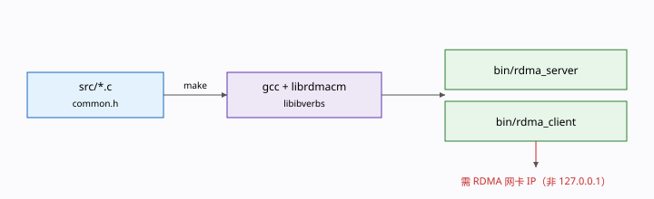

# 附录

> 两份随时可查的参考资料：**附录 A** 是全书术语表与参考文献，遇到不认识的词就翻
> 这里；**附录 B** 把 `examples/01`～`examples/08` 映射到对应章节，读到哪、跑到哪。
>
> 全书导读见 [前言与导读](00-前言与导读.md)。

## 本部分目录

- [附录 A · 术语表与参考文献](#appendix-a)
- [附录 B · 示例索引](#appendix-b)

---

<a id="appendix-a"></a>

## 附录 A · 术语表与参考文献

---

### 术语表（Glossary）

#### A

**AH（Address Handle）**
地址句柄，UD 传输类型下描述目标节点网络地址（GID / LID / SL / port）的对象。
每次 UD SEND 操作须在 WR 中指定 AH，相当于 UDP 的目标地址。

**ACK（Acknowledgment）**
RC 传输类型中，接收方 NIC 自动发回给发送方的确认包。应用不可见，由硬件处理。

---

#### C

**CNP（Congestion Notification Packet）**
DCQCN 拥塞控制中，接收方检测到 ECN 标记后回送给发送方的通知包，触发发送方降速。

**CQ（Completion Queue）**
完成队列，存放已完成操作的 CQE。每次 `ibv_poll_cq` 从中取出结果。

**CQE（Completion Queue Entry）**
完成队列条目，记录一次操作的结果：`wr_id`、`status`、`opcode`、`byte_len` 等。

**Credit（流控信用）**
发送方在 post_send 之前确认对端 RQ 有足够的预投递 WR 的机制。防止 RNR 错误。

---

#### D

**DC（Dynamic Connected）**
Mellanox/NVIDIA 私有传输类型，结合 RC 的可靠语义与 UD 的一对多扩展性。
发起方为 DCI，接受方为 DCT，NIC 内部动态建立/复用连接。

**DCQCN（Data Center Quantized Congestion Notification）**
RoCEv2 拥塞控制算法，基于 ECN 标记 + CNP 反馈 + 乘法降速/加法恢复。
标准化于 RFC 8257。

**Doorbell（门铃）**
应用通过 MMIO 写入网卡寄存器，通知 NIC 有新的 WQE 待处理。WC 内存写，延迟约 100ns。

**DMA（Direct Memory Access）**
外设（网卡）直接读写主机内存，不经过 CPU，是 RDMA 零拷贝的核心机制。

---

#### E

**ECN（Explicit Congestion Notification）**
交换机在 IP 头 ECN 字段打 CE 标记表示拥塞，不丢包。是 DCQCN 的信号来源。

---

#### F

**Fence（栅栏）**
`IBV_SEND_FENCE` 标志，确保当前 WR 在所有之前的 RDMA READ 完成后才执行，
用于保障操作顺序。

---

#### G

**GID（Global Identifier）**
128 位全局唯一标识符，类比 IPv6 地址。RoCEv2 下 GID 由网卡 MAC 和 IP 派生，
用于跨子网路由。

**GRH（Global Routing Header）**
UD 报文中携带 GID 信息的头部，共 40 字节。UD 接收方的 RQ 缓冲需预留 GRH 空间。

---

#### I

**IMM（Immediate Data）**
随 SEND 或 WRITE_WITH_IMM 携带的 32 位立即数，接收方在 CQE 中可读取（`wc.imm_data`）。
发送时 `htonl` 编码，接收时 `ntohl` 解码。

**IOMMU（Input–Output Memory Management Unit）**
将设备的 DMA 地址翻译为物理地址的硬件单元，隔离设备内存访问，提升安全性。
开启 IOMMU 会增加 `ibv_reg_mr` 的代价。

---

#### L

**lkey（Local Key）**
本端 WR 引用 MR 时使用的密钥，由 `ibv_reg_mr` 返回的 `mr->lkey`。

**LID（Local Identifier）**
InfiniBand 子网内的 16 位本地地址。RoCEv2（以太网）下 LID 为 0，改用 GID 路由。

---

#### M

**MMIO（Memory-Mapped I/O）**
将设备寄存器映射到进程地址空间，CPU 通过普通 store 指令写入，实现用户态直接操控硬件（如 doorbell）。

**MPT（Memory Protection Table）**
网卡中存储 MR 元数据（lkey/rkey、权限、起始地址、长度）的表。

**MR（Memory Region）**
已注册的内存区域。注册后内核 pin 住物理页，网卡建立 MTT/MPT 映射，
应用通过 lkey/rkey 引用。

**MTT（Memory Translation Table）**
网卡中将虚拟地址/DMA 地址翻译为物理页地址的页表，每个 MR 对应一组 MTT 条目。

**MW（Memory Window）**
MR 的子区域动态授权机制，可赋予 / 撤销对特定地址范围的远端访问权，无需重建 MR。
Type 1 通过 `ibv_bind_mw` 绑定，Type 2 嵌入 RDMA 操作原子完成。

---

#### N

**NUMA（Non-Uniform Memory Access）**
多处理器系统中，每个 CPU socket 有本地内存，跨 socket 访问延迟更高。
RDMA 应用应将 QP、MR 和工作线程绑定到同一 NUMA 节点。

---

#### O

**ODP（On-Demand Paging）**
`IBV_ACCESS_ON_DEMAND` 标志，允许注册未 pin 的虚拟地址。NIC 访问时触发缺页，
内核动态 pin 该页后 NIC 重试。适合大稀疏地址空间。

---

#### P

**PD（Protection Domain）**
保护域，所有 MR、QP、SRQ、AH 的归属容器。跨 PD 的资源不能互相引用，
防止越权访问。

**PFC（Priority Flow Control）**
以太网流控机制，交换机缓冲区接近满时发送 PAUSE 帧使上游停止发送，避免丢包。
副作用是 HOL（Head-of-Line）阻塞。

**PSN（Packet Sequence Number）**
每个 QP 维护的包序列号，用于乱序检测与重传。建连时双方交换初始 PSN（起始值随机）。

---

#### Q

**QP（Queue Pair）**
队列对，由发送队列（SQ）和接收队列（RQ）组成的 RDMA 通信端点。
每个 QP 有唯一的 QPN（Queue Pair Number）。

**QPN（Queue Pair Number）**
QP 的 24 位本地唯一编号，类比 TCP 端口。建连时双方交换 QPN。

---

#### R

**RC（Reliable Connected）**
可靠连接传输类型，提供顺序保证、重传和 ACK，支持 SEND/RECV/WRITE/READ/原子操作。
1 QP 对应 1 个对端 QP，N 对节点需 N² 个 QP。

**rkey（Remote Key）**
对端执行 RDMA READ/WRITE 时验证访问权限的密钥，由 `ibv_reg_mr` 返回的 `mr->rkey`。

**RNR（Receiver Not Ready）**
接收方 RQ 无可用 WR 时向发送方返回的 NAK。触发 `IBV_WC_RNR_RETRY_EXC_ERR` 错误。

**RoCE（RDMA over Converged Ethernet）**
在以太网上运行 RDMA 的协议。RoCEv1 基于以太帧，RoCEv2 封装在 UDP/IP（端口 4791）上，支持跨子网路由。

**RQ（Receive Queue）**
QP 中存放预投递接收 WR（`ibv_post_recv`）的队列。消息到达时 NIC 消耗一个 WR，写入数据，产生 CQE。

**RNIC（RDMA Network Interface Card）**
支持 RDMA 的网卡，内含硬件 QP/CQ/MR 引擎，能独立执行 DMA 操作而不依赖 CPU。

---

#### S

**SGE（Scatter/Gather Element）**
描述一段内存的三元组：`{addr, length, lkey}`。一个 WR 可包含多个 SGE，实现分散聚合 I/O。

**SL（Service Level）**
InfiniBand / RoCE 的流量优先级（0–15），决定交换机调度顺序和 PFC 优先级映射。

**SQ（Send Queue）**
QP 中存放待发送 WR（`ibv_post_send`）的队列，NIC 按序从中取出并执行。

**SRQ（Shared Receive Queue）**
多个 QP 共享同一个接收队列，将 RQ 内存从 O(连接数) 降为 O(1)。
通过 `ibv_post_srq_recv` 统一预投递。

---

#### T

**UC（Unreliable Connected）**
不可靠连接传输类型，1 QP 对 1 QP，无重传，支持 SEND/WRITE，不支持 READ/原子操作。

**UD（Unreliable Datagram）**
不可靠数据报传输类型，1 QP 可向任意多个对端发送，无重传，仅支持 SEND。
消息大小不超过一个 MTU，每包需指定 AH。

---

#### W

**WC（Work Completion）**
见 CQE。`struct ibv_wc` 是 C API 中的完成事件结构体。

**WQE（Work Queue Element）**
Work Request 在硬件队列中的存储形式，由 NIC DMA 读取并执行。

**WR（Work Request）**
应用通过 `ibv_post_send` / `ibv_post_recv` 提交的操作请求，描述操作类型、本地内存地址（SGE）和远端地址（WRITE/READ）。

---

#### X

**XRC（eXtended Reliable Connected）**
扩展可靠连接传输类型，通过 XRCD（XRC Domain）共享接收 QP，将 N 对节点的 QP 数从 N² 降为 N。
介于 RC 和 DC 之间，是纯标准 RoCE 环境下 DC 的替代方案。

---

### 专家术语（第 17 章）

> 以下术语多为 NVIDIA/Mellanox 厂商专有或前沿研究，详见
> [第 17 章 · 专家深水区](part3-专家.md#ch17)。

**mlx5dv（Direct Verbs）**
mlx5 厂商扩展库，在标准 verbs 对象之上取出底层硬件资源指针（SQ buffer、
doorbell record、BlueFlame 寄存器），由应用亲手构造 WQE，获取最低延迟。

**DEVX（Devx）**
用原始 PRM 命令直接创建/操作硬件对象（DC、steering、计数器），完全绕过 verbs
对象模型。`mlx5dv_devx_obj_create` 是入口。

**PRM（Programmer's Reference Manual）**
mlx5 硬件的命令格式与结构体布局规范，DEVX 编程的依据；固件升级可能变更。

**WQE 控制段（ctrl segment）**
WQE 的 16 字节头部，含 opcode、QPN、ds（descriptor 段数）、signature、
fm_ce_se（fence/完成事件标志）。

**DB record（Doorbell Record）**
host 内存中的门铃计数器，记录 SQ/RQ 的 producer index，让网卡知道队列推进到何处。

**BlueFlame（BF）**
write-combining（WC）内存映射的门铃寄存器。小 WQE 可内联写入 BF 寄存器，
省去网卡回读 SQ buffer 的那次 PCIe read，是亚微秒延迟的来源。

**DPU（Data Processing Unit）**
= NIC + 通用 ARM 核 + 专用加速器（加密/压缩/正则/存储）。可把 RDMA 控制面、
存储目标、网络功能从主机 CPU 卸载到网卡上。NVIDIA BlueField 是代表。

**DOCA**
NVIDIA DPU 的软件开发框架，含 DOCA Flow（硬件流表）、SF/VF 设备表示、
DMA/Crypto/EC 等加速库。

**SF / VF（Scalable Function / Virtual Function）**
网卡虚拟化机制：在一张物理网卡上虚拟出大量轻量功能，分配给不同容器/VM。

**INT（In-band Network Telemetry）**
交换机把每跳的队列深度、链路速率等戳进数据包头，供端侧精确计算拥塞，是 HPCC 的基础。

**HPCC / TIMELY / Swift**
现代拥塞控制算法：HPCC 用网内遥测（INT）精确测量、近零排队；TIMELY 用 RTT 梯度；
Swift 用端到端延迟拆分（fabric + endpoint）。

**PCC（Programmable Congestion Control）**
在网卡（ConnectX-6 Dx / BlueField）上用受限 C 编写自定义拥塞控制算法的能力。

**GGA（Generic Global Accelerator）**
DPU 内把 regex/SHA 等加速器与 RDMA 数据搬运串成一条流水线的机制，数据不进主机。

---

### 参考文献

#### 标准规范

- **InfiniBand Architecture Specification**  
  InfiniBand Trade Association (IBTA)  
  https://www.infinibandta.org/ibta-specification/  
  *IB Spec Vol 1 覆盖传输层、编程模型、QP 状态机；Vol 2 覆盖物理层。*

- **RoCEv2 标准（IBTA Annex A17）**  
  IBTA Supplement to InfiniBand Architecture Specification, Annex A17: RoCEv2  
  *定义 RoCEv2 封装格式（GRH → IP/UDP → IBA Transport Header → Payload）。*

- **RFC 8257 – Data Center TCP (DCQCN)**  
  https://datatracker.ietf.org/doc/html/rfc8257  
  *DCQCN 算法的 IETF 标准文档。*

- **RDMA over Converged Ethernet (RoCE): A Decade Retrospective**  
  Rosenblum et al., SIGCOMM 2023

#### 厂商文档

- **NVIDIA Mellanox OFED 文档**  
  https://network.nvidia.com/products/infiniband-drivers/linux/mlnx_ofed/  
  *包含 ibv_* API 手册、性能调优指南、计数器说明。*

- **NVIDIA Verbs Programming Manual**  
  https://network.nvidia.com/related-docs/prod_software/RDMA_Aware_Programming_user_manual.pdf  
  *rdma_cm / libibverbs / libmlx5 的完整 API 参考。*

- **NVIDIA GPUDirect RDMA 文档**  
  https://docs.nvidia.com/cuda/gpudirect-rdma/  
  *peer-memory 驱动安装与 GPU MR 注册流程。*

- **Intel RDMA 编程指南**  
  https://www.intel.com/content/www/us/en/developer/articles/guide/rdma-network-programming-guide.html

#### 开源实现

- **rdma-core（libibverbs / librdmacm / 工具集）**  
  https://github.com/linux-rdma/rdma-core  
  *内含 `ibv_*` API 头文件、示例程序（`examples/`）、man pages。*

- **perftest（ib_send_lat / ib_send_bw 等）**  
  https://github.com/linux-rdma/perftest  
  *RDMA 性能基准工具标准实现，常用于验证硬件性能与调优效果。*

- **Linux 内核 RDMA 子系统**  
  https://www.kernel.org/doc/html/latest/infiniband/  
  *uverbs / ODP / rdma_rxe (Soft-RoCE) / SIW (iWARP over TCP) 内核文档。*

#### 延伸阅读

- **"RDMA over Commodity Ethernet at Scale"**（RoCE 大规模部署经验）  
  Guo et al., SIGCOMM 2016 — Microsoft Azure 的 RoCE 实践。

- **"FaRM: Fast Remote Memory"**（RDMA 在分布式事务系统的应用）  
  Dragojevic et al., NSDI 2014

- **"Pilaf: Fast and Pilferage-Free Key-Value Store"**（RDMA KV 设计）  
  Mitchell et al., USENIX ATC 2013

- **"HERD: A Case for Data-Centric Networking in the Cloud"**（SEND vs WRITE 吞吐对比）  
  Kalia et al., SIGCOMM 2014

---

<a id="appendix-b"></a>

## 附录 B · 示例索引

> 本书每个核心概念都配有一个**独立可编译运行**的示例。这张索引把
> `examples/01` ～ `examples/08` 映射到书中章节，方便你「读到哪、跑到哪」。每个示例
> 都能在 Soft-RoCE 上跑通，**无需 RDMA 硬件**。

---

### 如何编译运行所有示例

所有示例共享 `common/` 脚手架，顶层一条 `make` 即可递归构建：

```bash
make            # 顶层递归构建所有示例（需 RDMA 开发库）
make list       # 列出可构建示例
make clean      # 清理产物
```

每个示例编译出 `bin/server` 与 `bin/client`，统一用法：

```bash
./bin/server <RDMA网卡IP> 7471    # 终端 1
./bin/client <RDMA网卡IP> 7471    # 终端 2
```

> 📌 没有 RDMA 网卡？用 Soft-RoCE 在普通以太网卡上模拟即可——**环境搭建见
> [第 2 章 · 30 分钟跑起来](part1-入门.md#ch02)**。Soft-RoCE 支持本书全部示例
> （SEND/RECV、WRITE、READ、ATOMIC、SRQ 等），是验证代码逻辑的理想环境（但延迟高，
> 不可用于性能基准）。



---

### 示例 → 章节映射

| 示例 | 演示什么 | 对应章节 | 一句话运行提示 |
|------|---------|---------|---------------|
| [01-write-demo](../../examples/01-write-demo/) | 控制面（SEND/RECV 交换 MR 元数据）+ 数据面（RDMA WRITE 推数据）的基线全流程 | [第 2 章](part1-入门.md#ch02)、[第 7 章](part1-入门.md#ch07) | 入门第一个示例；服务端 WRITE 把字符串直接写进客户端内存 |
| [02-send-recv](../../examples/02-send-recv/) | 双边 SEND/RECV 乒乓往返 + 平均延迟基准 | [第 6 章](part1-入门.md#ch06) | 两端互发，体会预投递与双边语义 |
| [03-read](../../examples/03-read/) | RDMA READ 单边读，从对端内存把数据拉回本地 | [第 7 章](part1-入门.md#ch07) | 与 WRITE 方向相反，对端 CPU 不参与 |
| [04-immediate](../../examples/04-immediate/) | `WRITE_WITH_IMM`：写数据 + 立即数通知合一 | [第 9 章](part1-入门.md#ch09) | 客户端读 `wc.imm_data` 当通知 |
| [05-atomic](../../examples/05-atomic/) | `FETCH_ADD` / `CMP_SWAP` 远端原子操作 | [第 9 章](part1-入门.md#ch09) | 对端内存上做原子加 / 比较交换 |
| [06-selective-signaling](../../examples/06-selective-signaling/) | 选择性 signaling 的吞吐对比实验（每 N 个才 signaled 一次） | [第 11 章](part2-进阶.md#ch11) | 对比全 signaled vs 选择性 signaling 的吞吐差异 |
| [07-srq](../../examples/07-srq/) | 多 QP 共享一个 SRQ，把 RQ 内存从 O(连接数) 降为 O(1) | [第 12 章](part2-进阶.md#ch12) | 多个 QP 从同一个 SRQ 取接收 WR |
| [08-rpc](../../examples/08-rpc/) | 极简请求/响应 RPC（ADD/MUL）+ 平均往返延迟基准 | [第 15 章](part3-专家.md#ch15) | 客户端发 `{op,a,b}`，服务端算后回结果；两端 `iters` 须一致 |

---

### 配套关系一览

- **入门主线（第 1–9 章）**：示例 01–05 逐个对应核心原语——先建立控制面 + 数据面
  的完整图景（01），再单独吃透双边（02）、单边读（03）、立即数（04）、原子（05）。
- **进阶专题（第 10–14 章）**：示例 06–07 把性能工程（选择性 signaling）与可扩展
  架构（SRQ）的关键优化做成可动手对比的实验。
- **专家集成（第 15–17 章）**：示例 08 把 RDMA 原语拼成一个最小 RPC，正是第 15 章
  「与上层系统集成」的起点；更深的 mlx5dv/DEVX、DPU 等内容以伪代码呈现，无独立
  示例（依赖特定厂商硬件）。

> 每个示例目录下都有自己的 `README.md`，含「要点与陷阱」「构建与运行」「关联章节」
> 三段，建议读章节正文时对照动手。

---

- [第一部分 · 入门](part1-入门.md) · [第二部分 · 进阶](part2-进阶.md) · [第三部分 · 专家](part3-专家.md)
- 回到起点：[前言与导读](00-前言与导读.md)
