# 第一部分 · 入门（建立直觉，先跑起来）

> 本部分把 RDMA 的地基一层层搭起来：先弄明白它为什么存在，再花 30 分钟把环境跑
> 通，然后一个概念一个概念地拆解核心对象、内存注册、连接建立与三大数据语义。
> 读完这九章并跑通配套示例，你已经具备独立写 RDMA 程序的能力。
>
> 全书导读见 [前言与导读](00-前言与导读.md)。

## 本部分目录

| 章 | 标题 | 你将学会 |
|----|------|----------|
| [第 1 章](#ch01) | 为什么需要 RDMA | TCP 的代价、内核旁路与零拷贝、三种传输语义 |
| [第 2 章](#ch02) | 30 分钟跑起来 | 用 Soft-RoCE 搭环境、编译并运行第一个示例 |
| [第 3 章](#ch03) | RDMA 的核心对象 | PD / MR / QP / CQ / WR 各是什么、如何配合 |
| [第 4 章](#ch04) | 内存注册：lkey 与 rkey | 为什么网卡只能访问注册内存、权限标志 |
| [第 5 章](#ch05) | 建立连接：rdma_cm | 类 socket 的连接建立流程与关键时序 |
| [第 6 章](#ch06) | 双边操作 SEND/RECV | 收发双方如何配合、预投递的意义 |
| [第 7 章](#ch07) | 单边操作 WRITE/READ | 不打扰对端 CPU 的高吞吐数据面 |
| [第 8 章](#ch08) | 完成机制：post 与 poll | RDMA 的异步本质、如何确认操作完成 |
| [第 9 章](#ch09) | 过渡：立即数与原子操作 | WRITE_WITH_IMM、FETCH_ADD/CMP_SWAP |

---

<a id="ch01"></a>

## 第 1 章 · 为什么需要 RDMA

> 这是全书的第一章。我们不急着写代码，先回答一个最朴素的问题：
> **为什么会有 RDMA 这种东西？传统的网络通信到底差在哪？**
> 读完本章，你会对「内核旁路」「零拷贝」「单边 / 双边」这几个词有直觉，
> 后面的章节都建立在这层直觉之上。

### 本章你将遇到的术语（预览）

下面这些词本章会出现，但你**现在不用记住**，只需要先有个一句话的印象：

- **内核旁路（kernel bypass）**：让网卡绕开操作系统内核，直接和你的程序内存打交道。
- **零拷贝（zero-copy）**：数据不在内核缓冲区和用户缓冲区之间来回搬，省掉多次内存拷贝。
- **RNIC（RDMA 网卡）**：一块「会自己搬内存」的智能网卡，是 RDMA 的硬件主角。
- **SEND / RECV（双边操作）**：收发双方都要动手的通信，像打电话，两边都得拿起话筒。
- **WRITE / READ（单边操作）**：只有发起方动手，对方 CPU 完全不知情，像别人直接往你抽屉里放东西。
- **MR（内存区域）**：一块提前向网卡「报备」过、允许它直接读写的内存（细节在第 4 章）。

### 场景 / 问题引入

设想你在写一个分布式系统：两台机器要互相传一大块数据，越快越好，而且 CPU 还得
腾出来干别的正事。你很自然地用上了 TCP socket，`write()` 一发、`read()` 一收，
代码很顺。但一压测就发现两个问题：

1. **CPU 被网络吃掉了**。明明只是「搬数据」，CPU 占用却高得吓人。
2. **延迟下不去**。哪怕在同一个机房，一来一回也要几十微秒起步。

你可能会想：「数据不就是从我这块内存，搬到对面那块内存吗？为什么要这么贵？」
这正是 RDMA 想解决的问题。

### 直觉与类比

先看一个生活类比。传统 TCP/IP 寄一次数据，像**走传统邮局**：

- 你把信交到柜台（用户态 → 内核，一次拷贝）；
- 邮局内部分拣、装车、贴单（协议栈处理、系统调用、中断）；
- 对面邮局收件、再分拣、最后送到收件人手上（对端内核 → 对端用户态，又一次拷贝）。

每一步都要有人经手，"经手"就是 CPU 的开销。

而 RDMA 像**给两家之间装了一条专用气动传输管道**：你把东西放进管口，
它「嗖」地直接出现在对方屋里的指定抽屉里，**中途没有任何人经手，对方甚至可能
都没注意到东西已经到了**。

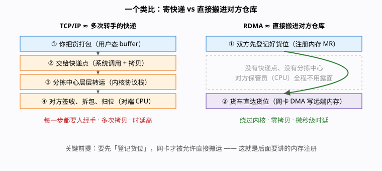

这条「专用管道」就是 RNIC（RDMA 网卡）在两块**已注册内存**之间直接做的 DMA 搬运。

### 概念一：传统 TCP/IP 的代价

我们把「走邮局」这件事拆开看，传统网络收发一次数据，至少要经历：

1. **数据拷贝**：用户缓冲区 → 内核 socket 缓冲区（发送端），对端再反过来一次。
   大数据量下，光是内存拷贝就很费 CPU 和内存带宽。
2. **系统调用**：每次 `read()` / `write()` 都要陷入内核，有上下文切换成本。
3. **协议栈处理**：TCP/IP 分段、校验、重组，全靠 CPU 一层层算。
4. **中断**：数据到达时网卡发中断，CPU 被打断去处理。
5. **对端 CPU 也得全程参与**：对方得调用 `read()` 把数据从内核搬到用户态。

注意最后一点：**哪怕你只是想把数据放到对方内存里，对方的 CPU 也躲不掉**。
在高并发服务器上，这是一笔巨大的隐形开销。

### 概念二：内核旁路与零拷贝

RDMA 的核心思路就两条，正好对应上面的痛点：

- **内核旁路**：连接建好之后，数据收发**不再经过内核协议栈**。应用程序直接把
  「我要发什么、发到哪」这样的请求交给网卡，网卡自己干活。系统调用、协议栈、
  中断这些开销在数据路径上基本消失了。
- **零拷贝**：网卡通过 **DMA** 直接读写应用程序**已注册的内存**，数据不在
  内核缓冲区和用户缓冲区之间来回搬。源在哪、目的地在哪，网卡一步到位。

下图把传统路径和 RDMA 路径并排放在一起，你能直观看到 RDMA "抄了近路"：

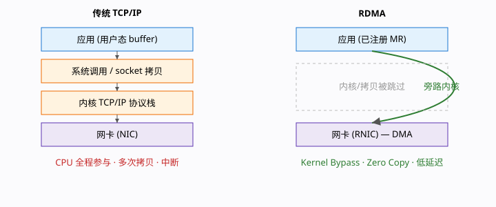

这里埋了一个伏笔：网卡凭什么能「直接」读写你的内存？它怎么知道哪块内存是它能碰的？
答案就是上面预览里提到的 **MR（内存区域）**——你得先把内存向网卡「报备」。
这件事我们留到第 4 章专门讲。

### 概念三：三种传输语义全景

RDMA 提供三种数据传输方式，理解它们「谁参与」是关键。我们先做个**全景概览**，
具体怎么用、怎么写代码，留到第 5～6 章细讲。

| 语义 | 谁的 CPU 参与 | 像什么 | 典型用途 |
|------|--------------|--------|----------|
| **SEND / RECV**（双边） | 收发双方都参与 | 打电话，两边都要拿话筒 | 控制面：握手、交换元数据 |
| **WRITE**（单边） | 只有发起方 | 直接把东西放进对方抽屉 | 数据面：把数据推入对端内存 |
| **READ**（单边） | 只有发起方 | 直接从对方抽屉拿东西 | 数据面：从对端内存拉数据 |

- **双边（two-sided）**：发送方要 `post_send`，接收方必须**事先**准备好接收缓冲
  （`post_recv`）。两边 CPU 都得动手，两边各产生一个「完成事件」。它适合传小而
  关键的控制信息——量不大，但需要对方"知道收到了"。
- **单边（one-sided）**：发起方提供**对方内存的地址和访问钥匙**，网卡直接 DMA
  读或写对方内存，**对方 CPU 全程不知情**，对方不产生完成事件。它适合高吞吐的
  数据面——这才是 RDMA 最"魔法"的部分。

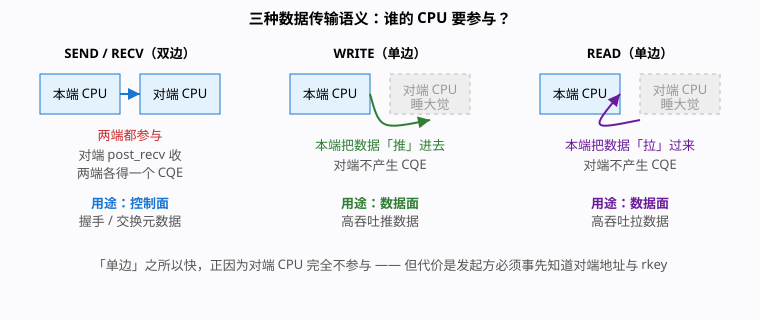

真实系统里最常见的范式是**两者结合**：先用 SEND/RECV 握手、交换"我的内存在哪、
钥匙是什么"，再用 WRITE/READ 高速搬数据。我们这本书的第一个示例
（示例 01）就是这个经典组合。

> 🛠 动手跑：[examples/01-write-demo/](../../examples/01-write-demo/)
> （先别急着读代码，第 2 章我们会带你把它跑起来。）

### 常见误区

- **「RDMA 就是更快的 TCP，换个 API 就行」**。不是。RDMA 是另一套编程模型：
  内存要预先注册、操作是异步的（发出去不等于做完了）、还要自己管理完成事件。
  心智模型变了，不只是换 API。
- **「单边操作对方完全无感，那不就不安全了？」**。对方并非毫无防备：它必须
  **主动把内存注册成可远程访问**，并把"钥匙"（rkey）交出去，发起方才能访问。
  没拿到钥匙、没被授权的内存，网卡碰都碰不了。细节见第 4 章。
- **「没有 RDMA 网卡就学不了」**。完全可以学。用 Soft-RoCE（纯软件模拟）就能在
  普通笔记本上跑通本书所有示例，下一章就教你 30 秒搭好。

### 小结

- 传统 TCP/IP 慢在：多次拷贝、系统调用、协议栈、中断，而且**对端 CPU 也得参与**。
- RDMA 用**内核旁路 + 零拷贝**抄近路：网卡直接 DMA 读写**已注册内存**。
- 三种语义中，**双边（SEND/RECV）**两端 CPU 都参与，适合控制面；
  **单边（WRITE/READ）**只有发起方参与，适合高吞吐数据面。
- 经典范式：先双边握手交换内存信息，再单边高速搬数据。

要让网卡直接搬内存，前提是先把内存「登记」给它。但在登记之前，我们得先有一个
能跑 RDMA 的环境，并亲眼看一次它工作的样子。**下一章，我们用 30 分钟把第一个
示例跑起来。**

### 术语速查

| 术语 | 含义 |
|------|------|
| 内核旁路 | 数据收发绕过操作系统内核协议栈，网卡直接服务应用 |
| 零拷贝 | 网卡 DMA 直接读写已注册内存，省去内核/用户缓冲区间的拷贝 |
| RNIC | 支持 RDMA 的智能网卡，负责实际的内存搬运 |
| DMA | 直接内存访问，硬件不经 CPU 直接读写内存 |
| 双边操作（SEND/RECV） | 收发双方 CPU 都参与的通信，适合控制面 |
| 单边操作（WRITE/READ） | 仅发起方参与、对端 CPU 无感，适合数据面 |
| MR（内存区域） | 向网卡报备过、允许其直接访问的内存（详见第 4 章） |

---

<a id="ch02"></a>

## 第 2 章 · 30 分钟跑起来

> 上一章我们建立了直觉：RDMA 让网卡直接搬内存，绕过内核、绕过对端 CPU。
> 但光说不练总隔着一层。这一章的目标很务实：**哪怕你手上只有一台普通笔记本或
> 云主机，也能在 30 分钟内跑起本书的第一个 RDMA 程序，并亲眼看到效果。**

### 本章你将遇到的术语（预览）

- **Soft-RoCE / rdma_rxe**：一个纯软件实现的 RDMA 网卡，让没有 RDMA 硬件的机器
  也能跑 RDMA 程序（功能完整，只是慢）。
- **ibv_devinfo**：列出系统里有哪些 RDMA 设备、状态如何的命令行工具。
- **server / client**：示例 01 的两个程序，分别扮演数据的"发送方"和"开放内存的一方"。
- **ACK**：服务端写完数据后给客户端发的一个"我写好了"的小通知。

### 场景 / 问题引入

你读完第 1 章，跃跃欲试，结果在网上一搜：「RDMA 需要 InfiniBand 网卡 / RoCE 网卡，
一块好几千」。心一凉——难道学个原理还得先买硬件？

好消息是：**不需要**。Linux 内核自带一个叫 `rdma_rxe` 的模块，它用纯软件在普通
以太网卡上模拟出一块 RDMA 网卡（这套方案叫 **Soft-RoCE**）。它跑得不快、不能用来
做性能基准，但**功能完整**——本书所有示例都能在它上面跑通，用来学原理、验证逻辑
绰绰有余。

### 直觉与类比

Soft-RoCE 就像**学开车时的驾校教练车**：它装了双刹、跑不快、不能上赛道，但
方向盘、油门、挡位一应俱全，你在上面学到的操作，换到真车上完全通用。我们先用
"教练车"把流程跑熟，将来换上真 RDMA 网卡，代码一行都不用改。

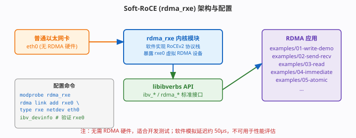

### 第一步：30 秒搭好 Soft-RoCE 环境

下面三条命令就能把"教练车"开出来（需要 root 权限，内核 ≥ 5.8 通常已内置模块）：

```bash
# 1. 加载 Soft-RoCE 内核模块
sudo modprobe rdma_rxe

# 2. 把一块以太网口"包装"成 RDMA 设备（用 `ip link` 查看真实网卡名，替换 eth0）
sudo rdma link add rxe0 type rxe netdev eth0

# 3. 验证：应能看到 rxe0，且端口 state 为 PORT_ACTIVE
ibv_devinfo
rdma link show
```

如果 `ibv_devinfo` 列出了 `rxe0` 并且状态是 `PORT_ACTIVE`，恭喜，你已经有一块
（虚拟的）RDMA 网卡了。后面命令里要填的 `<RDMA网卡IP>`，就是这块以太网口的 IP
（用 `ip addr show eth0` 查看）。

### 第二步：安装依赖

我们的示例用到 `libibverbs`（verbs 库）和 `librdmacm`（连接管理库），编译还需要
gcc / make：

```bash
# Anolis / RHEL / CentOS 系
dnf install -y gcc make pkgconf-pkg-config \
    rdma-core-devel libibverbs-devel librdmacm-devel

# Debian / Ubuntu 系
apt install -y build-essential libibverbs-dev librdmacm-dev rdma-core
```

### 第三步：构建并运行示例 01

仓库顶层 `make` 会递归构建所有示例，每个示例的产物落在各自的 `bin/` 下：

```bash
cd examples/01-write-demo && make    # 生成 bin/server 与 bin/client
```

构建与运行的整体流程如下图：

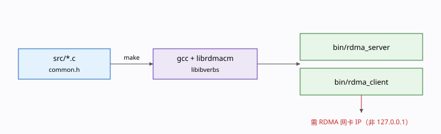

然后开**两个终端**，分别跑服务端和客户端（`<RDMA网卡IP>` 填上一步那块网卡的 IP）：

```bash
./bin/server <RDMA网卡IP> 7471   # 终端 1：先启动，进入监听
./bin/client <RDMA网卡IP> 7471   # 终端 2：发起连接
```

> 🛠 动手跑：[examples/01-write-demo/](../../examples/01-write-demo/)

### 第四步：读懂第一个输出

跑通后，服务端大致会打印：

```
[server] listening on <ip>:7471
[server] accepted connection
[server] remote MR: addr=0x..., rkey=..., size=1024
[server] write done, sent ack, disconnecting
```

客户端大致会打印：

```
[client] connected to <ip>:7471
[client] server note: RDMA write completed
[client] local buffer after remote write: "Hello from server via RDMA Write at pid=..."
```

**最值得玩味的是客户端最后一行**。客户端的本地缓冲区原本写的是
`"This text should be overwritten by server RDMA Write"`，但它**从头到尾没有调用
任何"接收数据"的函数**，那段内存却被悄悄改成了服务端的字符串。这正是上一章说的
**单边 WRITE**：服务端的网卡直接把数据 DMA 进了客户端内存，客户端 CPU 全程无感。

### 简化直觉版：刚才到底发生了什么

先不深入细节，建立一个整体画面就好。这次握手 + 传输大致分三步：

1. **交换名片（SEND/RECV，双边）**：客户端把"我的可写内存在哪、钥匙是什么、多大"
   通过 SEND 告诉服务端。这是控制面。
2. **直接写入（RDMA WRITE，单边）**：服务端拿着客户端给的地址和钥匙，让网卡把
   数据直接写进客户端内存。客户端 CPU 不参与。这是数据面。
3. **打个招呼（ACK）**：服务端再 SEND 一个小通知，告诉客户端"写好了"。客户端
   这才去看自己的缓冲区，发现已经被改写了。

整个端到端时序如下图。**现在你只需要记住这个"先握手、再搬数据、最后通知"的
三段式**，每一段背后的对象和 API，我们会在第 3～7 章逐一拆开讲：

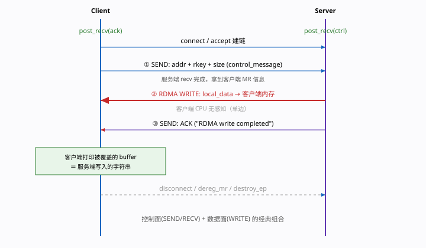

### 常见误区

- **用 `127.0.0.1` 跑，报 `rdma_create_ep: No such device`**。回环地址通常不映射
  到任何 RDMA 设备。请用你 Soft-RoCE 绑定的那块以太网口的真实 IP。
- **以为没有 RDMA 硬件就跑不了**。Soft-RoCE 就是为此而生，按第一步配置即可。
- **`rdma link add` 里的网卡名填错**。`eth0` 只是示例，务必用 `ip link` 查到你
  机器上真实存在的网卡名替换。
- **只开了一个终端**。server 和 client 是两个独立程序，要分别在两个终端运行，
  且先启动 server 再启动 client。

### 小结

- 没有 RDMA 硬件？用 **Soft-RoCE（rdma_rxe）** 三条命令搭出"教练车"，功能完整。
- 装好 `libibverbs` / `librdmacm` 依赖，`make` 构建，两个终端分别跑 server / client。
- 示例 01 的看点：客户端没"收数据"，内存却被改了——这就是单边 WRITE 的魔法。
- 一次完整交互是**三段式**：SEND/RECV 握手 → RDMA WRITE 搬数据 → SEND ACK 通知。

你已经亲眼见过 RDMA 工作了。但程序里那些 `pd`、`mr`、`rkey`、`post_send` 到底是
什么？**下一章，我们把 RDMA 编程绕不开的几个核心对象逐个认识一遍。**

### 术语速查

| 术语 | 含义 |
|------|------|
| Soft-RoCE / rdma_rxe | 纯软件模拟的 RDMA 网卡，无硬件也能跑 RDMA 程序 |
| ibv_devinfo | 列出系统 RDMA 设备及其状态的命令行工具 |
| PORT_ACTIVE | RDMA 端口处于可用状态的标志 |
| ACK | 服务端写完数据后发给客户端的"完成"通知 |
| make | 构建工具，本仓库用它编译各示例 |

---

<a id="ch03"></a>

## 第 3 章 · RDMA 的核心对象

> 上一章你把示例 01 跑了起来，也见到了 `pd`、`mr`、`post_send` 这些陌生名字。
> 这一章我们就把 RDMA 编程绕不开的几个**核心对象**逐个认识清楚：它们各自解决
> 什么问题、彼此是什么关系。理解了这几个对象，后面所有 API 都会变得顺理成章。

### 本章你将遇到的术语（预览）

- **PD（保护域）**：一个"权限圈"，圈定哪些内存和哪些队列属于同一伙、能互相访问。
- **MR（内存区域）**：向网卡报备过、允许它直接读写的一块内存（第 4 章细讲）。
- **QP（队列对）**：你和网卡之间下达任务的"信箱"，由发送队列 SQ + 接收队列 RQ 组成。
- **CQ（完成队列）**：网卡把"某个任务办完了"的回执投递到这里。
- **WR / WQE（工作请求 / 工作队列元素）**：一张"任务单"，描述一次具体操作。

### 场景 / 问题引入

RDMA 是异步的：你不是直接"调用一个函数把数据发出去"，而是**把一张任务单交给网卡，
然后该干嘛干嘛，等网卡办完了再来取回执**。

这就带来几个很自然的问题：

- 任务单交到哪里去？（→ QP）
- 网卡怎么知道哪块内存能碰？（→ MR）
- 凭什么这块内存能被这个队列用，而不是别人乱用？（→ PD）
- 办完了的回执去哪儿取？（→ CQ）

把这几个问题串起来，就是 RDMA 的核心对象模型。

### 直觉与类比

把一次 RDMA 操作想象成在**一家公司里派活**：

- **PD（保护域）** = 一个**部门**。同部门的人和资源才能协作，跨部门不能乱用。
- **MR（内存区域）** = 部门里**登记在册、贴了标签的文件柜**。只有登记过的柜子，
  公司的"自动搬运机器人"才允许去开。
- **QP（队列对）** = 你桌上的**收发文件筐**：一个"发件筐"（SQ）放你要派出去的活，
  一个"收件筐"（RQ）放你预备好接收别人东西的位置。
- **WR / WQE** = 你写好丢进文件筐的一张**任务单**："把 3 号柜的文件送到对面公司"。
- **CQ（完成队列）** = 墙上的**回执箱**：机器人办完一件事，就往这里贴一张"已完成"。

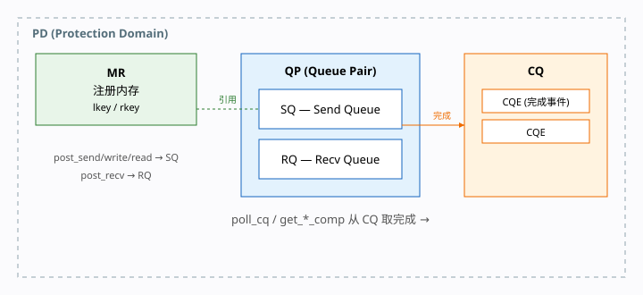

> 在本书示例里，`rdma_create_ep`（见 server.c / client.c）一次性帮我们创建了
> `rdma_cm_id`，它内部已经封装好 **PD + QP + CQ**，所以代码里看不到逐个创建的
> 样板。但理解它们各自的角色，对读懂后面的代码至关重要。

### 概念一：PD —— 保护域，划定协作边界

**PD（Protection Domain，保护域）解决"谁能和谁协作"的问题。** 它是一个权限边界：
MR 和 QP 都归属于某个 PD，**只有同一个 PD 内的 MR 才能被该 PD 的 QP 使用**。

这相当于一道安全栅栏：防止你不小心（或被恶意）拿 A 连接的内存钥匙去 B 连接上乱用。
在我们的示例里，所有 MR 都注册在 `ctx->id->pd` 上，也就是同一个端点的 PD，自然
都在一个保护域内。

### 概念二：MR —— 内存区域，网卡能碰的内存

**MR（Memory Region，内存区域）解决"网卡能访问哪块内存"的问题。** 网卡不能随意
读写进程的任意内存，必须先把某块内存"注册"成 MR。注册后你会拿到两把钥匙：
`lkey`（本端用）和 `rkey`（给对端用）。

MR 是第 4 章的主角，这里你只需记住：**没注册过的内存，网卡碰都碰不了**。示例里
`register_memory()` 函数干的就是注册 MR 的活。

### 概念三：QP —— 队列对，你和网卡的接口

**QP（Queue Pair，队列对）解决"任务怎么交给网卡"的问题。** 它由两个队列组成：

- **SQ（Send Queue，发送队列）**：放你主动发起的操作——SEND、WRITE、READ。
- **RQ（Receive Queue，接收队列）**：放你**预先备好的接收位置**，等对端 SEND 进来。

这里有个关键直觉：**对于双边 SEND/RECV，接收方必须事先在 RQ 里放好"接收任务单"
（post_recv），否则对端 SEND 到了无处安放。** 这点是新手最容易困惑的地方，第 5 章
会专门讲透。

本书示例用的是 **RC（Reliable Connection，可靠连接）** 类型的 QP，它像 TCP 一样
保证数据可靠、有序到达（见公共头文件 `fill_qp_attr()` 里的 `IBV_QPT_RC`）。

### 概念四：CQ —— 完成队列，取回执的地方

**CQ（Completion Queue，完成队列）解决"我怎么知道操作做完了"的问题。** 因为 RDMA
是异步的——你 `post` 一个操作后函数立刻返回，但活儿其实还没干完。网卡真正办完后，
会往 CQ 里投递一个 **CQE（完成事件）**。你从 CQ 里把它取出来（poll），才确认操作
真正完成，并能检查它成功还是失败。

示例里的 `wait_send_comp()` / `wait_recv_comp()` 就是在帮你从 CQ 取回执，并检查
`wc.status` 是否为成功。这套"post 了再 poll"的机制是第 7 章的主题。

### 概念五：WR / WQE —— 一张任务单

**WR（Work Request，工作请求）就是一次操作的描述。** 你把 WR `post` 进 QP 后，
它在队列里的实体形式叫 **WQE（Work Queue Element，工作队列元素）**。一张任务单上
写明了：要做什么操作（SEND/WRITE/READ）、用哪块内存（lkey）、（单边时）对方地址和
rkey 是什么、做完要不要产生 CQE 等等。

在示例里，`rdma_post_send` / `rdma_post_recv` / `rdma_post_write` 这些便捷函数，
本质上就是在帮你**填好一张任务单并丢进 QP**。

### 代码与示例

示例里这几行体现了对象之间的归属关系（来自客户端 `register_memory`）：

```c
/* data_mr 注册在 ctx->id->pd 这个 PD 上 —— MR 归属于 PD */
ctx->data_mr = ibv_reg_mr(ctx->id->pd, ctx->remote_writable_data,
                          sizeof(ctx->remote_writable_data),
                          IBV_ACCESS_LOCAL_WRITE | IBV_ACCESS_REMOTE_WRITE |
                              IBV_ACCESS_REMOTE_READ);
```

而 QP 的能力（队列能放多少任务单、什么类型）在公共头文件里统一设置：

```c
static inline void fill_qp_attr(struct ibv_qp_init_attr *qp_attr)
{
    qp_attr->cap.max_send_wr = 16;   /* SQ 最多挂 16 张发送任务单 */
    qp_attr->cap.max_recv_wr = 16;   /* RQ 最多挂 16 张接收任务单 */
    qp_attr->sq_sig_all   = 1;       /* 每个 send 都产生 CQE（方便 poll） */
    qp_attr->qp_type = IBV_QPT_RC;   /* 可靠连接 */
}
```

> 🛠 动手跑：[examples/01-write-demo/](../../examples/01-write-demo/)

### 常见误区

- **「QP 就是一个队列」**。不，它是**一对**队列（SQ + RQ）。发送和接收用的是
  不同的队列，职责分开。
- **「post 完操作就完成了」**。post 只是把任务单交给网卡，函数立刻返回。真正完成
  要等 CQ 里出现 CQE，必须 poll 才知道。
- **「PD 可有可无」**。PD 是安全边界，决定哪些 MR 能被哪些 QP 用。跨 PD 用错钥匙
  会直接失败。
- **「忘了给 RQ 放接收任务单」**。双边接收前必须 `post_recv`，否则对端 SEND 来了
  没地方接，这是新手第一大坑（第 5 章详解）。

### 小结

- **PD** 划边界，**MR** 是网卡能碰的内存，**QP（SQ+RQ）** 是你向网卡下达任务的信箱，
  **CQ** 是取回执的地方，**WR/WQE** 是一张任务单。
- RDMA 是异步的：**post 任务 → 网卡执行 → poll 回执**。
- 本书示例用 `rdma_create_ep` 一次性封装了 PD/QP/CQ，但理解各自角色才能读懂代码。

我们反复提到 MR 和它的两把钥匙 `lkey` / `rkey`，却一直没细讲。
**下一章，我们就把内存注册这件事彻底讲清楚：为什么必须注册、两把钥匙各管什么、
权限标志怎么决定对端能干什么。**

### 术语速查

| 术语 | 含义 |
|------|------|
| PD（保护域） | 权限边界，规定哪些 MR 能被哪些 QP 使用 |
| MR（内存区域） | 注册给网卡、允许其直接访问的内存（详见第 4 章） |
| QP（队列对） | 发送队列 SQ + 接收队列 RQ，应用向网卡下达任务的接口 |
| SQ / RQ | 发送队列 / 接收队列 |
| CQ（完成队列） | 网卡投递操作完成事件（CQE）的队列 |
| CQE | 完成事件，一条操作完成的回执，含成功/失败状态 |
| WR / WQE | 工作请求 / 工作队列元素，一次操作的"任务单" |
| RC（可靠连接） | 一种 QP 类型，保证可靠有序，类似 TCP |

---

<a id="ch04"></a>

## 第 4 章 · 内存注册：lkey 与 rkey

> 上一章我们认识了核心对象，其中 MR（内存区域）一再被提起却没细讲。这一章补上：
> **为什么网卡只能访问"注册过"的内存？注册后拿到的两把钥匙 `lkey` 和 `rkey` 各管
> 什么？权限标志又怎么决定对端能对你的内存干什么？** 这是 RDMA 安全模型的核心。

### 本章你将遇到的术语（预览）

- **内存注册（ibv_reg_mr）**：把一块内存"报备"给网卡，让它日后能直接读写。
- **pin（锁页）**：注册时把这块内存"钉"在物理内存里，防止被操作系统换出。
- **lkey（本地钥匙）**：本端在自己的任务单里引用这块内存时用的钥匙。
- **rkey（远端钥匙）**：交给对端、让对端做 RDMA READ/WRITE 时用来寻址 + 鉴权的钥匙。
- **访问权限标志**：`LOCAL_WRITE` / `REMOTE_WRITE` / `REMOTE_READ`，决定对端能干什么。
- **rdma_reg_msgs**：注册 SEND/RECV 控制消息缓冲的便捷封装。

### 场景 / 问题引入

第 1 章我们说，RDMA 的魔法是"网卡直接 DMA 读写应用内存"。但你冷静想想就会担心：

- 网卡要是能随便读写进程的**任意**内存，那也太危险了吧？
- 进程的虚拟地址随时可能被操作系统换出到磁盘，网卡拿着地址去访问，扑空了怎么办？
- 对端凭什么就能往"我的"内存里写东西？我怎么控制它只能写、不能读，或反过来？

这三个担忧，恰好由**内存注册**这一个机制统一解决。

### 直觉与类比

把注册内存想象成**去物业给一个房间办"准入登记"**：

- 你指定"3 号房间这块区域"交给物业的搬运机器人使用（指定 MR 的地址和大小）。
- 物业把这个房间**固定下来，保证它不会被临时挪走或拆掉**（pin 锁页）。
- 物业发给你**两把钥匙**：一把是你自己进出用的（lkey），一把是你可以转交给
  访客、让访客来访问这个房间用的（rkey）。
- 办登记时你还要勾选**访客权限**：访客只能取东西（READ）？还是也能放东西（WRITE）？
  还是干脆不许访客进（不开远端权限）？

没办过登记的房间，机器人根本不认，碰都不碰——这就是"网卡只能访问注册过的内存"。

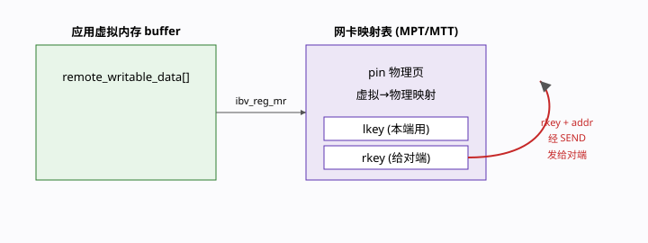

### 概念一：为什么必须注册

网卡通过 **DMA** 直接读写内存，它用的是物理地址，而且访问时 CPU 不参与、来不及
做地址翻译和换页。注册（`ibv_reg_mr`）一次性把两件事办妥：

1. **pin（锁页）**：把这块内存钉在物理内存里，**防止操作系统把它换出（page out）**。
   否则网卡正要 DMA，页却被换走了，就会出错。
2. **建立地址映射**：在网卡的内部表（MPT / MTT）里登记"这块虚拟内存对应哪些物理页"，
   网卡日后凭钥匙就能快速找到真实位置。

> 这里只讲到"为什么要注册"的直觉。MPT/MTT 表、锁页对性能的影响、注册为什么"慢"
> 等硬件细节，留到后面的硬件模型章节深入。现在记住一句话：**注册 = 锁页 + 在网卡
> 建映射 + 发钥匙**。

### 概念二：lkey 与 rkey，两把钥匙各管一端

注册成功后，你拿到一个 `struct ibv_mr`，里面有两把钥匙：

- **lkey（local key，本地钥匙）**：**你自己**在 SQ/RQ 的任务单里引用这块内存时
  必须带上它。比如你要 SEND 一块数据，任务单里就要写明"用哪块内存 + 它的 lkey"。
- **rkey（remote key，远端钥匙）**：**给对端用的**。当对端要对你这块内存做
  RDMA READ 或 WRITE 时，它的任务单里要填上"你的内存地址 + 这个 rkey"。rkey
  同时承担**寻址**和**鉴权**：对端没有正确的 rkey，就动不了你的内存。

一句话区分：**lkey 是你进自己房间的钥匙，rkey 是你发给访客的访客卡。**

### 概念三：权限标志决定对端能干什么

注册时通过访问权限标志，精确控制这块内存"开放到什么程度"：

| 标志 | 含义 |
|------|------|
| `IBV_ACCESS_LOCAL_WRITE` | 本端可写（网卡能往这块内存写，比如做接收缓冲） |
| `IBV_ACCESS_REMOTE_WRITE` | 允许**对端**通过 RDMA WRITE 写入这块内存 |
| `IBV_ACCESS_REMOTE_READ` | 允许**对端**通过 RDMA READ 读取这块内存 |

权限是**最小授权原则**：需要什么才开什么。看看示例 01 里两端的不同选择就明白了。

**客户端**开放了一段可被服务端写入的内存，所以必须打开 `REMOTE_WRITE`：

```c
/* client.c —— 开放 REMOTE_WRITE，服务端才能 RDMA Write 进来 */
ctx->data_mr = ibv_reg_mr(ctx->id->pd, ctx->remote_writable_data,
                          sizeof(ctx->remote_writable_data),
                          IBV_ACCESS_LOCAL_WRITE |
                          IBV_ACCESS_REMOTE_WRITE |   /* 允许对端写入 */
                          IBV_ACCESS_REMOTE_READ);    /* 允许对端读取 */
```

**服务端**这块内存只是它自己 RDMA WRITE 的**数据源**，不需要被对端访问，
所以只开 `LOCAL_WRITE`：

```c
/* server.c —— 仅本地源缓冲，无需对端权限 */
ctx->data_mr = ibv_reg_mr(ctx->id->pd, ctx->local_data, sizeof(ctx->local_data),
                          IBV_ACCESS_LOCAL_WRITE);
```

对比这两段：**谁的内存要被对方碰，谁才开 REMOTE_* 权限。** 这是 RDMA 安全模型的
精髓——访问的可能性是**被访问方**主动授予的。

### 概念四：rdma_reg_msgs，控制消息的便捷封装

注册控制消息（SEND/RECV 用的小缓冲）时，示例没直接调 `ibv_reg_mr`，而是用了
`rdma_reg_msgs`：

```c
ctx->send_ctrl_mr = rdma_reg_msgs(ctx->id, &ctx->send_ctrl, sizeof(ctx->send_ctrl));
ctx->recv_ctrl_mr = rdma_reg_msgs(ctx->id, &ctx->recv_ctrl, sizeof(ctx->recv_ctrl));
```

`rdma_reg_msgs` 是 `ibv_reg_mr` 的便捷封装，**自动加上 `LOCAL_WRITE` 权限**，
专门用于 SEND/RECV 的消息缓冲（双边操作只需本地访问，不必开远端权限）。
用它能少写几行样板。

> 🛠 动手跑：[examples/01-write-demo/](../../examples/01-write-demo/)

回到第 3 章埋的线：客户端注册完 `data_mr` 后，把它的 `addr + rkey + size`
打包进 `struct control_message`（见公共头文件），通过 SEND 交给服务端——这正是
服务端日后能 RDMA WRITE 进客户端内存所需的全部信息。**注册产生的 rkey，就是控制面
要传递的核心内容。**

### 常见误区

- **「注册一下很轻，随便多注册几次没关系」**。注册要锁页、建映射，是**重操作**，
  开销不小。生产系统常用"注册缓存 / 内存池"来摊薄成本（属于进阶话题）。
- **「lkey 和 rkey 可以混用」**。不行。本端任务单用 lkey，给对端用的是 rkey，
  角色不同，填错直接失败。
- **「对端能不能写我的内存，是发起方决定的」**。恰恰相反——**由被访问方在注册时
  开不开 `REMOTE_WRITE` 决定**。没开权限，对端拿着 rkey 也写不进去。
- **「注册的内存可以随便释放」**。在 `ibv_dereg_mr` 注销之前不能释放底层内存，
  否则网卡可能访问到已失效的页。注意 MR 与内存的生命周期匹配。

### 小结

- 网卡只能访问**注册过**的内存：注册 = **锁页** + **在网卡建立地址映射** + **发钥匙**。
- 注册产出两把钥匙：**lkey** 给本端自己用，**rkey** 交给对端用（兼做寻址与鉴权）。
- **访问权限标志**（LOCAL_WRITE / REMOTE_WRITE / REMOTE_READ）由**被访问方**设定，
  决定对端能读、能写、还是不能碰——这是 RDMA 安全模型的核心。
- `rdma_reg_msgs` 是注册 SEND/RECV 控制缓冲的便捷封装，自动加 `LOCAL_WRITE`。

现在内存登记好了、钥匙也有了，但两台机器还没"接上头"。
**下一章，我们讲连接是怎么建立的：rdma_cm 如何把建连和创建 QP 封装成类 socket
的 API，以及那个让无数新手困惑的关键时序——为什么接收方必须在连接可用前就
预投递接收缓冲。**

### 术语速查

| 术语 | 含义 |
|------|------|
| 内存注册（ibv_reg_mr） | 把内存报备给网卡，使其可被直接 DMA 访问 |
| pin（锁页） | 注册时固定内存物理页，防止被操作系统换出 |
| MR（内存区域） | 注册后的内存对象，含 lkey/rkey 等信息 |
| lkey（本地钥匙） | 本端在自己任务单中引用该内存时使用 |
| rkey（远端钥匙） | 交给对端做 RDMA READ/WRITE，用于寻址 + 鉴权 |
| IBV_ACCESS_LOCAL_WRITE | 允许本端写入该内存 |
| IBV_ACCESS_REMOTE_WRITE | 允许对端 RDMA 写入该内存 |
| IBV_ACCESS_REMOTE_READ | 允许对端 RDMA 读取该内存 |
| rdma_reg_msgs | 注册 SEND/RECV 消息缓冲的便捷封装（自动加 LOCAL_WRITE） |

---

<a id="ch05"></a>

## 第 5 章 · 建立连接：rdma_cm

> 上一章我们把内存登记好、拿到了钥匙。但两台机器还各自为政，没有"接上头"。
> 这一章讲连接是怎么建起来的：**rdma_cm 如何把建连和创建 QP 封装成熟悉的
> 类 socket 流程**，以及一个让无数新手栽跟头的关键时序——**为什么接收方必须在
> 连接真正可用之前，就先把接收缓冲准备好。**

### 本章你将遇到的术语（预览）

- **rdma_cm（librdmacm）**：RDMA 的连接管理库，把建连 + 建 QP 包装成类 socket API。
- **rdma_cm_id**：连接的句柄，类似 socket fd，内部封装了 PD/QP/CQ。
- **rdma_create_ep**：创建带 QP 的端点，一步到位。
- **rdma_listen / rdma_get_request / rdma_accept**：服务端监听、取连接请求、接受。
- **rdma_connect**：客户端发起连接。
- **预投递接收（post_recv）**：在连接可用前就往 RQ 里放好接收任务单。

### 场景 / 问题引入

会用 TCP socket 的你，对建连流程很熟：服务端 `socket → bind → listen → accept`，
客户端 `socket → connect`。

RDMA 建连其实更麻烦：除了"接上头"，还要在两端创建并协商 QP、交换底层参数、把 QP
推进到能收发的状态……如果手工用底层 verbs 做，代码会非常长。

好在我们不必受这个苦。**rdma_cm 这套库，把"建立连接 + 创建并配置好 QP"打包成了
一套和 socket 长得几乎一样的 API。** 但它有一个和 socket 不同、且极易被忽略的
关键点，我们这一章重点讲透。

### 直觉与类比

rdma_cm 就像一个**贴心的搬家中介**：你只管说"我要和那栋楼接上线"，中介帮你把
拉专线、装好两端的收发文件筐（QP）、调试线路这些杂活全办了，最后给你一个"线路
句柄"（`rdma_cm_id`），你拿着它就能收发。

但中介有一条铁律提醒你：**通话接通的那一刻，对方可能立刻就开始往你这边发东西。
所以你必须在接通之前，就先把"收件筐"摆好**——否则对方第一句话发过来，你这边
没地方接，连接就出问题了。这条铁律就是下面要讲的"预投递接收"。

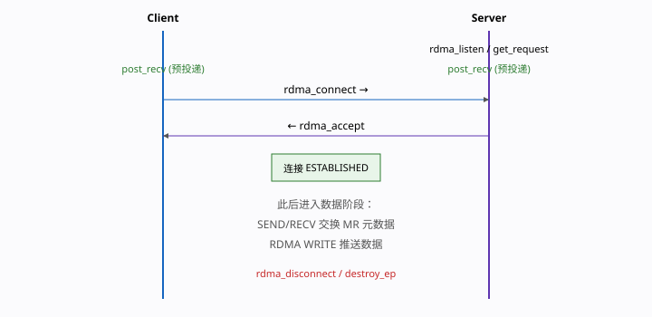

### 概念一：rdma_cm_id 与 rdma_create_ep

`rdma_cm_id` 是连接的句柄，**类似 socket fd**。最妙的是它内部已经封装了第 3 章讲的
**PD + QP + CQ**——这就是为什么示例代码里看不到逐个创建这些对象的样板。

创建端点用 `rdma_create_ep`，它一步到位地建好带 QP 的端点：

```c
fill_qp_attr(&qp_attr);                                  /* 配置 QP 能力 */
check_zero(rdma_create_ep(&id, res, NULL, &qp_attr), "rdma_create_ep");
ctx.id = id;                                             /* 之后 ctx->id->pd 即本端 PD */
```

`res` 来自 `rdma_getaddrinfo`，它负责把"IP + 端口"解析成 RDMA 能用的地址信息，
类似 socket 编程里的 `getaddrinfo`。

### 概念二：服务端流程

服务端的流程和 TCP 几乎一一对应：

```c
rdma_getaddrinfo(...)                 /* 解析本地绑定地址（带 RAI_PASSIVE 标志） */
rdma_create_ep(&listen_id, ...)       /* 创建监听端点 */
rdma_listen(listen_id, 1)             /* 开始监听，类似 listen() */
rdma_get_request(listen_id, &conn_id) /* 取出一个连接请求，得到新的 conn_id */
/* ……此处必须先 post_recv（见概念四）…… */
rdma_accept(conn_id, NULL)            /* 接受连接，类似 accept() */
```

注意 `rdma_get_request` 返回一个**新的** `conn_id`，代表这条具体连接（监听用
`listen_id`，通信用 `conn_id`），这和 TCP 里 `accept()` 返回新 fd 是一个道理。

### 概念三：客户端流程

客户端更简单：

```c
rdma_getaddrinfo(...)        /* 解析服务端地址 */
rdma_create_ep(&id, ...)     /* 创建端点 */
/* ……此处必须先 post_recv（见概念四）…… */
rdma_connect(id, NULL)       /* 发起连接，类似 connect() */
```

到这里，连接建立的"形"你已经掌握了，和 socket 几乎无差别。真正的"神"在下一节。

### 概念四（关键）：为什么必须在连接可用前预投递接收

这是本章、也是很多 RDMA 新手最容易困惑、最容易出错的地方，请慢慢读。

回忆第 3 章：QP 的接收队列 RQ 里，必须**事先放好"接收任务单"（post_recv）**，
对端 SEND 过来的数据才有地方安放。RDMA 的接收**不像** TCP——TCP 即使你还没
`read()`，内核也会先把数据缓存在 socket 缓冲区里。**RDMA 没有这层内核缓冲：
对端 SEND 到达时，如果你的 RQ 里没有预备好的接收缓冲，这条消息就无处安放，会出错。**

所以铁律是：**接收方必须在连接"真正可用"之前，就先 `post_recv`。**

- "真正可用"对服务端来说是 `rdma_accept` 之后，对客户端来说是 `rdma_connect`
  完成之后——一旦可用，对端随时可能 SEND 过来。
- 因此 post_recv 必须**早于**这个时间点。

看示例 01 怎么做的。**服务端**在 `rdma_accept` **之前** 就预投递了接收：

```c
/* server.c —— 预投递接收，必须在 accept 前 */
rdma_post_recv(conn_id, NULL, &ctx.recv_ctrl, sizeof(ctx.recv_ctrl), ctx.recv_ctrl_mr);
rdma_accept(conn_id, NULL);
```

**客户端**同样，在 `rdma_connect` **之前** 就预投递了接收 ACK 的缓冲：

```c
/* client.c —— 预投递接收 ACK，必须在 connect 前 */
rdma_post_recv(id, NULL, &ctx.recv_ctrl, sizeof(ctx.recv_ctrl), ctx.recv_ctrl_mr);
rdma_connect(id, NULL);
```

记住这个顺序：**先摆好收件筐（post_recv），再接通电话（accept / connect）。**
顺序反了，对端的第一条消息就可能扑空。

> 🛠 动手跑：[examples/01-write-demo/](../../examples/01-write-demo/)

### 常见误区

- **「RDMA 和 TCP 一样，数据没收会被内核缓存」**。错。RDMA 没有内核 socket 缓冲，
  接收前必须先 `post_recv` 备好缓冲，否则消息无处安放。
- **「post_recv 放在 accept / connect 之后也行」**。危险。连接一旦可用，对端可能
  立刻 SEND，此时 RQ 还空着就会出错。务必**先 post_recv 再 accept/connect**。
- **「监听用的 id 和通信用的 id 是同一个」**。服务端 `rdma_get_request` 会返回
  **新的** `conn_id`，监听 `listen_id` 和连接 `conn_id` 要分清。
- **「单边 WRITE/READ 也要对端 post_recv」**。不需要。post_recv 只为**双边 SEND**
  准备接收位置；单边操作对端 CPU 不参与，自然不需要它备接收缓冲。

### 小结

- **rdma_cm** 把建连 + 创建/配置 QP 封装成类 socket 流程，`rdma_cm_id` 类似 fd，
  内部封装了 PD/QP/CQ。
- 服务端：`getaddrinfo → create_ep → listen → get_request → accept`；
  客户端：`getaddrinfo → create_ep → connect`。
- **铁律**：接收方必须在连接真正可用前 `post_recv` 预投递接收缓冲。RDMA 没有内核
  缓冲，对端 SEND 到达时 RQ 必须已有接收位置。本书示例正是 accept/connect 之前
  就 post_recv。

至此，第一部分入门篇的"骨架"已经搭齐：你理解了 RDMA 为何存在、跑通了第一个示例、
认识了核心对象、弄清了内存注册、掌握了连接建立。接下来，我们将真正进入数据收发的
细节——**双边的 SEND/RECV、单边的 WRITE/READ，以及 post 与 poll 的完成机制**，
把示例 01 的每一步都吃透。

### 术语速查

| 术语 | 含义 |
|------|------|
| rdma_cm（librdmacm） | RDMA 连接管理库，类 socket 的建连 + 建 QP 封装 |
| rdma_cm_id | 连接句柄（类似 socket fd），内部封装 PD/QP/CQ |
| rdma_getaddrinfo | 解析地址 + 端口为 RDMA 地址信息 |
| rdma_create_ep | 创建带 QP 的端点 |
| rdma_listen / rdma_get_request / rdma_accept | 服务端监听 / 取连接请求 / 接受连接 |
| rdma_connect | 客户端发起连接 |
| 预投递接收（post_recv） | 在连接可用前往 RQ 放好接收任务单，否则对端 SEND 无处安放 |

---

<a id="ch06"></a>

## 第 6 章 · 双边操作 SEND/RECV

第 5 章里，我们终于把连接建好了：两端的 QP 都进入了可用状态，控制通道也通了。
连接就像两根接好的水管——可现在水管里还一滴水都没流过。这一章，我们就让数据
第一次真正在两台机器之间流动起来，用的是最容易上手的方式：**双边操作
SEND/RECV**。

### 本章你将遇到的术语（预览）

- **双边操作（two-sided）**：一次传输，收发两端的 CPU 都要出力。
- **post_send / post_recv**：分别把「我要发」和「我准备收」这两个意图放进队列。
- **预投递（pre-post）**：在对方发来之前，接收方必须先把接收缓冲挂好。
- **RNR（Receiver Not Ready）**：对方发来了，你却没准备好接收，于是报错重试。
- **credit / 流控**：接收方还能收几条，发送方心里得有数。

### 场景 / 问题引入

连接建好之后，最先要解决的不是「怎么把一个 G 的数据高速怼过去」，而是一个更
朴素的问题：**两端怎么互相交换一点点关键信息？** 比如：

- 客户端想让服务端往自己的内存里写数据，可服务端根本不知道「往哪写」——它需要
  客户端内存的地址、rkey 和大小。
- 数据传完了，发起方想知道「对面收好了吗」，需要一个 ACK。

这些信息又小又关键，而且**收发双方都得知道这件事发生了**。这正是 SEND/RECV
擅长的活儿。

### 直觉与类比

把 SEND/RECV 想象成**寄快递**：

- 发件人（发送方）把包裹投进快递柜（`post_send`）。
- 但收件人必须**事先在家放好一个收件箱**（`post_recv`），快递员才有地方放。
- 如果收件人没准备收件箱，快递员只能拎着包裹在门口干等、反复来敲门——这就是
  **RNR**。
- 包裹送达后，发收两边各自得到一张「签收回执」（各产生一个 CQE）。

对比下一章的单边操作（直接拿钥匙开对方家门把东西放进去），双边的特点就是：
**对方必须在场配合**。

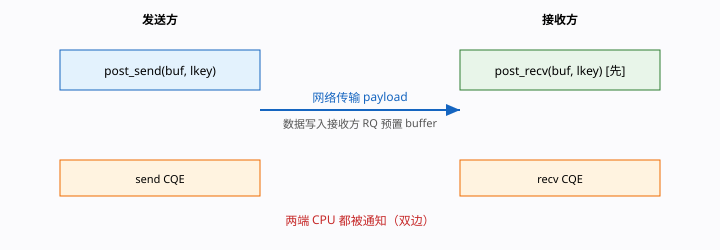

### 概念一：为什么叫「双边」

「双边」的核心含义是：**发送方调用 `post_send`，接收方必须已经调用过
`post_recv`，两端 CPU 都参与了这次传输，并且两端各产生一个 CQE。**

这和我们下一章要讲的单边操作形成鲜明对照。单边操作里，发起方提供对端地址，
网卡直接 DMA，对端 CPU 全程不知情、不产生 CQE。而双边操作里，接收方必须主动
「张开手」接住——它的 RQ（接收队列）里得有一个等着的 WR。

这带来一个重要后果：**接收方拥有控制权**。它决定了「我准备接收几条、每条多大」。
正因如此，双边特别适合控制面：握手、交换元数据、发 ACK——这些都需要对端有意识
地参与。

### 概念二：接收必须「预投递」

新手最容易栽的坑：以为「发送方一发，数据就自动到位」。不是的。

RDMA 网卡收到一条 SEND 报文时，会去接收方的 RQ 里**取一个已经挂好的接收 WR**，
把数据放进那个 WR 指定的缓冲区。如果 RQ 是空的——没有任何预投递的接收 WR——网卡
无处安放数据，于是触发 **RNR**：对端被告知「接收方还没准备好」，按重试策略稍后
再试。

所以铁律是：**接收方要在对端可能 SEND 过来之前，就先 `post_recv`。**

这也解释了第 5 章那个看似奇怪的顺序：服务端在 `rdma_accept` 之前就 post_recv，
客户端在 `rdma_connect` 之前就 post_recv。因为一旦连接握手完成，对端的 SEND
随时可能到达，接收缓冲必须**早已就位**。

### 概念三：交换 MR 元数据——双边的经典用法

回忆第 3 章的 `struct control_message`：它装的正是 `addr + rkey + size`。
这就是双边操作最典型的载荷——客户端把「我这块可写内存在哪、钥匙是什么」用 SEND
告诉服务端，服务端用 RECV 收下：

```c
// 客户端把自己的 addr/rkey/size 发给服务端
ctx.send_ctrl.addr = (uint64_t)(uintptr_t)ctx.remote_writable_data;
ctx.send_ctrl.rkey = ctx.data_mr->rkey;
ctx.send_ctrl.size = sizeof(ctx.remote_writable_data);
rdma_post_send(id, NULL, &ctx.send_ctrl, sizeof(ctx.send_ctrl),
               ctx.send_ctrl_mr, IBV_SEND_SIGNALED);

// 服务端在 RQ 取出该消息
wait_recv_comp(conn_id, "...");   // 得到 recv_ctrl.addr / rkey
```

逐行看「为什么」：

- `addr`/`rkey`/`size` 三件套，是后面单边 WRITE/READ 的「门牌号 + 钥匙 + 房间
  大小」，缺一不可。
- `IBV_SEND_SIGNALED` 让这次 send 产生一个 CQE，发送方才能 `wait_send_comp`
  确认「确实发出去了」（第 8 章详谈）。
- 服务端这边，数据已经被网卡放进了它预投递的接收缓冲，`wait_recv_comp` 一返回，
  `recv_ctrl` 里就是客户端的元数据了。

### 概念四：用乒乓理解 credit 与流控

示例 02 是一个纯双边的乒乓程序：客户端发 `ping`，服务端 echo 回 `pong`，循环
N 次，测平均往返延迟（RTT）。它最适合用来体会**预投递的节奏**。

```c
/* 预投递接收第一个 pong，必须在 connect 前 */
check_zero(rdma_post_recv(id, NULL, recv_buf, MSG_SIZE, recv_mr), "post_recv");
check_zero(rdma_connect(id, NULL), "rdma_connect");

for (int i = 0; i < iters; i++) {
    rdma_post_send(id, NULL, send_buf, MSG_SIZE, send_mr, IBV_SEND_SIGNALED);
    wait_send_comp(id, "send ping");
    wait_recv_comp(id, "recv pong");
    if (i + 1 < iters) {
        rdma_post_recv(id, NULL, recv_buf, MSG_SIZE, recv_mr);  // 为下一发预投递
    }
}
```

注意循环里的关键动作：**每收到一个 pong，就立刻为「下一发」再 post 一个接收
WR**。这就是在持续补充「接收 credit」。

什么是 credit？可以理解成接收方手里的「接收名额」。RQ 里每挂一个接收 WR，就给
对端一个「你可以再发一条」的名额。乒乓程序里名额数永远维持在 1，所以收发严格
交替、不会堆积。真实系统中，接收方会一次预投递很多个 WR（批量补充 credit），
让发送方可以连发多条不必等待——这就是双边流控的雏形。

> 🛠 动手跑：[examples/02-send-recv/](../../examples/02-send-recv/)

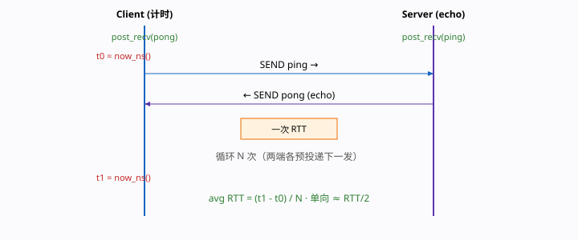

### 常见误区

- **「发送方一发数据就到了，接收方不用管」**：错。接收方不预投递就 RNR。RDMA 把
  「准备接收」这件事显式交给了你。
- **「post_recv 的 buffer 可以小于对端发来的数据」**：不行。接收缓冲必须 ≥ 对端
  SEND 的长度，否则报错（`IBV_WC_LOC_LEN_ERR`）。
- **「收发各只产生一个 CQE，所以 send 完成就代表对端收到了」**：要分清——send
  的 CQE 只代表**本端网卡已把数据交付出去**（RC 下意味着对端网卡已确认），但
  「对端 CPU 已读取并处理」需要应用层自己用 ACK 来表达。
- **「乒乓很慢说明 RDMA 不快」**：乒乓是最朴素、未优化的形态（每发都 signaled、
  阻塞等完成），是性能优化的**基线**，不是终点。

### 小结

- 双边 SEND/RECV：收发两端 CPU 都参与，各产生一个 CQE。
- 接收方必须**预投递** `post_recv`，否则触发 RNR。
- 双边最适合**小而关键的控制信息**：交换 MR 元数据、发 ACK。
- 持续补充接收 WR 就是在补充 **credit**，这是双边流控的基础。

下一章，我们换一种完全不同的玩法：**单边操作**——发起方拿着对端的 addr+rkey，
让网卡直接 DMA 进对方内存，对端 CPU 全程不参与。这正是 RDMA 高吞吐数据面的主角。

### 术语速查

| 术语 | 含义 |
|------|------|
| 双边操作（two-sided） | SEND/RECV，收发两端 CPU 都参与，各产生一个 CQE |
| post_send | 把「要发送的数据」作为 WR 放入发送队列 SQ |
| post_recv | 把「接收缓冲」作为 WR 预先放入接收队列 RQ |
| 预投递（pre-post） | 在对端 SEND 到达之前先 post_recv |
| RNR（Receiver Not Ready） | 数据到达时 RQ 为空，接收方未就绪，触发重试 |
| credit | 接收方剩余的接收名额，每个未消费的接收 WR 即一个名额 |
| ACK | 应用层用一条 SEND 表达「我已处理完毕」 |

---

<a id="ch07"></a>

## 第 7 章 · 单边操作 WRITE/READ

上一章的 SEND/RECV 很可靠，但有个「累」的地方：每次传输，对端 CPU 都得在场
配合——要预投递接收、要从 CQ 取完成、要参与每一笔。控制面消息小、次数少，这点
开销无所谓。可一旦进入**高吞吐数据面**，每秒几百万次传输，还让对端 CPU 笔笔
参与，它就别干别的了。

这一章的主角——**单边操作 WRITE/READ**——正是为此而生：发起方拿着对端的地址和
钥匙，让网卡直接 DMA 读写对方内存，**对端 CPU 完全不参与**。

### 本章你将遇到的术语（预览）

- **单边操作（one-sided）**：只有发起方 CPU 参与，对端 CPU 全程无感。
- **WRITE**：把本地数据**推**进对端内存。
- **READ**：把对端内存的数据**拉**回本地。
- **remote addr + rkey**：发起单边操作必须先拿到的「对端门牌号 + 钥匙」。
- **对端不产生 CQE**：被访问的一方网卡默默搬数据，CQ 里什么都没有。

### 场景 / 问题引入

设想一个分布式 KV 存储：客户端要把一个 value 存到服务端某块内存里。如果用
SEND/RECV，服务端 CPU 得：预投递接收、被中断/轮询唤醒、把数据从接收缓冲拷贝到
目标位置……每一笔都打扰它。

我们真正想要的是：**客户端直接把 value 写进服务端早已划好的那块内存，服务端
CPU 该干嘛干嘛，完全不被打扰。** 这就是 WRITE。反过来，如果客户端想读取服务端
内存里某个值，也不想惊动服务端 CPU——那就是 READ。

### 直觉与类比

还记得第 6 章「寄快递」的类比吗？单边操作是另一个画风：

- **WRITE** = 你有对方家的钥匙，自己开门进去，把东西放在约定好的桌子上就走。
  主人可能在睡觉，全程不知道你来过。
- **READ** = 同样拿钥匙进门，但这次是从对方桌上**拿走**一份资料带回家。

「钥匙」就是 `rkey`，「桌子的位置」就是 `remote addr`。关键点：**对方必须事先
把钥匙和地址给你**——而给钥匙这个动作，恰恰是上一章的双边 SEND 干的活儿。这就是
为什么真实系统总是「先双边交换元数据，再单边搬数据」。

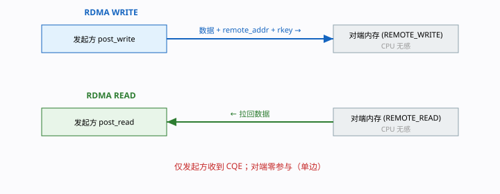

### 概念一：什么是「单边」

「单边」的精确含义：**发起方提供对端的 addr + rkey，网卡直接 DMA 访问对端内存，
对端 CPU 完全不参与，对端不产生 CQE。**

把它和第 6 章对照着记最清楚：

| | SEND/RECV（双边） | WRITE/READ（单边） |
|---|---|---|
| 对端 CPU | 必须参与（预投递、取完成） | 完全不参与 |
| 对端 CQE | 产生一个 recv CQE | **不产生** |
| 发起前需要 | 对端已 post_recv | 对端的 addr + rkey |
| 典型用途 | 控制面、小消息 | 数据面、高吞吐 |

「对端不产生 CQE」是单边最反直觉、也最强大的性质：被访问方的网卡默默完成 DMA，
它的应用程序甚至感知不到这次访问发生过。这就是单边能做到极致吞吐和极低对端
开销的根源。

### 概念二：WRITE——把数据推进对端内存

本仓库的入门示例里，服务端用 RDMA WRITE 把数据直接写进客户端内存：

```c
rdma_post_write(conn_id, NULL,
                ctx.local_data, strlen(ctx.local_data)+1,
                ctx.data_mr, IBV_SEND_SIGNALED,
                ctx.recv_ctrl.addr,   // 对端地址（客户端通过 SEND 告知）
                ctx.recv_ctrl.rkey);  // 对端 rkey
```

逐项看「为什么」每个参数都不可少：

- `ctx.local_data` + `ctx.data_mr`：本地源数据及其 MR（网卡要 DMA 读它，需要
  lkey，封在 mr 里）。
- `ctx.recv_ctrl.addr` / `ctx.recv_ctrl.rkey`：**对端**的目标地址和钥匙——这正是
  客户端先前通过双边 SEND 告诉服务端的（第 6 章的元数据交换）。没有它俩，网卡
  根本不知道往哪写、也没权限写。
- `IBV_SEND_SIGNALED`：让这次 write 在**发起方**产生 CQE，发起方才能确认完成。
  注意——CQE 只在发起方这边产生，客户端（被写方）那边**什么 CQE 都没有**。

这就引出 WRITE 的一个经典「尾巴」：客户端怎么知道数据写好了？因为它收不到 CQE。
办法之一是服务端写完后再补一发 SEND 当 ACK 通知客户端——这恰好是第 9 章
WRITE_WITH_IMM 要优化掉的那个往返。

> 🛠 动手跑（WRITE）：[examples/01-write-demo/](../../examples/01-write-demo/)

### 概念三：READ——从对端内存拉数据

READ 和 WRITE 完全对称，只是数据流向相反：

```c
rdma_post_read(id, NULL, local_buf, len, local_mr,
               IBV_SEND_SIGNALED,
               remote_addr, remote_rkey);   // 对端地址 + rkey
```

示例 03 由**客户端发起 READ**，把服务端内存里的数据拉回本地：

- 服务端把内存注册为 `IBV_ACCESS_REMOTE_READ`，并通过 SEND 告知 addr/rkey/size。
  （权限标志决定对方能干什么——只给 READ 权限，对方就只能读不能写。）
- 客户端本地目标 buffer 需 `IBV_ACCESS_LOCAL_WRITE`，因为网卡要把读回来的数据
  **写入**本地这块内存。
- **READ 完成在发起方的发送队列产生 CQE**，用 `wait_send_comp` 获取；服务端对
  这次数据搬运**毫无感知**。

WRITE 与 READ 的对称性，一张表说清：

| | 数据流向 | 谁发起 | 对端是否产生 CQE |
|---|---|---|---|
| WRITE | 本地 → 对端 | 写入方 | 否 |
| READ | 对端 → 本地 | 读取方 | 否 |

> 🛠 动手跑（READ）：[examples/03-read/](../../examples/03-read/)

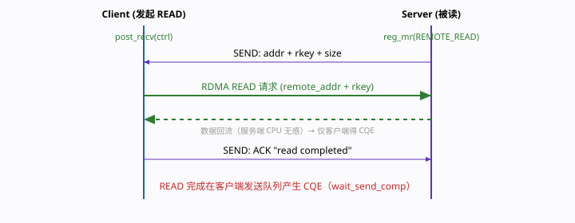

### 概念四：READ 通常比 WRITE 慢一点

虽然两者对称，延迟却不完全一样，这点对性能工程很重要：

- **WRITE** 是「推」：发起方把数据连同请求一起发出，对端网卡收下、DMA 落地即可。
  发起方的 CQE 在「对端确认收到」后产生。
- **READ** 是「拉」：发起方先发一个读请求过去，对端网卡再把数据 DMA 读出、发回，
  数据**走完一个完整往返**才算完成。

直觉上，READ 多了「请求过去 + 数据回来」的来回，所以**READ 的延迟通常高于
WRITE**，单边写在很多高性能设计里因此更受偏爱。当你要拉对端数据又在乎延迟时，
有时会反过来设计成「让对端主动 WRITE 给你」。

### 常见误区

- **「单边操作不需要对端做任何事」**：搬数据时确实不需要。但对端必须**事先**做
  两件事：注册内存并开放对应权限（REMOTE_WRITE / REMOTE_READ），以及把
  addr+rkey 告诉你。这一步通常用双边 SEND 完成。
- **「WRITE 完成的 CQE 说明对端应用已经读到数据了」**：不。CQE 只说明数据已落进
  对端内存，对端应用并不知道——它没有 CQE。要通知它，得用 ACK 或
  WRITE_WITH_IMM。
- **「rkey 是固定不变的，可以写死」**：rkey 随每次 `ibv_reg_mr` 而变，必须运行时
  动态交换，不能硬编码。
- **「权限随便开，方便」**：只开必要权限。该只读就别给 REMOTE_WRITE，这是安全
  边界。

### 小结

- 单边 WRITE/READ：发起方提供对端 addr+rkey，网卡直接 DMA，**对端 CPU 不参与、
  不产生 CQE**。
- WRITE 把数据推入对端内存；READ 把对端数据拉回本地，两者方向相反、形式对称。
- 单边的前提是先用双边交换 addr+rkey 并开放好内存权限。
- READ 因多一次往返，延迟通常高于 WRITE。

到这里你已经掌握了 RDMA 的三大数据语义（SEND/RECV、WRITE、READ）。但有一个问题
一直被我们绕过去了：这些操作都是**异步**的——`post` 之后就立即返回了，那到底
「什么时候算完成」？下一章我们就专门拆解 **post 与 poll 的完成机制**。

### 术语速查

| 术语 | 含义 |
|------|------|
| 单边操作（one-sided） | 仅发起方 CPU 参与，对端 CPU 无感、不产生 CQE |
| WRITE | 把本地数据 DMA 推入对端内存 |
| READ | 从对端内存 DMA 拉数据回本地 |
| remote addr | 对端目标内存的地址，由对端通过双边告知 |
| rkey | 对端内存的远程访问钥匙，发起单边操作必需 |
| IBV_ACCESS_REMOTE_WRITE/READ | 内存注册时开放的远程写/读权限 |

---

<a id="ch08"></a>

## 第 8 章 · 完成机制：post 与 poll

前两章我们发了 SEND、做了 WRITE、玩了 READ。但每次代码里都悄悄跟着一句
`wait_send_comp` 或 `wait_recv_comp`，我们一直没正面解释它。这一章就来补上这块
拼图：**RDMA 操作是异步的，你得分两步走——先 post，再 poll。** 理解了它，你才算
真正理解了 RDMA 的「节奏」。

### 本章你将遇到的术语（预览）

- **异步（asynchronous）**：`post` 立即返回，硬件在后台干活，不阻塞你。
- **post**：把一个 WR（工作请求）放进队列，交给网卡。
- **poll**：从 CQ（完成队列）取出 CQE，确认某个操作真的完成了。
- **CQE / ibv_wc**：一张「操作完成回执」，里头有状态、操作码等信息。
- **IBV_SEND_SIGNALED / sq_sig_all**：决定一次 send 类操作要不要产生 CQE。
- **wc.status**：完成的结果码，`IBV_WC_SUCCESS` 才算成功。

### 场景 / 问题引入

来看一行你已经见过很多次的代码：

```c
rdma_post_send(id, NULL, buf, len, mr, IBV_SEND_SIGNALED);
```

这行调用返回了——**但数据真的发出去了吗？** 答案是：不一定。它只是把「请发送」
这个请求挂进了发送队列，网卡可能还没开始搬、正在搬、或刚搬完。如果你这时候就
复用 `buf`、或者以为对端已经收到了，就会踩坑。

那「到底什么时候算完成」要怎么知道？这就是 poll 要回答的问题。

### 直觉与类比

把 post/poll 想象成**点外卖**：

- 你下单（`post`）——App 立刻提示「下单成功」，但你的饭还没做好，更没送到。下单
  动作本身瞬间完成，不阻塞你继续刷手机。
- 厨房后台在做饭、骑手在送（**网卡硬件异步执行**）。
- 你时不时刷新订单状态，直到看到「已送达」（`poll` 到一个 CQE）。
- 「已送达」的回执上还写着结果：成功送到，还是「商家已取消」（`wc.status`）。

关键认知：**下单 ≠ 吃到饭**。`post` 返回 ≠ 操作完成。必须 poll 到那张回执，才能
确信。

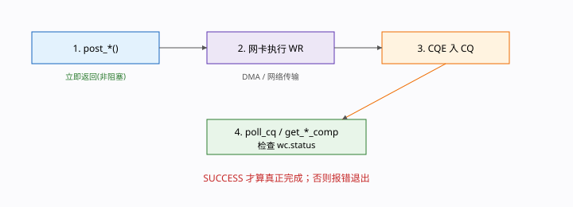

### 概念一：异步的两步——post 与 poll

RDMA 为了极致性能，把一次操作拆成两个解耦的阶段：

1. **post（投递）**：`rdma_post_send` / `post_recv` / `post_write` / `post_read`
   把一个 WR 放入队列，**立即返回**，由网卡硬件在后台执行。这一步几乎不耗 CPU，
   也不陷入内核——这正是 RDMA 内核旁路、低开销的体现。
2. **poll（轮询完成）**：从 CQ 里取出一个 CQE（完成事件），确认对应操作**真正
   完成**了，并检查它的结果。

之所以要拆开，是因为这样你可以**连续 post 很多个操作**（让网卡流水线满载），
之后再统一 poll 它们的完成——这是高吞吐的基础。乒乓示例里我们「发一个等一个」，
那是最朴素的形态；性能优化阶段会让 post 和 poll 充分解耦。

### 概念二：CQE 与本项目的便捷封装

操作完成后，网卡向 CQ 投递一个 **CQE**，在 verbs API 里就是一个 `struct ibv_wc`
（work completion）。本项目用 librdmacm 的便捷封装把「poll」这件事包了起来——
底层其实就是 `ibv_poll_cq`：

```c
static inline void wait_send_comp(struct rdma_cm_id *id, const char *what)
{
    struct ibv_wc wc;
    if (rdma_get_send_comp(id, &wc) <= 0) {   // 底层 ibv_poll_cq，阻塞取一个完成
        die_rdma(what);
    }
    if (wc.status != IBV_WC_SUCCESS) {        // ★ 必须检查状态！
        fprintf(stderr, "%s: send wc status=%s\n", what, ibv_wc_status_str(wc.status));
        exit(EXIT_FAILURE);
    }
}
```

逐行讲「为什么」：

- `rdma_get_send_comp(id, &wc)`：从**发送**完成队列取一个 CQE。返回值 `<= 0`
  表示出错或没取到。`rdma_get_recv_comp` 则对应**接收**完成。
- `&wc`：取回的那张回执。里面有 `status`、`opcode`、`byte_len`、`imm_data`（第
  9 章会用到）等字段。
- `wc.status != IBV_WC_SUCCESS`：**这步绝不能省**。下一节专门讲。

接收方向同理用 `wait_recv_comp`（底层 `rdma_get_recv_comp`）。对照第 7 章的结论
再强化一次：单边 WRITE/READ 只在**发起方**产生 send CQE，所以发起方用
`wait_send_comp`；被访问方根本没有 CQE 可 poll。

### 概念三：signaled——决定一次操作要不要产生 CQE

不是每个 post 都会自动产生 CQE。是否产生，由两个开关控制：

- **每条 WR 的 `IBV_SEND_SIGNALED` 标志**：给这一条操作单独开启「完成时产生
  CQE」。
- **QP 的 `sq_sig_all` 属性**：建 QP 时设为 1，则该 QP 上**每个** send 类操作都
  自动产生 CQE，不必逐条加标志。

本项目的脚手架两个都用了——教学默认「事事有回执」，最直观：

```c
qp_attr->sq_sig_all = 1;       /* 教学默认：每个 send 都产生 CQE */
qp_attr->qp_type = IBV_QPT_RC; /* 可靠连接 */
```

而每次 post 又显式带上 `IBV_SEND_SIGNALED`。为什么强调这个？因为**只有产生了
CQE 的操作才能被 poll 到**。如果你既没设 `sq_sig_all`、又没加
`IBV_SEND_SIGNALED`，那个操作完成时**不产生 CQE**——你在那儿 poll 会一直等不到，
程序卡死。

反过来，「事事 signaled」在高吞吐场景是浪费：CQE 越多，poll 的开销越大。所以
进阶的**选择性 signaling**（每 N 个操作才 signal 一个）是重要的性能优化——这是
第二部分的内容，这里先埋个伏笔。

### 概念四：永远检查 wc.status

poll 到一个 CQE，**不等于操作成功了**——它只表示「有结果了」。结果是好是坏，看
`wc.status`：

- `IBV_WC_SUCCESS`：成功。
- 其它值（如 `IBV_WC_RNR_RETRY_EXC_ERR`、`IBV_WC_LOC_LEN_ERR`、
  `IBV_WC_REM_ACCESS_ERR` 等）：各种失败，可用 `ibv_wc_status_str(wc.status)`
  打印成人类可读字符串。

更要命的是：**RC（可靠连接）QP 一旦某个操作出错，整个 QP 会进入 error 态**，后续
所有操作都会失败。所以错误必须当场发现、当场处理。本项目的约定就是检查到非
SUCCESS 立即报错退出——简单粗暴，但教学上一目了然，也符合「verbs 调用务必检查
返回值与 wc.status」的工程纪律。

### 常见误区

- **「post 返回了就等于发出去/完成了」**：错。post 只是投递，必须 poll 才知道
  真正完成。在 poll 到完成前**不要复用或释放 send 的源 buffer**。
- **「poll 到 CQE 就是成功」**：错。必须再看 `wc.status == IBV_WC_SUCCESS`。
- **「忘了 signal 却在那儿 poll」**：操作不产生 CQE，poll 永远等不到，程序假死。
- **「一个操作产生多个 CQE」**：一个 signaled 操作只产生一个 CQE；别重复 poll。
- **「send 的 CQE 代表对端应用已处理」**：只代表本端网卡已交付（RC 下对端网卡已
  确认）。对端应用是否处理，需应用层 ACK。

### 小结

- RDMA 是异步的两步：**post**（投递 WR，立即返回，硬件后台执行）+ **poll**（从
  CQ 取 CQE 确认完成）。
- 本项目用 `rdma_get_send_comp` / `rdma_get_recv_comp`（底层 `ibv_poll_cq`）来
  poll。
- `IBV_SEND_SIGNALED` 与 `sq_sig_all` 决定操作是否产生 CQE——**没 CQE 就 poll
  不到**。
- poll 到之后**必须检查 `wc.status == IBV_WC_SUCCESS`**；RC QP 出错会整体进入
  error 态。

至此，入门主线（核心对象、内存注册、建链、三大语义、完成机制）已经全部贯通。
下一章是入门通往进阶的**桥梁**：我们会看两个更精巧的操作——带立即数的写
（省一次 ACK 往返）和原子操作（分布式锁的地基），并由此引出第二部分的硬件模型
与性能工程。

### 术语速查

| 术语 | 含义 |
|------|------|
| post | 把 WR 投递进队列，立即返回，硬件后台执行 |
| poll | 从 CQ 取出 CQE，确认操作完成 |
| CQE / ibv_wc | 一次操作的完成回执，含 status、opcode 等 |
| ibv_poll_cq | poll CQ 的底层 verbs 调用 |
| rdma_get_send_comp / recv_comp | librdmacm 对 poll 的便捷封装 |
| IBV_SEND_SIGNALED | 让单条操作完成时产生 CQE |
| sq_sig_all | QP 属性，令每个 send 都自动产生 CQE |
| wc.status | 完成结果码，IBV_WC_SUCCESS 才算成功 |

---

<a id="ch09"></a>

## 第 9 章 · 过渡：立即数与原子操作

恭喜你走到了入门篇的最后一章。前八章我们搭好了 RDMA 的「主干道」：建链、注册
内存、三大数据语义、完成机制。这一章是一座**桥**——我们看两个更精巧的操作，
它们既是前面知识的自然延伸，又已经带上了「为性能与并发而设计」的味道，正好把
你引向第二部分的硬件模型与性能工程。

两个主角：

- **WRITE_WITH_IMM**：单边写，顺手通知对端，省掉一次 ACK 往返。
- **原子操作（FETCH_ADD / CMP_SWAP）**：让网卡对对端内存做不可分割的「读-改-
  写」，分布式锁与无锁计数器的地基。

### 本章你将遇到的术语（预览）

- **立即数（immediate data）**：随操作捎带的 32 位小数据，能触发对端 recv CQE。
- **WRITE_WITH_IMM**：带立即数的 RDMA 写，写数据 + 通知合二为一。
- **原子操作（atomic）**：网卡对对端 8 字节做的不可分割读-改-写。
- **FETCH_ADD**：原子地「加一个数并返回旧值」。
- **CMP_SWAP**：原子地「若等于期望值则替换」，比较并交换。
- **8 字节对齐**：原子操作目标地址的硬性要求。

---

### 9.1 WRITE_WITH_IMM：写 + 通知合一

#### 问题：单边写之后那个多余的往返

回忆第 7 章 WRITE 的尾巴：服务端用 RDMA WRITE 把数据写进客户端内存——可客户端
（被写方）**不产生 CQE**，它压根不知道数据到了。入门示例的办法是：服务端写完
**再补一发 SEND 当 ACK**，客户端 RECV 到 ACK 才知道「数据就绪」。

这意味着：一次逻辑上的「写并通知」，实际跑了「WRITE + SEND」两次操作、两个往返
开销。能不能合成一次？能——这就是 **WRITE_WITH_IMM**。

#### 直觉与类比

普通 WRITE 像「悄悄把东西放进对方家就走」，对方不知道。WRITE_WITH_IMM 则是
「放完东西**顺手按一下门铃**」——东西照常 DMA 进对方内存（对端 CPU 不搬数据），
但额外触发对端一个 recv CQE，门铃声里还夹带一张 32 位的小纸条（立即数）。

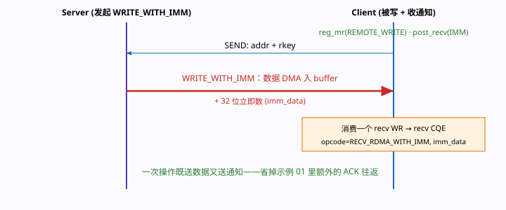

#### 它怎么工作

- 写入的数据照常 DMA 进客户端目标 buffer（**单边**，对端 CPU 不参与搬运）。
- **但额外消费对端一个 recv WR，产生 recv CQE**，
  `wc.opcode == IBV_WC_RECV_RDMA_WITH_IMM`，`wc.imm_data` 携带 32 位立即数。

于是客户端**无需额外 ACK 报文**就被通知到，少一个往返。注意这里 recv WR 被消费
了——所以即便它不承载数据，接收方**仍必须预投递一个 recv WR**（哪怕 0/1 字节
占位），否则又是 RNR（呼应第 6 章）。

#### 代码与陷阱

```c
/* librdmacm 的 rdma_post_write 不支持立即数，必须手工构造 ibv_send_wr */
struct ibv_send_wr wr = {0}, *bad;
struct ibv_sge sge = { .addr=(uintptr_t)buf, .length=len, .lkey=mr->lkey };
wr.opcode      = IBV_WR_RDMA_WRITE_WITH_IMM;   // ★ 关键 opcode
wr.send_flags  = IBV_SEND_SIGNALED;
wr.imm_data    = htonl(0xCAFEF00D);            // 立即数走网络字节序
wr.sg_list     = &sge;
wr.num_sge     = 1;
wr.wr.rdma.remote_addr = remote_addr;          // 对端 addr（SEND 告知）
wr.wr.rdma.rkey        = remote_rkey;          // 对端 rkey
ibv_post_send(id->qp, &wr, &bad);
```

逐点讲「为什么」：

- **必须用 `ibv_post_send` 手工构造**：librdmacm 的便捷封装 `rdma_post_write`
  不支持立即数，到了这里就得「下沉」到原生 verbs。
- `imm_data` 走线为**网络字节序**：发端 `htonl`，收端 `ntohl`，跨机器别忘了。
- 接收方读立即数需要拿到 `ibv_wc`，所以客户端直接用 `rdma_get_recv_comp(&wc)`
  而非丢弃 wc 的封装，再 `ntohl(wc.imm_data)` 取出那张小纸条。

> 🛠 动手跑：[examples/04-immediate/](../../examples/04-immediate/)

立即数典型用途：用那 32 位携带「消息编号 / 槽位 ID / 状态码」，让对端一收到门铃
就知道「哪块数据好了」，省去单独的元数据交换。

---

### 9.2 原子操作：分布式锁与计数器的地基

#### 问题：多个客户端同时改同一个远端变量

设想多台机器要共享一个远端计数器，各自做「读出来 +1 再写回去」。如果用「READ
然后 WRITE」两步，两个客户端就可能同时读到 100、各自加成 101，结果丢了一次
计数——这就是经典的竞态。

我们需要的是**不可分割**的「读-改-写」：从读到改到写，中间谁都插不进来。RDMA
**原子操作**就提供这个，而且全程**对端 CPU 不参与**。

#### 直觉与类比

原子操作像银行柜台的「凭条」：你说「给账户加 5，并把加之前的余额告诉我」，柜员
一气呵成完成，期间不接待别人。无论多少人同时来，每笔都干净利落、不会互相踩。

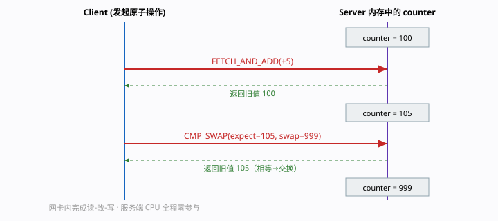

#### 两种原子操作

RDMA 让网卡直接对**对端内存中的一个 64 位字**做不可分割的读-改-写。示例 05 的
客户端依次演示两种：

1. **FETCH_AND_ADD(+5)**：`*remote += 5`，返回**旧值**（100 → 105，返回 100）。
   无锁计数器、序列号分配的基础。
2. **COMPARE_AND_SWAP(expect=105, swap=999)**：若 `*remote == 105` 则置为 999，
   返回旧值。分布式锁、CAS 自旋的基础——「只有在我以为的状态没被别人改过时，
   我才动手」。

两者都把**操作前的旧值**写回客户端本地 8 字节 buffer，并在**发送队列产生 CQE**
（和单边一样，对端无感）。

#### 代码与陷阱

原子操作也只能用 `ibv_post_send` 手工构造，参数在 `wr.wr.atomic`：

```c
struct ibv_send_wr wr = {0}, *bad;
struct ibv_sge sge = { .addr=(uintptr_t)local8, .length=8, .lkey=mr->lkey };
wr.opcode      = IBV_WR_ATOMIC_FETCH_AND_ADD;   // 或 IBV_WR_ATOMIC_CMP_AND_SWP
wr.send_flags  = IBV_SEND_SIGNALED;
wr.sg_list     = &sge;                           // 旧值写回这里（8 字节）
wr.num_sge     = 1;
wr.wr.atomic.remote_addr = remote_addr;          // ★ 必须 8 字节对齐
wr.wr.atomic.rkey        = remote_rkey;
wr.wr.atomic.compare_add = 5;                    // FETCH_ADD 的加数 / CMP_SWAP 的比较值
wr.wr.atomic.swap        = 999;                  // 仅 CMP_SWAP 使用
ibv_post_send(id->qp, &wr, &bad);
```

务必记住的几条陷阱：

- **目标地址必须 8 字节对齐**（示例用 `__attribute__((aligned(8)))`）。原子操作
  作用于一个 64 位字，未对齐直接出错。
- **目标 MR 必须开放 `IBV_ACCESS_REMOTE_ATOMIC`**——和 REMOTE_WRITE/READ 一样，
  这是独立的权限位。
- `compare_add` 一字段两用：FETCH_ADD 时是加数，CMP_SWAP 时是比较值；`swap`
  仅 CMP_SWAP 用。
- 原子性保证的**粒度/范围**取决于设备能力（`atomic_cap`，IB 级 vs 全局）。跨
  主机的 RDMA 原子操作与本地 CPU 的原子指令**混用同一变量时**要格外小心——两者
  不一定互相保证原子。

> 🛠 动手跑：[examples/05-atomic/](../../examples/05-atomic/)

---

### 常见误区

- **「WRITE_WITH_IMM 的接收方不用 post_recv，反正不传数据」**：错。立即数会消费
  一个 recv WR，没预投递照样 RNR。
- **「立即数可以传任意大小的元数据」**：不行，只有 32 位。它是「通知 + 小标签」，
  不是数据通道。
- **「原子操作能对任意长度内存生效」**：不行，固定就是一个 64 位字、且地址必须
  8 字节对齐。
- **「远端 RDMA 原子和本地 `__atomic` 对同一变量混用没问题」**：危险。原子域取决
  于设备，混用前务必确认 `atomic_cap`。
- **「这些高级操作还能用 librdmacm 的 rdma_post_* 封装」**：不能。立即数与原子
  都必须下沉到 `ibv_post_send` 手工构造 WR。

### 小结

- **WRITE_WITH_IMM**：单边写 + 32 位立即数，触发对端 recv CQE，把「写数据」和
  「通知对端」合成一次操作，省掉一次 ACK 往返；接收方仍须预投递 recv WR。
- **原子操作 FETCH_ADD / CMP_SWAP**：网卡对对端一个 8 字节字做不可分割的读-改-
  写，对端 CPU 不参与，是分布式锁、无锁计数器、序列号分配的地基；地址须 8 字节
  对齐，MR 须开放 REMOTE_ATOMIC。
- 这两类操作都已超出 librdmacm 便捷封装，需要手工构造 `ibv_send_wr`——这也预示
  着：再往深走，你会越来越多地直接面对原生 verbs 与硬件细节。

#### 通往第二部分

到这里，入门篇画上句号。你已经能读懂、写出一个完整的 RDMA 程序，并理解它每一步
「为什么这么做」。但还有许多问题我们只是点到为止：网卡内部到底怎么把 WR 变成
线上的报文？为什么 READ 比 WRITE 慢、怎么把吞吐压榨到极限？选择性 signaling、
inline、批处理这些优化背后的硬件模型是什么？

**第二部分**将带你下沉到**硬件模型与性能工程**：MMIO/DMA 如何驱动队列、RC/UC/UD
的取舍、MPT/MTT 地址翻译、以及把延迟与吞吐推向极致的系统化方法。我们从「会用」
走向「用好、用对、用到极致」。

### 术语速查

| 术语 | 含义 |
|------|------|
| 立即数（immediate data） | 随操作捎带的 32 位数据，能触发对端 recv CQE |
| WRITE_WITH_IMM | 带立即数的 RDMA 写，写数据 + 通知合一 |
| IBV_WC_RECV_RDMA_WITH_IMM | 对端收到带立即数写时的完成 opcode |
| 原子操作（atomic） | 网卡对对端 8 字节做的不可分割读-改-写 |
| FETCH_ADD | 原子地加一个数并返回旧值 |
| CMP_SWAP | 原子地「若等于期望值则替换」，返回旧值 |
| IBV_ACCESS_REMOTE_ATOMIC | 允许对端做原子操作的 MR 权限位 |
| atomic_cap | 设备的原子能力/保证范围（IB 级 vs 全局） |

---

## 下一步

入门篇到此结束——你已经能独立写出一个正确的 RDMA 程序。接下来
[第二部分 · 进阶](part2-进阶.md#ch10)会掀开硬件的盖子，解释这些 API 背后
真正发生了什么，以及怎样让它跑得更快、扛得住规模。

- 上一站：[前言与导读](00-前言与导读.md)
- 下一站：[第二部分 · 进阶](part2-进阶.md)
- 随时查阅：[附录 A · 术语表](appendix-附录.md#appendix-a) · [附录 B · 示例索引](appendix-附录.md#appendix-b)
