# 第二部分 · 进阶（高级工程师）

> 入门篇教会了你「怎么调 API」，本部分回答「为什么这样调」。我们先建立硬件数据
> 路径的心智模型，再依次深入性能工程、可扩展架构、可靠性与高级内存管理——每一项
> 优化都从机理讲起，而不是给一张调参速查表。
>
> 全书导读见 [前言与导读](00-前言与导读.md)。

## 本部分目录

| 章 | 标题 | 你将学会 |
|----|------|----------|
| [第 10 章](#ch10) | 硬件模型：数据路径的真实代价 | MMIO/DMA/PCIe、Verbs 分层、传输类型、地址翻译、排序与 FENCE |
| [第 11 章](#ch11) | 性能工程 | 选择性 signaling、轮询 vs 事件、inline、批处理、多 QP、基准方法 |
| [第 12 章](#ch12) | 可扩展架构 | SRQ、共享 CQ、手工 QP 状态机、UD/DC |
| [第 13 章](#ch13) | 可靠性与生产化 | 错误恢复、重传超时、拥塞控制、资源生命周期 |
| [第 14 章](#ch14) | 高级内存管理 | 注册缓存、ODP、Memory Windows、大页 |

---

<a id="ch10"></a>

## 第 10 章 · 硬件模型：数据路径的真实代价

> 第一部分（入门篇）已经把你带到了「会用」的程度：你能创建 QP/MR/CQ，能
> post/poll，能跑通 SEND/RECV 与 WRITE。但「会用」之后，迟早会撞到两类问题：
> 为什么我的延迟下不去？为什么换个机器、换个 NUMA 节点，性能就抖了？
> 答案不在 API 文档里，而在 API 底下的**硬件**里。本章不再教你「怎么写」，
> 而是回答「**为什么是这样、代价究竟花在哪**」——为后面的性能工程（第 11 章）
> 打地基。

---

### 本章你将遇到的术语（预览）

下面每个术语先给一句话直觉（预热用），完整定义在正文展开；章末另有一份复习速查表。

| 术语 | 一句话直觉 |
|------|-----------|
| **MMIO** | CPU 用一条普通的「写内存」指令，写的其实是网卡上的寄存器。 |
| **Doorbell（门铃）** | 就是那条写到网卡寄存器的指令——「叮，有新活了」，约 100 ns。 |
| **DMA** | 网卡自己去读写主机内存，不打扰 CPU——这是「零拷贝」的本体。 |
| **IOMMU** | 给设备 DMA 做地址翻译的「关卡」，开了它注册内存会更慢。 |
| **MPT** | 网卡里的一张表，存每块注册内存的「身份证」（key、权限、地址、长度）。 |
| **MTT** | 另一张表，把虚拟/DMA 地址翻成物理页地址——网卡专用页表。 |
| **MR** | 注册过的内存：页被 pin 住 + 在 MTT/MPT 里登记。 |
| **lkey / rkey** | 引用一块 MR 的钥匙，本端用 lkey，对端用 rkey。 |
| **RC / UC / UD** | 可靠连接 / 不可靠连接 / 不可靠数据报，三种 QP 性格。 |
| **XRC / DC** | 两种缓解「QP 数量爆炸」的扩展传输类型。 |
| **Fence（栅栏）** | 一道「先等前面的 READ/ATOMIC 干完再走」的命令。 |

---

### 引子：内核旁路不是免费的

入门篇反复强调 RDMA 的卖点是「内核旁路、零拷贝」，很容易让人产生一种错觉：
既然绕过了内核，延迟岂不是约等于零？

并不是。内核旁路做的事，是把**系统调用的开销**换成了 **MMIO + PCIe 事务**的
开销。前者是微秒级，后者是百纳秒级——确实快了一个数量级，但绝不是零。
要知道延迟的下限在哪、该往哪优化，你得把一次 `post_send` 在硬件上**真正
发生的事**拆开看一遍。这就是第 1 节要做的。

---

### 1. 一次 post_send 的真实代价：MMIO · DMA · WC vs WB

**问题**：你调用 `rdma_post_send` 后函数立刻返回了，但数据显然还没发出去。
那么从「函数返回」到「对端收到」，中间这台机器到底忙了些什么？

**类比**：把 post_send 想象成「给楼下快递柜寄件」。你（CPU）把包裹和单子放进
柜子（写 WQE 到内存），然后**按一下柜子上的呼叫按钮**（doorbell）通知快递员
（网卡）。快递员过来取件（DMA 读 WQE），送达后在你的签收本上盖个章
（DMA 写 CQE），你回头翻签收本（poll CQ）才知道寄到了。按钮一按你就能走人
——这就是「post 立即返回」，但寄送的物理过程一样都没省。

#### 硬件事务序列

一次 post_send 在硬件上严格按这五步发生：

```
① CPU 填写 WQE（Work Queue Element）到 SQ 所在内存（Write-Back 普通内存）
② CPU 写 doorbell 寄存器（MMIO，Write-Combining 内存）→ 网卡得到通知
③ 网卡通过 PCIe DMA 读 WQE（可能顺带读 inline 以外的数据 buffer）
④ 网卡完成传输后，PCIe DMA 写 CQE 到 CQ 内存
⑤ CPU poll_cq，读取 CQE 确认完成
```

这里出现了两个需要先解释的词：**MMIO**（Memory-Mapped I/O）是指 CPU 用普通的
内存写指令去写一个其实落在网卡上的地址；**DMA**（Direct Memory Access）是指
网卡反过来自己读写主机内存，全程不惊动 CPU——这正是「零拷贝」的物理本体。

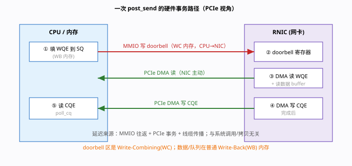

#### 为什么 doorbell 区和 SQ 区是两种内存：WC vs WB

第 ① 步写 WQE 和第 ② 步写 doorbell，落在**两种性质完全不同的内存**上。这不是
随意安排，理解它才能理解延迟从哪来。

| 内存类型 | 用途 | 特点 |
|----------|------|------|
| WB（Write-Back，普通） | SQ / CQ / 数据 buffer | CPU cache 一致，可被 DMA 读到最新值 |
| WC（Write-Combining，MMIO doorbell 区） | 写 doorbell 通知网卡 | CPU 写合并后再刷到 PCIe 总线；**不可读** |

通俗说：**WB** 是你日常用的内存，读写都走 cache，网卡 DMA 读它能拿到最新值，
所以 WQE、CQE、数据 buffer 都放这里。**WC** 是专门留给 doorbell 的「只写
通道」——CPU 会把多次写合并（combine）后一次性刷到 PCIe 总线，效率高，
但代价是它**不可读**，且需要一次「刷出」动作。

doorbell 区映射到 `/proc/<pid>/maps` 里 `[uverbs]` 开头的 mmap 区域。每次
`rdma_post_send` 最终触发一次对该区域的 MMIO 写，加上来回 PCIe 事务，构成
RDMA 延迟的**硬件下限**，通常在百纳秒量级（取决于 PCIe 代数、NUMA 距离）。

#### 延迟到底由哪些部分组成

把上面五步加上线缆传播，一次操作的总延迟可以拆成：

```
总延迟 ≈ WQE 写缓存（WB）+ doorbell 刷出（WC）
       + PCIe 读 WQE 往返
       + 数据 DMA（WRITE/READ）
       + PCIe 写 CQE 往返
       + 线缆/交换机传播
```

注意这里面没有一项是「系统调用」——那正是内核旁路省下的。但每一项 PCIe
往返都实打实地花时间。其中一个常被忽略的杀手是 **NUMA 距离**：当 CPU 与网卡
不在同一个 NUMA 节点时，那次跨节点的 doorbell 写会让延迟劣化 **30–50 ns**。
这就是「CPU-NIC 亲和性」要求的硬件根因——第 11 章会把它变成可操作的优化手段。

---

### 2. Verbs 软硬件分层：控制面慢、数据面快

**问题**：同样是调 verbs API，为什么有人说「RDMA 收发不走内核」，可创建 QP
时明明又触发了系统调用？这两种说法都对吗？

**类比**：把 RDMA 软件栈想成一家餐厅。**控制面**像是「办会员卡、订包间」——
要走前台、填表、走流程（系统调用进内核），慢，但你一晚上只办一次。
**数据面**像是「服务员直接上菜」——你和后厨之间有条专用通道，不用每道菜都
回前台登记。混淆这两条路，是 RDMA 性能误解的头号来源。

RDMA 软件栈分三层，关键在于**控制面与数据面走不同的路径**。

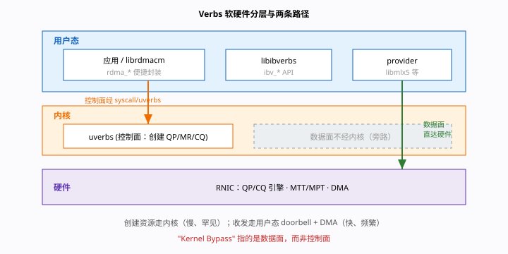

#### 控制面（慢路径）

```
应用 → librdmacm / libibverbs → ioctl(uverbs) → 内核 ib_core → 驱动 → 硬件
```

创建 / 销毁 QP、MR、CQ、PD 都走这条路。每次都有系统调用，但它们只在**连接
建立时**发生，频率极低，**不在关键路径上**——所以慢一点无所谓。

#### 数据面（快路径）

```
应用 → libibverbs → provider（libmlx5 等）→ WQE 写用户态 mmap → MMIO doorbell
                                                                      ↓
                                                              RNIC 硬件直接处理
```

`ibv_post_send` / `ibv_poll_cq` 完全在用户态执行，**0 系统调用、0 内核态切换**。
这里出现的 **provider**（如 `libmlx5`）是厂商提供的用户态驱动库，它直接调用
网卡的用户态接口写 WQE 并敲 doorbell。这才是「内核旁路」名副其实的地方。

#### 想确认自己在用哪条路？看这几个文件

```
/dev/infiniband/uverbs0        # 控制面字符设备（ioctl）
/sys/class/infiniband/mlx5_0/ # 设备能力、计数器
ldd bin/server | grep mlx5    # 确认 provider 是否链接
```

记住这条性能直觉：**syscall 是微秒级，WQE 写是纳秒级**。把任何本该在数据面
做的事误放到控制面（比如频繁 reg/dereg 内存），就是把纳秒的活硬塞进微秒的
路径——第 11 章和第 6 节都会再提到这条线。

---

### 3. 传输类型对比：RC / UC / UD / XRC / DC

**问题**：入门篇所有示例都用 RC（可靠连接），用着也挺好，为什么还要了解
别的类型？

**类比**：选传输类型就像选「快递服务」。**RC** 是顺丰标快——保证送达、保证
顺序、丢了自动重发，但每个收件人都要单独建一条专线。**UD** 是同城闪送广播
——一辆车能给很多人送，便宜灵活，但不保证每件都到。当你的收件人从 10 个
涨到 10000 个，「每人一条专线」的 RC 就会让你的 QP 数量爆炸（N² 问题），
这时就得换思路。

不同 QP 类型在**可靠性、连接性、支持的操作、扩展代价**上差异显著，选型直接
影响架构。

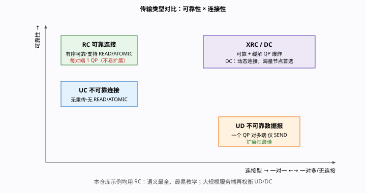

#### 四种主要类型

| 类型 | 可靠性 | 连接 | 支持操作 | 扩展性 |
|------|--------|------|----------|--------|
| **RC**（Reliable Connected） | 有序可靠，硬件重传 | 一对一 | SEND/RECV/WRITE/READ/ATOMIC | 差：N² QP |
| **UC**（Unreliable Connected） | 无重传，包可丢 | 一对一 | SEND/RECV/WRITE | 较差 |
| **UD**（Unreliable Datagram） | 无重传，包可丢 | 一对多 | 仅 SEND/RECV | 最佳：1 QP |
| **XRC**（eXtended RC） | 同 RC | 共享 RQ | SEND/RECV/WRITE/READ | 缓解 N² |

读表小贴士：可靠性越强、操作越全，往往连接越「私有」、扩展越差。RC 是
功能最全但最不可扩展的一端，UD 是反过来的一端。**XRC**（扩展 RC）通过让多个
QP 共享接收队列，在保住 RC 可靠性的同时缓解 N² 爆炸。

#### DC（Dynamic Connected，Mellanox 扩展）

DC 是 Mellanox/NVIDIA 网卡特有的类型，可以理解成「按需拨号的可靠连接」：
它兼顾 RC 的可靠性与 UD 的扩展性，连接在网卡内**动态建立与复用**，应用层
不需要维护全量 QP。特别适合万节点以上的 All-to-All 通信（如 NCCL、存储网络）。

#### 何时选什么

- **教学 / 通用**：RC，语义最全、最易理解（本仓库所有示例）。
- **低延迟广播 / 路由发现**：UD。
- **大规模存储 / AI 集群**：DC 或 RoCE v2 + ECMP。
- **QP 数量超出硬件限制**：XRC 或 SRQ（见阶段四 / 第 12 章）。

---

### 4. 内存与地址翻译：MR / MPT / MTT / IBV_ACCESS_*

**问题**：第 3 章讲过注册内存会拿到 lkey/rkey，对端凭 rkey 就能直接写你的
内存。但凭一个 32 位的数字就能随意访问别人内存，这安全吗？网卡又是怎么把
一个虚拟地址翻成它能 DMA 的物理地址的？

**类比**：把一块注册内存想成「银行保险柜」。**rkey 是钥匙**，但光有钥匙没用
——银行（网卡）还要查一本**登记簿**（MPT）：这把钥匙对应哪个柜子、持钥匙人
有没有权限、要取的范围在不在柜子里。核验通过后，再用一张**楼层平面图**
（MTT）找到柜子的真实物理位置。钥匙 + 登记簿 + 平面图，缺一不可。

RDMA 的安全与性能都建立在**内存注册**机制上。注册不只是「告诉网卡有这块
内存」，而是构建了一条从 rkey 到物理地址的**鉴权翻译链**。

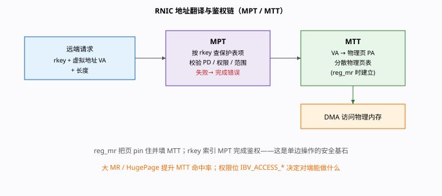

#### MPT（Memory Protection Table）：那本登记簿

每个 MR 在 RNIC 内对应一条 MPT 表项，索引键就是 `lkey` 或 `rkey`。
远端 WRITE/READ 请求到达时，网卡先查 MPT，做三道校验：

1. **PD 校验**：请求来自的 QP 与 MR 是否属于同一 PD。
2. **权限校验**：操作类型是否在 `IBV_ACCESS_*` 权限集内。
3. **范围校验**：`addr + length` 是否落在注册范围内。

任何一项失败，都会产生完成错误（`IBV_WC_REM_ACCESS_ERR` 等），**根本不会
触碰内存**。所以「凭 rkey 就能乱写」的担心，被这三道锁挡住了。

#### MTT（Memory Translation Table）：那张平面图

MPT 通过 `MTT_base` 指向一组物理页映射（等价于内核的页表）。校验通过后，
网卡用 MTT 把虚拟/DMA 地址翻译成物理页地址，才能 DMA。

这也解释了 `ibv_reg_mr` 为什么慢（μs–ms 级）——它的开销主要在两件重活：

- `get_user_pages()`：pin 住所有物理页（防止被 swap 换出）。
- 在 RNIC 的 MTT 中建立 VA → PA 映射。

正因为注册这么贵，生产环境绝不会每次收发都 reg/dereg，而是用**注册缓存**
（registration cache）复用 MR（见阶段六 / 第 6 节）。顺带一提，若开启了
**IOMMU**（设备 DMA 的地址翻译关卡），注册代价还会进一步增加。

#### IBV_ACCESS_* 权限矩阵

权限位决定了「这把钥匙能开多大的门」：

```c
IBV_ACCESS_LOCAL_WRITE    // 本端 RQ（post_recv）或 READ 目标必须有此权限
IBV_ACCESS_REMOTE_WRITE   // 允许对端 RDMA WRITE
IBV_ACCESS_REMOTE_READ    // 允许对端 RDMA READ
IBV_ACCESS_REMOTE_ATOMIC  // 允许对端原子操作（FETCH_ADD / CMP_SWAP）
IBV_ACCESS_ON_DEMAND      // ODP：延迟 pin（见阶段六）
```

一句话规则：**对端能做什么，完全由 MR 注册时的权限决定——rkey 是钥匙，
MPT 是锁**。请遵守最小权限原则：只开放必要的位，这样即便 rkey 泄露，
爆炸半径也最小。

---

### 5. 完成语义与排序保证：FENCE 与 PCIe ordering

**问题**：RC 不是保证「有序可靠」吗？那我先 WRITE 再 SEND，对端一定先看到
WRITE 的数据、再收到 SEND 通知，对吧？以及——`wc.status == SUCCESS` 是不是
就代表对端那边数据已经完全可用了？

**类比**：RC 的「有序」保证的是**信件投递的先后顺序**，但「信送到收件人楼下」
和「收件人本人读到信」之间还有一截。RDMA 程序里很多数据竞争，就藏在这截
微妙的缝隙里。

RC QP 保证报文有序到达，但「有序到达」与「对端内存可见」「对端 CPU 可读」
之间仍有微妙差别，是 RDMA 程序出现数据竞争的常见根源。

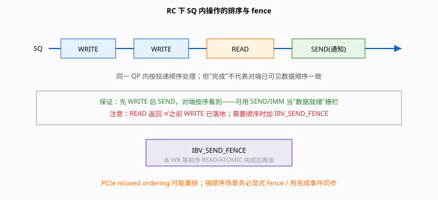

#### RC 内的顺序保证

```
同一 QP：WR 按投递顺序在 SQ 中排队，网卡按序执行。
```

具体来说（IB Spec Vol.1 §10.7.3）：

- **SEND 可用作数据栅栏**：RC 下，同一 QP 先 WRITE 后 SEND，对端**保证**先
  收到 WRITE 的数据，再收到 SEND——这正是示例 01/04 用 SEND/ACK 当通知的
  理论依据。
- **同一 QP、同一地址：WRITE→READ 有序**：RC 保证同一 QP 上后投递的 READ 能
  观测到先投递的 WRITE 已生效（操作按 SQ 顺序在对端执行）。换句话说，
  「同 QP 先 WRITE 后 READ 会读到旧值」是**误解**。真正需要 FENCE 的场景，是
  当**本地** READ/ATOMIC 的返回结果要喂给**后续**操作时（见下文
  FETCH_ADD→FENCE→WRITE），以及 PCIe relaxed ordering 下本地完成顺序的边界
  情形。
- **跨 QP 无顺序保证**：多个 QP 之间没有全局顺序，需应用层同步。

#### IBV_SEND_FENCE：让后面的操作等一等

```c
wr.send_flags = IBV_SEND_SIGNALED | IBV_SEND_FENCE;
```

带 FENCE 标志的 WR 会等待**本 QP 内所有先前的 READ / ATOMIC 完成**后，
才开始执行自身。典型用法：FETCH_ADD → FENCE → WRITE——先原子取回一个旧值，
确保它真的回来了（FENCE），再把基于旧值算出的结果写出去。

#### PCIe Relaxed Ordering 的影响

PCIe 默认启用 Relaxed Ordering（RO），允许 PCIe 事务重排，以提高总线利用率。
这是一把双刃剑：

- NIC 的 DMA 写（CQE / RDMA WRITE 数据）可能在对端以乱序落地。
- Mellanox 网卡在 RC 下默认**关闭 RO**，保证 WRITE 语义；但 UD 场景下可能存在。
- 自研或异构场景需检查 `ethtool -I <dev>` 和 PCIe 配置，或显式用 FENCE。

#### 生产排查要点

记住下面两条「等号不成立」，能避开一大半诡异 bug：

```
wc.status == IBV_WC_SUCCESS   ≠ 对端数据已完全可见（不同 CPU core 的 cache）
                               → 需要 fence 或应用层同步原语
wc.status != IBV_WC_SUCCESS   → QP 进入 ERROR 态，后续 WR 全部以 flush error 完成
                               → 必须重建 QP（阶段五 / 后续章节详述）
```

---

### 小结：五段式（原理 → API → 代码 → 性能 → 陷阱）

下表把全章浓缩成可复习的五段式，便于回看：

| 节 | 原理 | 核心 API | 代码位置 | 性能影响 | 常见陷阱 |
|----|------|---------|---------|---------|---------|
| 10.1 | MMIO + DMA 是真实路径 | `ibv_post_send` doorbell | `common/rdma_common.h` `wait_send_comp` | NUMA 亲和 ±50 ns | 误认为"零延迟" |
| 10.2 | 数据面 0 syscall | provider mmap | 透明，应用不感知 | syscall = 微秒级；WQE 写 = 纳秒级 | 混淆控制面/数据面开销 |
| 10.3 | RC/UD/DC 取舍 | `qp_type` in `ibv_qp_init_attr` | `fill_qp_attr()` `common/rdma_common.h:43` | UD 1 QP vs RC N² QP | 大规模下坚持用 RC 导致 QP 爆炸 |
| 10.4 | MPT/MTT 鉴权链 | `ibv_reg_mr` `IBV_ACCESS_*` | `examples/*/server.c` `client.c` | reg 慢（ms）；MTT 命中影响 DMA | 权限过宽暴露 rkey |
| 10.5 | RC 有序但需 fence | `IBV_SEND_FENCE` `wc.status` | `wait_send_comp` / `wait_recv_comp` | fence 串行化 SQ | 误认为 WRITE 后 READ 仍看新值 |

---

### 术语速查

> 完整术语表见 [附录 A · 术语表与参考文献](appendix-附录.md#appendix-a)。

| 术语 | 含义 |
|------|------|
| **MMIO** | 内存映射 I/O，CPU 通过普通 store 指令写设备寄存器（如 doorbell）|
| **Doorbell（门铃）** | MMIO 写网卡寄存器通知有新 WQE，WC 内存写约 100ns |
| **DMA** | 网卡直接读写主机内存，不经过 CPU，零拷贝核心 |
| **IOMMU** | 设备 DMA 地址→物理地址翻译单元，开启会增加 reg_mr 代价 |
| **MPT** | 内存保护表，存 MR 元数据（lkey/rkey、权限、地址、长度）|
| **MTT** | 内存翻译表，虚拟/DMA 地址→物理页地址的页表 |
| **MR** | 已注册内存区域，pin 页 + 建立 MTT/MPT 映射 |
| **lkey / rkey** | 本端 / 对端引用 MR 的密钥 |
| **RC / UC / UD** | 可靠连接 / 不可靠连接 / 不可靠数据报传输类型 |
| **XRC / DC** | 扩展可靠连接 / 动态连接，缓解 N² QP 爆炸 |
| **Fence** | `IBV_SEND_FENCE`，保障当前 WR 在之前 READ 完成后才执行 |

---

<a id="ch11"></a>

## 第 11 章 · 性能工程

> 第 10 章把数据路径的真实代价摊开了：MMIO doorbell、PCIe 往返、CQE 的 DMA
> 写、NUMA 距离……每一项都在花时间。本章就是把那些「代价」逐个变成「优化
> 手段」——目标是把延迟做到 μs 级、把带宽打满线速，并且**每一项优化都说清
> 背后的硬件机理**，而不是「调一调试试看」。
>
> 前置阅读：第 10 章（硬件模型）；建议先跑过 `examples/02-send-recv/`
> 拿到自己的延迟基线，再看本章的优化能把它压到多低。

---

### 本章你将遇到的术语（预览）

每个术语先给一句话直觉，完整定义在正文展开；章末另有复习速查表。

| 术语 | 一句话直觉 |
|------|-----------|
| **SQ / RQ** | 一个 QP 的两条队列：发送队列、接收队列。 |
| **CQ / CQE** | 完成队列和它里面的条目——poll 它来确认操作干完了。 |
| **WR / WQE** | 你提交的「工作请求」和它在硬件队列里的存储形态。 |
| **SGE** | 一个 `{addr, length, lkey}` 三元组，一个 WR 可挂多个，自动拼接多段内存。 |
| **Doorbell** | 通知网卡「有新活」的那次 MMIO 写——批处理能把多次合成一次。 |
| **IMM** | 立即数，随 SEND/WRITE_WITH_IMM 捎带的 32 位通知。 |
| **Credit** | 流控信用：确保对端 RQ 里预投递了足够的接收 WR。 |
| **NUMA** | 非一致内存访问——QP/MR/线程最好都绑在同一节点。 |

---

### 引子：从「能跑」到「跑得快」

入门篇的示例每发一个 WR 就 poll 一次完成，清晰、好懂，但每次操作都背着一份
「生成 CQE + poll 同步」的固定开销。当你追求每秒上百万次操作时，这份固定
开销会变成主要瓶颈。本章的六节优化，本质都在做同一件事：**把第 10 章里那些
按次计费的硬件代价（CQE DMA 写、doorbell、PCIe 读、跨 NUMA 访问）摊薄、合并
或消除掉**。我们从收益最直接的「选择性 signaling」开始。

---

### 1. 选择性 signaling 与 SQ 回收

> 🛠 可运行示例：[examples/06-selective-signaling/](../../examples/06-selective-signaling/)
> ——同样 N 次 WRITE，对比「全 signaled」与「每 K 个 signaled」的吞吐加速比。

**问题**：每个 WR 都打 `IBV_SEND_SIGNALED`、每发一个就 poll 一个完成，逻辑最
直白。但既然 RC 的 SQ 是严格有序完成的，为什么还要为每一个 WR 都确认一遍？

**类比**：想象你在工厂流水线末端验货。「全 signaled」是每下线一件就停下来
签一次字；「选择性 signaling」是攒够 64 件、只签最后一件的字——因为流水线
是顺序出货的，最后一件签了，就证明前 63 件也都下线了。少签 63 次字，吞吐
自然上来了。

#### 原理

每个 `IBV_SEND_SIGNALED` 的 WR 完成后，网卡都要通过 PCIe DMA 写一条 CQE。
高吞吐场景下，如果每个 WR 都打 SIGNALED，CQ 的 DMA 写和 CPU 的 `ibv_poll_cq`
本身就会占用大量 PCIe 带宽和 CPU 周期。

**选择性 signaling**：每 N 个 WR 只让最后一个带 `IBV_SEND_SIGNALED`，其余为
unsignaled。一次 `poll_cq` 就能确认前 N 个 WR 全部完成——因为 RC 的 SQ 是
严格有序的。CQE/poll 开销直接摊薄到 1/N。

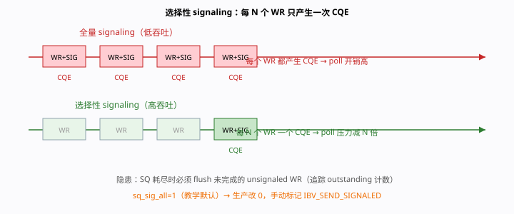

#### 代码模式

```c
#define SIGNAL_INTERVAL 16          /* 每 16 个 WR signaled 一次 */
static int outstanding = 0;         /* 未 poll 的 unsignaled WR 数 */

static void post_write_selective(struct rdma_cm_id *id, /* ... */)
{
    int flags = (++outstanding % SIGNAL_INTERVAL == 0)
                ? IBV_SEND_SIGNALED : 0;

    /* ibv_post_send ... flags ... */

    if (flags & IBV_SEND_SIGNALED) {
        wait_send_comp(id, "selective signal");
        outstanding = 0;
    }
}

/* 退出前 flush 剩余 unsignaled WR */
static void flush_outstanding(struct rdma_cm_id *id, int remain)
{
    if (remain > 0) {
        /* post 一个 no-op / 0 字节 WRITE 带 SIGNALED，然后 poll */
        /* 或直接 post 最后一个真实 WR 带 SIGNALED */
        wait_send_comp(id, "flush");
    }
}
```

#### 关键约束（陷阱）

- 教学默认 `sq_sig_all = 1`（`common/rdma_common.h:fill_qp_attr`）——生产环境
  改为 `0`，手动控制 `IBV_SEND_SIGNALED`。
- 未 signaled 的 WR **仍占用 SQ 槽位**，直到其后某个 signaled WR 完成才被回收。
  因此在途上限 ≈ `SIGNAL_INTERVAL`，QP 的 `max_send_wr` 必须 **≥** 它，否则 SQ
  在 poll 之前就满了，`ibv_post_send` 会返回 `ENOMEM`。这正是要**周期性
  signaled 回收**的原因（示例 06 设 `SQ_DEPTH=256`、`SIGNAL_EVERY=64`）。
- unsignaled WR 出错时**不会**产生错误 CQE；需靠后续 signaled WR 的 `wc.status`
  间接发现（此时 QP 已进入 ERROR 态，所有后续 WR 以 flush error 完成）。
- 退出前别忘了 **flush 剩余 unsignaled WR**，否则最后不足一个区间的 WR 可能
  还没确认完成程序就退了。

示例 06 的实测：单边 WRITE 不消耗服务端 CPU，A/B 两轮差异**纯粹**来自客户端的
signaling 策略，B 轮通常快数倍；即便在 Soft-RoCE 上绝对值偏慢，相对加速比依然
清晰可见。

---

### 2. 轮询 vs 事件

**问题**：怎么知道一个操作完成了？最简单是写个死循环不停 poll，但那会把一个
CPU 核烧到 100%。可如果改成「睡觉等通知」，延迟又会变差。到底该怎么选？

**类比**：等快递有两种姿势。**busy-poll** 是站在门口一直盯着——最快知道，但
你什么别的事都干不了（独占 CPU）。**事件驱动**是回屋睡觉、等门铃响——省力，
但从按铃到你起身开门多了一截延迟。**混合策略**则是先在门口盯一会儿，没动静
再回屋睡——兼顾两者。

#### 三种模式对比

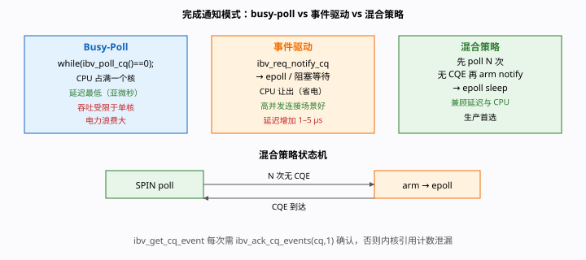

##### Busy-Poll（最低延迟）

```c
struct ibv_wc wc;
while (ibv_poll_cq(cq, 1, &wc) == 0)
    ;   /* 空转 */
```

- **优点**：消除事件通知延迟，P50 可达亚微秒级。
- **缺点**：独占一个 CPU 核，功耗高，不适合 QPS 低的场景。

##### 事件驱动（省 CPU）

```c
/* 注册 completion channel */
struct ibv_comp_channel *cc = ibv_create_comp_channel(ctx);
ibv_req_notify_cq(cq, 0);          /* arm：下一个 CQE 触发事件 */

/* 线程阻塞等待 */
struct ibv_cq *ev_cq; void *ev_ctx;
ibv_get_cq_event(cc, &ev_cq, &ev_ctx);
ibv_ack_cq_events(ev_cq, 1);       /* 必须 ack，否则引用计数泄漏 */
ibv_req_notify_cq(ev_cq, 0);       /* 重新 arm */
ibv_poll_cq(ev_cq, batch, wcs);    /* 取出所有 CQE */
```

这里 **arm** 指 `ibv_req_notify_cq`——它的语义是「下一个 CQE 到来时给我发一个
事件」。注意两个易错点：`ibv_ack_cq_events` **必须调用**，否则 CQ 的引用计数
泄漏、销毁时卡住；每次取完事件要**重新 arm**，因为 arm 是一次性的。

- **优点**：线程可睡眠，适合高连接数 / 低 QPS。
- **缺点**：事件路径多一次内核交互，延迟增加 1–5 μs。

##### 混合策略（生产首选）

```c
/* 先 busy-poll N 次，无 CQE 则切换为事件模式 */
int spin = 0;
while (ibv_poll_cq(cq, 1, &wc) == 0) {
    if (++spin > SPIN_THRESHOLD) {
        ibv_req_notify_cq(cq, 0);
        /* 再 poll 一次防 race */
        if (ibv_poll_cq(cq, 1, &wc) == 0) {
            ibv_get_cq_event(cc, &ev_cq, &ev_ctx);
            ibv_ack_cq_events(ev_cq, 1);
        }
        spin = 0;
    }
}
```

#### 一定要讲透的陷阱：arm 之后必须再 poll 一次

为什么 arm 完不能直接去睡（`ibv_get_cq_event`），而要中间再 poll 一次？

因为存在这样一个**竞态窗口**：CQE 恰好在你调用 `ibv_req_notify_cq`（arm）**之后**、
调用 `ibv_get_cq_event`（睡眠）**之前**就到达了。arm 只对「arm 之后到来的
CQE」负责，这条「卡在缝里」的 CQE 不会再触发新事件——于是你的线程在
`ibv_get_cq_event` 上**永久睡眠**，CQE 永远没人取。

补救办法就是 arm 之后**立刻再 poll 一次**：如果那条 CQE 已经躺在 CQ 里，这一
poll 直接把它取走，根本不去睡；只有确认 CQ 真空了，才安全地进入事件等待。
这是事件驱动模式里最经典、也最容易漏掉的一步。

---

### 3. Inline data 与小消息优化

**问题**：发一条 64 字节的控制消息，网卡为什么还要专门发起一次 PCIe DMA 去
另一块 buffer 取这点数据？能不能把这么小的数据「随 WQE 一起捎过去」？

**类比**：寄一张小纸条，普通做法是「单子上写明纸条放在哪个柜子」，快递员还得
专门跑一趟柜子取（一次 DMA 往返）。inline 则是「直接把纸条贴在单子上」——
快递员读单子就拿到了内容，省掉那趟取件。

#### 原理

普通 `ibv_post_send` 在 WQE 中存储 `(addr, lkey, length)`，网卡执行时再发起
PCIe DMA 去读数据 buffer。对于小消息，这次额外的 DMA 往返成本显著。

`IBV_SEND_INLINE` 把数据直接**内嵌进 WQE**，网卡读 WQE 即得数据，**省去一次
PCIe 往返**，通常可降低延迟 20–50 ns。

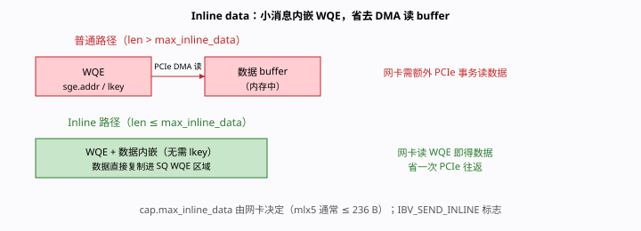

#### 使用方法

```c
/* 创建 QP 时声明最大 inline 容量（受硬件限制） */
qp_attr.cap.max_inline_data = 236;   /* mlx5 典型上限 */

/* post_send 时加 IBV_SEND_INLINE 标志（不需要 lkey） */
struct ibv_send_wr wr = { ... };
wr.send_flags = IBV_SEND_SIGNALED | IBV_SEND_INLINE;
```

注意 `rdma_post_send` 这个便捷封装没有直接的 inline 参数，需要回退到
`ibv_post_send` 手工构造 WR。

#### 调优建议（陷阱）

```bash
# 查询设备支持的最大 inline 大小
ibv_devinfo -v | grep max_inline
```

- 超过 `max_inline_data` 的 WR 设置 `IBV_SEND_INLINE` 会返回 `EINVAL`——所以
  上限要先查清楚再用。
- 控制面消息（64–128 B，本仓库 `control_message` = 80 B）是 inline 的理想候选。
- 大数据面传输（>1 KB）收益极小，不必 inline——数据本身的 DMA 才是大头，
  省那一次往返微不足道。

---

### 4. 批处理、链式 WR 与 SGE 聚合

**问题**：第 1 节摊薄了 CQE 开销，但每次 `ibv_post_send` 还各自敲一次 doorbell
（一次 MMIO 写，约 50–100 ns）。要发 1000 个 WR，难道就得敲 1000 次门铃？

**类比**：寄 10 个包裹，与其按 10 次呼叫按钮叫快递员来 10 趟，不如把 10 个
包裹串成一摞、按一次按钮让他一次取走。**链式 WR** 就是「把多个 WR 串成一摞，
一次 doorbell 全投递」；**SGE 聚合**则是「一个包裹里塞进散落各处的几样东西，
快递员打包时自动拼好」。

#### 批处理与链式 WR

每次 `ibv_post_send` 都会触发一次 doorbell MMIO 写（WC flush），代价约
50–100 ns。将多个 `ibv_send_wr` 通过 `wr.next` 链成链表，**一次 `ibv_post_send`
调用**即可投递整个链，只需一次 doorbell——doorbell 开销直接除以 batch 大小。

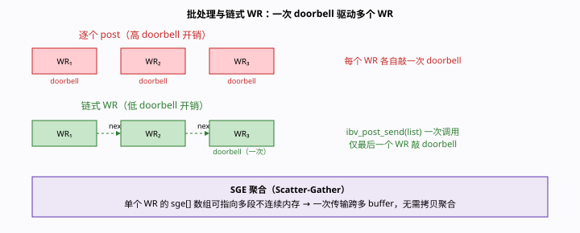

```c
struct ibv_send_wr wr[BATCH], *bad;
for (int i = 0; i < BATCH - 1; i++) {
    build_wr(&wr[i], ...);
    wr[i].send_flags = 0;           /* unsignaled */
    wr[i].next = &wr[i + 1];
}
build_wr(&wr[BATCH-1], ...);
wr[BATCH-1].send_flags = IBV_SEND_SIGNALED;
wr[BATCH-1].next = NULL;

ibv_post_send(qp, &wr[0], &bad);   /* 一次调用，一次 doorbell */
wait_send_comp(...);
```

注意这里和第 1 节的选择性 signaling **天然配合**：链中间的 WR 全部
unsignaled，只有链尾带 `IBV_SEND_SIGNALED`，且链尾 `next = NULL`。两个细节
缺一不可——忘了置 `NULL` 会让网卡顺着野指针往下读。

#### SGE 聚合（Scatter-Gather）

单个 WR 可携带 `sge[]` 数组，指向多段**不连续内存**，网卡在 DMA 时自动拼接。
`max_send_sge` 决定每个 WR 最多几个 SGE（通常 ≥ 16）。

```c
struct ibv_sge sge[2] = {
    { .addr = (uint64_t)hdr,  .length = hdr_len,  .lkey = hdr_mr->lkey  },
    { .addr = (uint64_t)body, .length = body_len, .lkey = body_mr->lkey },
};
wr.sg_list = sge;
wr.num_sge = 2;
```

这避免了为「拼包」而做的内存拷贝（比如把 header 和 body 复制到一段连续
buffer 再发），是 zero-copy RPC 框架的常用技巧。

---

### 5. 多 QP / 多核扩展与 NUMA 亲和

**问题**：前面的优化都在压单 QP 的每次操作开销。可单 QP 本质是串行的——前一个
WR 没完成就排队。要榨干一张 100Gb 网卡，靠一个 QP、一个核够吗？

**类比**：单 QP 像一条单车道——再优化红绿灯，车流上限也就那样。要提吞吐得
**修多条并行车道**（多 QP + 多核），而且每条车道最好都修在「离网卡近的那个
城区」（同一 NUMA 节点），否则车每次过桥（跨 NUMA）都要多花几十纳秒过路费。

#### 单 QP 的瓶颈

单 QP 本质上是串行的——前序 WR 完成才能继续。高吞吐需要多 QP 并行，
每个工作线程独享一组 QP + CQ，彻底消除锁竞争。

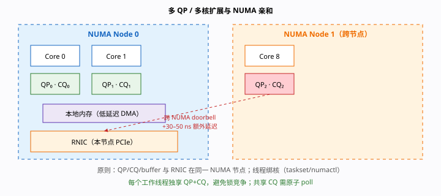

#### NUMA 亲和三原则

回忆第 10 章：跨 NUMA 的 doorbell 写会额外增加 30–50 ns，是 P99 抖动的常见
根源。要消除它，三件事都要对齐到 RNIC 所在的那个 NUMA 节点：

1. **找到 RNIC 所在 NUMA 节点**：`cat /sys/bus/pci/devices/<BDF>/numa_node`
2. **数据 buffer 在同节点分配**：`numa_alloc_onnode()` 或
   `numactl --membind=<node>`
3. **工作线程绑定到同节点 CPU**：`taskset -c <core>` 或 `pthread_setaffinity_np`

#### 多 QP 设计模式

```
模式 A：每线程独享 QP + CQ
    线程 0 → QP₀ + CQ₀   (无锁，最快)
    线程 1 → QP₁ + CQ₁

模式 B：共享 CQ + 各自 QP
    线程 0/1 → QP₀/QP₁ → 共享 CQ
    poll_cq 需加锁（或用原子 CAS）

模式 C（阶段四）：SRQ + 共享 CQ
    大量连接共享一个 RQ，节省内存
```

选型直觉：**生产推荐模式 A**（无锁、最快）；当连接数 > CPU 核数、再给每个
连接独享 QP+CQ 太浪费时，才考虑模式 B/C（用一点锁竞争或共享换取内存与
扩展性）。模式 C 的 SRQ 留到阶段四 / 后续章节细讲。

---

### 6. 基准方法学

**问题**：你做了一堆优化，怎么证明它真的快了、又快到了哪？「我跑了一次感觉
变快了」不是工程结论。

**类比**：测性能像称体重——只称一次说明不了什么，要在**固定时间、固定条件**
下多次测量看分布。而且你得先有一把**校准过的秤**（perftest）当参照，才知道
自己的程序离硬件极限还有多远。

#### perftest 校准流程

`perftest` 是社区标准的 RDMA 基准工具，把它的数字当作「这台硬件能达到的
上限参照」：

```bash
# 安装
dnf install -y perftest

# RDMA WRITE 带宽基线（双机）
ib_write_bw -d mlx5_0 -i 1              # server
ib_write_bw -d mlx5_0 -i 1 <server-ip> # client

# RDMA WRITE 延迟基线
ib_write_lat -d mlx5_0 -i 1
ib_write_lat -d mlx5_0 -i 1 <server-ip>

# SEND 延迟
ib_send_lat ...

# 关键参数
ib_write_bw ... -s 65536 -n 10000      # 消息大小 64 KB，10000 次迭代
ib_write_lat ... --output=percentiles   # 输出百分位数
```

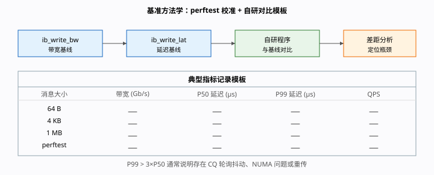

#### 自研程序对比 checklist

把 `examples/02-send-recv` 的 RTT 数字与 `ib_send_lat` 对比，差距大时逐项排查
（每一项都对应本章或第 10 章讲过的某个机理）：

| 检查项 | 命令 / 方法 |
|--------|------------|
| 是否跨 NUMA | `numactl --hardware` + `lstopo` |
| SQ 深度是否够 | `ibv_devinfo \| grep max_qp_wr` |
| 中断亲和性 | `/proc/irq/*/smp_affinity` |
| CPU 调速器 | `cpupower frequency-info` → 改 performance |
| 重传计数器 | `/sys/class/infiniband/mlx5_0/ports/1/counters/port_rcv_errors` |
| PCIe 带宽饱和 | `pcm-pcie` 或 `nvidia-smi dmon` |

#### 延迟解读：别只看平均值

```
P50  ≈ 理想路径延迟（无抖动）
P99  ≈ 抖动上限
P99 > 3 × P50  → 存在明显抖动，检查：
    - CQ 轮询不及时（缺 busy-poll 或批量 poll 不够大）
    - 重传（rnr_retry 触发、congestion）
    - NUMA 跨节点访问
    - OS jitter（NMI、timer、kthread）
```

一句话：报告性能要给 **P50 / P99 / 带宽** 三件套，单次测量或只报平均值都
是不可复现、会骗人的。

---

### 小结：五段式（原理 → API → 代码 → 性能 → 陷阱）

| 节 | 原理 | 核心 API / 参数 | 代码示例 | 性能收益 | 常见陷阱 |
|----|------|----------------|---------|---------|---------|
| 11.1 | 减少 CQE DMA 写次数 | `IBV_SEND_SIGNALED` · `sq_sig_all=0` | `fill_qp_attr` · `examples/06` | QPS 提升 N 倍 | flush 剩余 unsignaled WR |
| 11.2 | CPU 占用 vs 延迟折中 | `ibv_req_notify_cq` · `ibv_get_cq_event` | — | 延迟 vs 省电 | arm 后忘记再 poll 一次 |
| 11.3 | 省去小消息 DMA 读 | `IBV_SEND_INLINE` · `max_inline_data` | — | −20–50 ns | 超 limit 返回 EINVAL |
| 11.4 | 减少 doorbell 次数 | `wr.next` 链式 · `ibv_post_send(list)` | — | doorbell 开销 ÷ batch | 链尾 `next=NULL` 且 SIGNALED |
| 11.5 | 消除锁 + NUMA 延迟 | `taskset` · `numa_alloc_onnode` | — | P99 抖动减少 30–50 ns | buffer 跨 NUMA 分配 |
| 11.6 | 建立可重复的度量基线 | `ib_write_bw/lat` · `--output=percentiles` | `02-send-recv` | — | 单次测量 vs 统计百分位 |

---

### 术语速查

> 完整术语表见 [附录 A · 术语表与参考文献](appendix-附录.md#appendix-a)。

| 术语 | 含义 |
|------|------|
| **SQ / RQ** | 发送队列 / 接收队列，组成一个 QP |
| **CQ / CQE** | 完成队列 / 完成队列条目，poll_cq 取出结果 |
| **WR / WQE** | 工作请求 / 其在硬件队列中的存储形式 |
| **SGE** | Scatter/Gather 元素 `{addr, length, lkey}`，一个 WR 可含多个 |
| **Doorbell** | MMIO 通知 NIC 新 WQE；批处理可合并多次 doorbell |
| **IMM** | 立即数，随 SEND/WRITE_WITH_IMM 携带的 32 位通知 |
| **Credit** | 流控信用，确保对端 RQ 有足够预投递 WR |
| **NUMA** | 非一致内存访问，QP/MR/线程应绑定同一 NUMA 节点 |

---

<a id="ch12"></a>

## 第 12 章 · 可扩展架构

> 前面的章节里，我们的程序始终只有"两个进程、一条连接"。那是理解 RDMA 语义的
> 最佳起点，却离真实服务端很远。一台 RDMA 服务器往往要同时面对成千上万个客户端。
> 本章要回答的核心问题是：**当连接数从 1 涨到 10000，原来那套写法会在哪里崩溃，
> 又该如何重构？**

---

### 本章你将遇到的术语（预览）

下面这些名词会在本章反复出现，这里先各给一句"直觉版"解释，正文里再展开。

| 术语 | 一句话直觉 |
|------|-----------|
| **SRQ** | 让很多 QP 共用一个接收队列，接收缓冲内存不再随连接数膨胀 |
| **CQ / CQE** | 完成队列 / 完成事件；共享一个 CQ 时靠 `wr_id`、`qp_num` 认领归属 |
| **QP / QPN** | 队列对 / 它那个 24 位的唯一编号，建连时双方互相告知 |
| **PSN** | 包序列号，建连时双方各报一个随机起始值 |
| **GID** | 128 位全局地址，RoCE 下由 MAC/IP 派生，类似"网络层地址" |
| **AH** | 地址句柄，UD 发送时用来说明"这一发要寄给谁" |
| **RC / UC / UD** | 三种传输类型，扩展性 UD > DC > RC |
| **DC / DCT / DCI** | 动态连接 / 目标端 / 发起端，用来缓解 N² 个 QP 的爆炸 |
| **XRC** | 扩展可靠连接，纯标准 RoCE 下用来替代私有的 DC |

> 完整术语表见 [附录 A · 术语表与参考文献](appendix-附录.md#appendix-a)。

---

### 引子：两进程 demo 撑不起一万个连接

回想我们之前的程序结构：一个 QP、一个 CQ、几块 MR，靠 `rdma_cm` 帮我们把连接
和 QP 一手包办。这套结构在连接数是 1 的时候清爽无比，但只要把它原样复制 N 份，
四个瓶颈会接连冒出来：

1. 每个 QP 都要单独喂饱自己的接收队列 → **接收缓冲内存随连接数线性膨胀**；
2. 每个 QP 配一个 CQ、配一个轮询线程 → **CPU 线程数随连接数线性膨胀**；
3. `rdma_cm` 一次建一条连接，万级建连时不够灵活 → **需要更可控的批量建连**；
4. RC 是点对点的，N 个节点两两互联就要 N² 个 QP → **QP 数量爆炸**。

本章四节正是逐一拆解这四个瓶颈：SRQ 解决内存、共享 CQ 解决线程、手工 QP 状态机
解决建连、UD/DC 解决 QP 爆炸。

---

### 12.1 SRQ（Shared Receive Queue）：让接收缓冲不再按连接数膨胀

> 🛠 可运行示例：[examples/07-srq/](../../examples/07-srq/)
> ——两个客户端连接共享一个 SRQ，用 `wc.qp_num` 区分来源。

#### 问题：每个 QP 各养一支接收队列，太奢侈了

先看一个直觉。RC 连接里，发送方要 SEND 一条消息，**接收方必须事先在自己的接收
队列（RQ）里放好一个空缓冲**等着接，否则对端会撞上 RNR（Receiver Not Ready，
"收方没准备好"）错误。这就像快递必须有人在家签收：你得提前安排人手。

一个 QP 安排几个"签收名额"还好，可如果有 1000 个 QP，每个都要预投递 N 个 WR
（Work Request，一次接收请求），内存就是 `1000 × N` 份。更尴尬的是，这些缓冲
绝大多数时刻都在"空等"——名额开了一大堆，真正来快递的没几个。

#### 机理：把所有接收队列合并成一个共享池

**SRQ（Shared Receive Queue，共享接收队列）** 的思路非常朴素：与其每家都雇一个
签收员，不如整栋楼共用一个收发室。多个 QP 不再各自维护 RQ，而是共享同一个接收
WR 池：

- 内存从 `QP数 × N` 降为固定的 `N`，**无论有多少个 QP**；
- 任意 QP 收到消息时，NIC 从 SRQ 里取一个 WR 来用，完成后在 CQ 产生一个 CQE，
  其中 `wc.qp_num` 标明"这条是哪个 QP 收到的"；
- 预投递改由应用统一管理：调用 `ibv_post_srq_recv`，而不是各 QP 自己的
  `ibv_post_recv`。

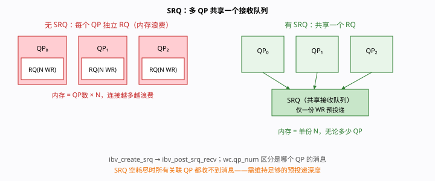

#### API 与代码

```c
// 创建 SRQ
struct ibv_srq_init_attr srq_attr = {
    .attr = { .max_wr = 1024, .max_sge = 1 }
};
struct ibv_srq *srq = ibv_create_srq(pd, &srq_attr);

// 预投递到 SRQ（而非某个 QP）
struct ibv_sge sge = { .addr = (uint64_t)buf, .length = buf_len, .lkey = mr->lkey };
struct ibv_recv_wr wr = { .wr_id = (uint64_t)buf, .sg_list = &sge, .num_sge = 1 };
struct ibv_recv_wr *bad;
ibv_post_srq_recv(srq, &wr, &bad);

// 创建 QP 时绑定 SRQ
struct ibv_qp_init_attr qp_attr = { .srq = srq, ... };
struct ibv_qp *qp = ibv_create_qp(pd, &qp_attr);
```

配套示例 [`examples/07-srq/`](../../examples/07-srq/) 把这套流程做成了可运行版本：
服务端建一个 SRQ，两个客户端连接共享它，服务端用 `wc.qp_num` 区分 A、B 两条
消息。注意示例 README 里强调的几个落地细节：用 SRQ 时**必须手工
`rdma_create_qp`** 并把 `qp_init_attr.srq` 指向 SRQ，不能再用 `rdma_create_ep`
的自动 QP；所有 QP、SRQ、MR 必须在**同一个 PD** 下；绑定 SRQ 的 QP，其
`cap.max_recv_wr` 由 SRQ 决定，建 QP 时无需设置。

#### 陷阱

SRQ 是共享的，所以一旦它**被取空**，所有关联 QP 都会同时"收不到消息"（静默撞
RNR），影响面比单 QP 大得多。因此必须持续补投递、维持足够的水位深度。配套工具：
`ibv_get_srq_num` 取得 SRQ 编号便于对端识别；`ibv_modify_srq` 可动态调整
`srq_limit`，在余量低于阈值时触发"低水位事件"提醒你补货。

---

### 12.2 共享 CQ + 单线程事件循环：让轮询线程不再按连接数膨胀

#### 问题：每个 QP 配一个 CQ、一个线程，CPU 扛不住

解决了内存，再看 CPU。传统写法每个 QP 配一个 CQ，于是你得为每个 CQ 安排轮询。
连接一多，要么开等比例的线程去轮询（线程数随连接数线性增长），要么一个线程轮询
一大堆 CQ（轮询开销同样线性增长）。无论哪种，CPU 都会被连接数拖垮。

#### 机理：所有 QP 的完成事件汇入同一条流水线

**共享 CQ** 把所有 QP 的完成事件汇入同一个完成队列，由一个线程统一收割、分发：

- 创建 CQ 时，`cq_size` 要按最坏情况（所有 QP 同时完成）来估，免得溢出；
- 每个 CQE 都自带 `wr_id`（应用自定义，可塞上下文指针）和 `qp_num`，足以让你
  反查"这是谁的哪一次操作"；
- 这套结构适合"**高连接数、中低 QPS**"的场景；如果 QPS 极高，单线程会成为瓶颈，
  那时应改为按 CPU 核分片（见第三阶段性能工程 3.5）。

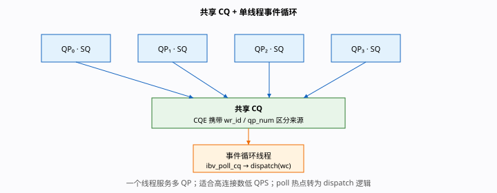

#### 代码

```c
// 一个 CQ 服务 N 个 QP
struct ibv_cq *cq = ibv_create_cq(ctx, CQ_DEPTH, NULL, NULL, 0);

// 所有 QP 创建时指定同一个 send_cq / recv_cq
struct ibv_qp_init_attr attr = {
    .send_cq = cq,
    .recv_cq = cq,
    ...
};

// 事件循环
void event_loop(struct ibv_cq *cq) {
    struct ibv_wc wc[32];
    while (running) {
        int n = ibv_poll_cq(cq, 32, wc);
        for (int i = 0; i < n; i++) {
            if (wc[i].status != IBV_WC_SUCCESS) handle_error(&wc[i]);
            else dispatch(&wc[i]);   // 按 wr_id / qp_num 分发
        }
    }
}
```

#### 进阶：和事件通知结合，省掉空转 CPU

纯忙轮询在连接很多但大多数空闲时很浪费 CPU。这时把 `ibv_req_notify_cq` +
`ibv_get_cq_event` 用上，让线程在没有完成事件时睡眠、有事件再被唤醒，可大幅降低
空闲 CPU 占用（参见第三阶段 3.2 的混合策略）。

---

### 12.3 连接管理规模化：手工 QP 状态机

#### 问题：`rdma_cm` 很省心，但不够"可控"

`rdma_cm` 像 socket API 一样，把 QP 的状态迁移全替你做了，写起来很爽。但当你
需要精细控制建连细节，或者要在极短时间内批量建立海量连接时，这层封装反而碍事。
这时常见的做法是：**用一条普通的带外 TCP 连接交换元数据，再自己手工调用
`ibv_modify_qp` 把 QP 一步步推到可用状态**。

#### 机理：QP 是个状态机，必须按顺序爬台阶

一个新建的 QP 出厂状态是 **RESET**，它不能直接干活，必须严格按顺序迁移：

```
RESET → INIT → RTR（Ready To Receive）→ RTS（Ready To Send）
```

可以把它想成一台机器的开机自检流程：通电（INIT）→ 准备好收（RTR）→ 准备好发
（RTS），每一步都要填好对应的"配置表单"，缺一项都过不去。每步调用一次
`ibv_modify_qp`，并通过掩码告诉它"这次我要改哪些字段"。

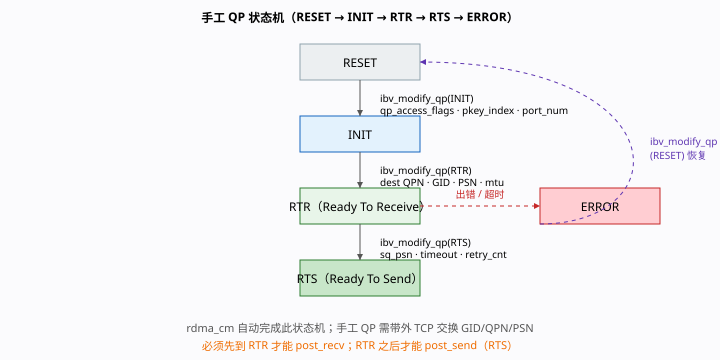

```c
// 1. RESET → INIT
struct ibv_qp_attr attr = {
    .qp_state        = IBV_QPS_INIT,
    .pkey_index      = 0,
    .port_num        = port,
    .qp_access_flags = IBV_ACCESS_REMOTE_WRITE | IBV_ACCESS_REMOTE_READ,
};
ibv_modify_qp(qp, &attr,
    IBV_QP_STATE | IBV_QP_PKEY_INDEX | IBV_QP_PORT | IBV_QP_ACCESS_FLAGS);

// 2. INIT → RTR（需对端 QPN / GID / PSN，通过带外 TCP 交换）
attr.qp_state              = IBV_QPS_RTR;
attr.path_mtu              = IBV_MTU_4096;
attr.dest_qp_num           = remote_qpn;
attr.rq_psn                = remote_psn;
attr.max_dest_rd_atomic    = 16;
attr.min_rnr_timer         = 12;
attr.ah_attr.is_global     = 1;
attr.ah_attr.grh.dgid      = remote_gid;
attr.ah_attr.grh.hop_limit = 64;
attr.ah_attr.dlid          = 0;  // RoCE 下不用 LID
attr.ah_attr.port_num      = port;
ibv_modify_qp(qp, &attr,
    IBV_QP_STATE | IBV_QP_PATH_MTU | IBV_QP_DEST_QPN | IBV_QP_RQ_PSN |
    IBV_QP_MAX_DEST_RD_ATOMIC | IBV_QP_MIN_RNR_TIMER | IBV_QP_AV);

// 3. RTR → RTS
attr.qp_state      = IBV_QPS_RTS;
attr.timeout       = 14;   // ~67 ms
attr.retry_cnt     = 7;
attr.rnr_retry     = 7;    // 无限重试
attr.sq_psn        = local_psn;
attr.max_rd_atomic = 16;
ibv_modify_qp(qp, &attr,
    IBV_QP_STATE | IBV_QP_TIMEOUT | IBV_QP_RETRY_CNT |
    IBV_QP_RNR_RETRY | IBV_QP_SQ_PSN | IBV_QP_MAX_QP_RD_ATOMIC);
```

#### 关键约束（爬台阶时容易摔的几处）

- 必须先到 **RTR** 才能 `ibv_post_recv`（否则没有接收上下文，投了也无处安放）。
- 必须到 RTR 之后、再到 RTS 之后，才能 `ibv_post_send`。
- QP 一旦进入 **ERROR** 态，要先 `ibv_modify_qp(RESET)` 重置，再重走上面整套流程。
- 带外元数据通常用普通 TCP socket 交换，内容就是一组 `{ qpn, psn, gid, lid }`。

---

### 12.4 UD / DC：一对多与连接爆炸

#### 问题：N 个节点两两互联，要 N² 个 QP

RC 的可靠是有代价的：它是**点对点**的，一个 QP 只对应一个对端。万节点集群做
All-to-All 通信时，连接数是 N²——10000 个节点就是上亿个 QP，光是这些 QP 占用的
内存和 NIC 缓存就足以压垮系统。我们需要"一个 QP 能对多个目标说话"的能力。

#### UD（Unreliable Datagram）：一个 QP 广播给所有人

UD（不可靠数据报）传输类型下，**单个 QP 可向任意多个目标发送**，不必为每对关系
建一个 QP。代价是它像 UDP 一样"不可靠"：

- 每条 SEND 都附带一个 **AH（Address Handle，地址句柄）**，指定目标 GID/LID/SL，
  相当于每封信单独写收件地址；
- 仅支持 SEND，**没有 WRITE/READ**；
- 不保证顺序、不重传、消息可能丢失（这就是"不可靠"的含义）；
- 单条消息大小不能超过一个 MTU（典型 4096 字节）；
- 接收方可从 `wc.src_qp` 得知发送方的 QPN。

```c
// 创建 UD QP
struct ibv_qp_init_attr attr = { .qp_type = IBV_QPT_UD, ... };

// 发送时指定 Address Handle
struct ibv_send_wr wr = {
    .opcode = IBV_WR_SEND,
    .wr.ud.ah       = ah,          // ibv_create_ah() 创建
    .wr.ud.remote_qpn  = dest_qpn,
    .wr.ud.remote_qkey = QKEY,
};
```

#### DC（Dynamic Connected）：既要可靠，又要一对多

如果既想要 RC 的可靠语义（WRITE/READ），又想要 UD 的扩展性，怎么办？DC（动态
连接，Mellanox/NVIDIA 的私有扩展）就是为此而生：

- **DCT（DC Target，目标端）**：被动接受方，相当于"监听端"；
- **DCI（DC Initiator，发起端）**：主动发起方，每次操作时动态连接到不同的 DCT；
- NIC 内部维护一个连接缓存（类似 TLB），自动复用已有连接，整个过程对应用透明；
- 万节点 All-to-All 场景下，本来要 N² 对连接，用 DC 只需 N 个 DCI 加 N 个 DCT。

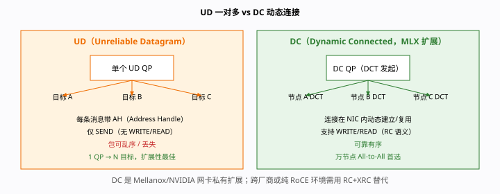

#### 三种传输类型如何取舍

| 维度 | UD | DC | RC |
|------|----|----|-----|
| 可靠性 | 无 | 有（RC 语义） | 有 |
| 操作 | SEND only | WRITE/READ/SEND | 全集 |
| 扩展性 | 最佳（1 QP→N） | 优秀（NIC 内动态） | 差（N² QP） |
| 可用性 | 全厂商 | 仅 Mellanox/NVIDIA | 全厂商 |
| 适用场景 | 控制面广播 | HPC All-to-All | 点对点数据面 |

> DC 是 Mellanox ConnectX 网卡的私有功能（需 `IBV_EXP_*` 实验性 API 或 DOCA
> SDK）；如果你的环境跨厂商或是纯标准 RoCE，就需要用 **RC + XRC**（扩展可靠
> 连接）来替代 DC。

---

### 小结

> 下面这张"原理 → API → 代码 → 性能 → 陷阱"五段式表，方便日后快速回顾本章。

| 维度 | 要点 |
|------|------|
| **原理** | 高连接数的两大瓶颈：RQ 内存（SRQ 解决）、CQ 线程（共享 CQ 解决）；连接建立成本（手工状态机批量化）；QP 数爆炸（UD/DC 解决） |
| **API** | `ibv_create_srq` / `ibv_post_srq_recv`；共享 `send_cq/recv_cq`；`ibv_modify_qp` 三步迁移；UD AH + `IBV_QPT_UD` |
| **代码** | SRQ 与 QP 在同一 PD 下创建；CQ 大小按峰值并发 WR 估算；带外 TCP 交换 `{qpn, psn, gid}` |
| **性能** | SRQ 将 RQ 内存从 O(连接数) 降到 O(1)；共享 CQ 将轮询线程从 O(连接数) 降到 O(1)；DC 将 QP 数从 O(N²) 降到 O(N) |
| **陷阱** | SRQ 耗尽静默丢包；QP 未到 RTR 就 post_recv 报错；ERROR 态 QP 须 RESET 后重建；UD 消息含 40B GRH 头需在 RQ 预留额外空间 |

---

### 术语速查

| 术语 | 含义 |
|------|------|
| **SRQ** | 共享接收队列，多 QP 共用一个 RQ，内存降为 O(1) |
| **CQ / CQE** | 完成队列；共享 CQ 用 `wr_id`/`qp_num` 区分来源 |
| **QP / QPN** | 队列对 / 其 24 位唯一编号，建连时交换 |
| **PSN** | 包序列号，建连双方交换初始值（随机起始）|
| **GID** | 128 位全局标识符，RoCE 下由 MAC/IP 派生 |
| **AH** | 地址句柄，UD SEND 须指定目标地址 |
| **RC / UC / UD** | 三种传输类型，扩展性 UD > DC > RC |
| **DC / DCT / DCI** | 动态连接 / 目标端 / 发起端，缓解 N² QP |
| **XRC** | 扩展可靠连接，纯标准 RoCE 下 DC 的替代方案 |

> 完整术语表见 [附录 A · 术语表与参考文献](appendix-附录.md#appendix-a)。

---

<a id="ch13"></a>

## 第 13 章 · 可靠性与生产化

> 到目前为止，我们的程序都假设"一切顺利"：连接建好、消息送达、操作成功。可一旦
> 把 RDMA 程序丢进真实数据中心，网络会拥塞、对端会来不及接收、链路会抖动、进程
> 会 fork、内存会被回收。本章要回答的问题是：**当事情出错时，RDMA 会怎么表现，
> 我们又该如何探知、恢复，并避免那些静默到让人抓狂的坑？**

---

### 本章你将遇到的术语（预览）

| 术语 | 一句话直觉 |
|------|-----------|
| **WC / CQE** | 工作完成 / 完成事件；它的 `wc.status` 是你判断成败的唯一依据 |
| **ACK** | RC 下接收方 NIC 自动回发的"收到了"确认包 |
| **RNR** | Receiver Not Ready，对端接收队列空时回的"我没准备好" |
| **PSN** | 包序列号，用来检测乱序、驱动重传 |
| **PFC** | 优先级流控，用 PAUSE 帧防丢包，副作用是队头阻塞 |
| **ECN** | 显式拥塞通知，交换机打标记代替丢包 |
| **CNP** | 拥塞通知包，接收方回送它来让发送方降速 |
| **DCQCN** | RoCEv2 的拥塞控制算法：ECN + CNP + 乘性降速/加性恢复 |
| **PD** | 保护域，销毁资源时必须遵守它牵出的依赖顺序 |

> 完整术语表见 [附录 A · 术语表与参考文献](appendix-附录.md#appendix-a)。

---

### 引子：可靠 ≠ 不会出错

很多人初学时有个误解：RC 是"可靠连接"，那是不是就万事大吉了？并不是。RC 保证的
是"消息要么按序送达，要么明确告诉你失败了"——它**不会替你解决拥塞、不会替你准备
接收缓冲、更不会替你管理内存生命周期**。生产化的 RDMA 程序，恰恰是在这些"可靠"
覆盖不到的地方栽跟头。本章分四节：怎么读懂错误完成、怎么调重传参数、怎么治理
拥塞、怎么不让资源泄漏。

---

### 13.1 错误完成处理：读懂第一个真错误，忽略后续的冲刷

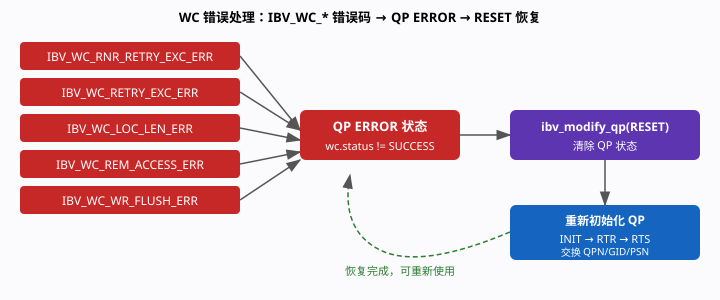

#### 问题：操作"失败"了，但失败信息藏在哪？

RDMA 是异步的，你 post 出去就返回了，真正成败要从 CQ 里 poll 出来的那个完成事件
（WC）里读。关键纪律只有一条：**每次 poll 出 WC，都要检查 `wc.status`**。它等于
`IBV_WC_SUCCESS` 才算成功，否则就是出了问题——而具体是什么问题，全写在状态码里。

#### 常见错误码速查

| 错误码 | 含义 | 常见原因 |
|--------|------|----------|
| `IBV_WC_RNR_RETRY_EXC_ERR` | RNR 重试次数耗尽 | 对端 RQ 空（未及时 post_recv） |
| `IBV_WC_RETRY_EXC_ERR` | 通用重试次数耗尽 | 链路故障、对端宕机、超时 |
| `IBV_WC_LOC_LEN_ERR` | 本地长度错误 | SGE 长度超过 MR 大小 |
| `IBV_WC_REM_ACCESS_ERR` | 远端访问权限错误 | rkey 无效或权限不足（无 REMOTE_WRITE/READ） |
| `IBV_WC_WR_FLUSH_ERR` | WR 被冲刷 | QP 已处于 ERROR 状态时投递的 WR |

#### QP 进入 ERROR 状态：分清"真凶"和"陪葬"

这里有一个最容易让人误判的机制。任何一次操作只要完成时 `wc.status != IBV_WC_SUCCESS`，
对应的那个 QP 就会立刻跌入 **ERROR** 状态。此后，队列里所有还没完成的 WR 都会以
`WR_FLUSH_ERR` 完成——这是"冲刷"清场动作，**不是新的独立错误**。

打个比方：一条流水线上某个工件出了致命缺陷，整条线急停，后面排队的半成品全部被
当场报废。报废的那些不是"又出了 N 个故障"，它们只是被那一个真故障连累。所以排错
时务必认准：**真正的错误是第一个非 SUCCESS 的 CQE**，后面一串 FLUSH 只是陪葬，
统计即可，不要当成新问题去追。

```c
struct ibv_wc wc;
while (ibv_poll_cq(cq, 1, &wc) > 0) {
    if (wc.status != IBV_WC_SUCCESS) {
        if (wc.status == IBV_WC_WR_FLUSH_ERR) {
            /* QP 已出错，正在冲刷队列，忽略或统计 */
            continue;
        }
        fprintf(stderr, "WC error: %s (vendor_err=0x%x)\n",
                ibv_wc_status_str(wc.status), wc.vendor_err);
        /* 触发 QP 恢复流程 */
    }
}
```

#### QP 恢复：跌倒了得从头爬

QP 一旦进 ERROR，就再也不能直接用了，必须走完整的状态机重置（与第 12 章手工建连
同一套台阶）才能复用：

```c
/* 1. 重置到 RESET */
struct ibv_qp_attr attr = { .qp_state = IBV_QPS_RESET };
ibv_modify_qp(qp, &attr, IBV_QP_STATE);

/* 2. RESET → INIT */
attr.qp_state   = IBV_QPS_INIT;
attr.pkey_index = 0;
attr.port_num   = port;
attr.qp_access_flags = IBV_ACCESS_REMOTE_WRITE | IBV_ACCESS_REMOTE_READ;
ibv_modify_qp(qp, &attr,
    IBV_QP_STATE | IBV_QP_PKEY_INDEX | IBV_QP_PORT | IBV_QP_ACCESS_FLAGS);

/* 3. INIT → RTR（需重新交换 QPN/GID 等信息） */
/* 4. RTR → RTS */
/* ... 与初始化时相同 ... */
```

> **生产建议**：把 QP 的生命周期封装成一个状态机；出错时**先把 CQ 排空**（poll
> 到再无 CQE 为止），再做 RESET，避免遗留的 CQE 污染下一轮操作。

---

### 13.2 重传与超时：在"快速失败"和"扛抖动"之间拨刻度

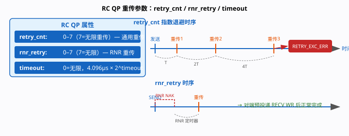

#### 问题：丢一个包就放弃，还是死等？

RC QP 内置了重传机制——发出去的包等不到 ACK（接收方 NIC 自动回发的确认包）就重发。
但"重发几次""每次等多久"不是写死的，由三个参数控制。调这三个旋钮，本质是在两个
极端之间找平衡：调得太激进，偶尔的网络抖动就被当成故障上报；调得太宽容，对端真挂
了你还在傻等。

#### retry_cnt —— 通用重传计数

```c
attr.retry_cnt = 7;   /* 0–7，7 = 无限重传 */
```

发送方等不到 ACK（超时）就重传，最多重 `retry_cnt` 次，超了就报 `RETRY_EXC_ERR`。
重传间隔由下面的 `timeout` 决定，且**每次翻倍**（指数退避）。

- **数据中心**：设 `retry_cnt=7`（实际意味着无限），依赖 PFC 把丢包从根上掐掉，
  正常情况下根本不会真触发重传。
- **WAN / 有损网络**：设小一点（3–5），好让故障尽早暴露、快速上报。

#### rnr_retry —— RNR 重传计数

```c
attr.rnr_retry = 7;   /* 0–7，7 = 无限 */
```

**RNR（Receiver Not Ready）** 指对端的接收队列里没有预投递的 RECV WR。RC 协议
允许发送方收到 RNR NAK 后，等一段时间（这段时间由**对端**的 `min_rnr_timer` 决定）
再重试，最多重 `rnr_retry` 次，超了报 `RNR_RETRY_EXC_ERR`。

> 避免 RNR 的根本办法是：让接收队列里始终备着足够的 RECV WR。第 12 章讲的 SRQ
> （共享接收队列）能在多 QP 场景下显著减轻这份接收管理负担。

#### timeout —— 本地 ACK 超时

```c
attr.timeout = 14;  /* 单位：4.096µs × 2^timeout */
                    /* timeout=14 ≈ 67ms */
```

公式是 `T = 4.096µs × 2^timeout`，这是个指数刻度，几档常用值如下：

| timeout 值 | 超时时间 |
|-----------|---------|
| 0 | 无限（禁用） |
| 8 | ~1ms |
| 14 | ~67ms |
| 17 | ~536ms |
| 21 | ~8.5s |

**数据中心推荐组合**：`timeout=14`，`retry_cnt=7`，`rnr_retry=7`。

---

### 13.3 拥塞控制：无损以太网的两层防御

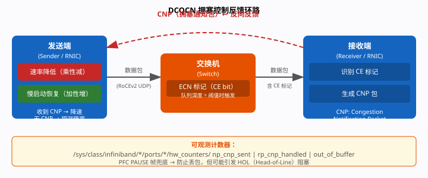

#### 问题：RoCEv2 跑在以太网上，可它最怕丢包

RDMA over Converged Ethernet（RoCEv2）把 RDMA 搬到了普通以太网上，但它的重传机制
对丢包很敏感——一旦拥塞导致丢包，性能会断崖式下跌。所以 RoCEv2 依赖**无损以太网**，
拥塞控制分两层来防御：底层用 PFC 兜底"绝不丢包"，上层用 ECN/DCQCN 主动"提前降速"。

#### PFC（Priority Flow Control）—— 无损传输的地基

PFC 是 IEEE 802.1Qbb 标准。当交换机某个端口快被塞满时，它向上游发 **PAUSE 帧**，
让上游暂停发送特定优先级的流量，从而避免溢出丢包。这就像高速收费站快堵死时，直接
拉起栏杆让后面的车先别过来。

但它有个著名副作用——**HOL（Head-of-Line，队头）阻塞**：PFC 是按优先级（per-priority）
粒度暂停的，同一优先级里的不同流会相互连累。一条慢流就能把整个优先级队列卡住，殃及
本来毫不相干的其他流。

#### ECN（Explicit Congestion Notification）—— 主动通知，不靠丢包

PFC 是粗暴的"急刹"，ECN 则温和得多。交换机发现队列深度超过阈值时，不丢包，而是在
数据包的 IP 头打上一个 **CE（Congestion Experienced，遭遇拥塞）** 标记。接收方看到
CE 标记，就回送一个 **CNP（Congestion Notification Packet，拥塞通知包）** 给发送方，
等于轻轻提醒一句"前面有点堵，您慢点"。

#### DCQCN 算法

DCQCN（Data Center Quantized Congestion Notification）是 RoCEv2 的标准拥塞控制
算法，把上面的信号变成具体的速率调整动作：

1. **速率降低**：收到 CNP → 乘性减小发送速率（类似 TCP AIMD 里的 MD 部分，一脚收油）。
2. **慢启动恢复**：一段时间没再收到 CNP → 加性增大速率，慢慢试探还有多少带宽可用。
3. **快速恢复**：连续很久都没 CNP，超过阈值 → 切到快速恢复模式，更激进地把速率拉回来。

#### 可观测计数器（排查时怎么看）

```bash
# 查看硬件拥塞计数器
ls /sys/class/infiniband/mlx5_0/ports/1/hw_counters/

# 关键指标
cat /sys/class/infiniband/mlx5_0/ports/1/hw_counters/np_cnp_sent      # 本机作为通知点(NP)发出的 CNP 数
cat /sys/class/infiniband/mlx5_0/ports/1/hw_counters/rp_cnp_handled   # 本机作为反应点(RP)收到并降速的 CNP 数
cat /sys/class/infiniband/mlx5_0/ports/1/hw_counters/out_of_buffer    # 接收端无可用 RQ/SRQ WR 的丢包数（RNR 类）

# PFC pause 计数（注意：与 out_of_buffer 无关）需看以太网侧计数器：
ethtool -S eth0 | grep -E 'rx_pause|tx_pause|prio.*pause'

# 使用 perfquery 查看端口计数器
perfquery -x <lid>
```

这里有个**极易踩的认知陷阱**，务必记牢：`out_of_buffer` 统计的是"接收端没有可用
接收 WR 而丢的包"，属于 **RNR 类**问题，**它和 PFC 触发次数毫无关系**。真正的 PFC
pause 计数要去**以太网侧**看，也就是上面 `ethtool -S` 里的 `rx_pause`/`tx_pause`/
`prio.*pause`。把 `out_of_buffer` 当成 PFC 指标，会让你的拥塞排查彻底跑偏。

> **调优建议**：在交换机侧启用 ECN + DCQCN 做主力，PFC 只作兜底，而且**只在 RDMA
> 所在的那个 priority 上开**。千万别开全局 PFC，否则 HOL 阻塞会蔓延到非 RDMA 流量上。

---

### 13.4 资源生命周期与泄漏排查

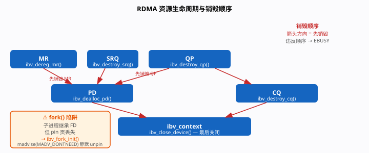

#### 问题：RDMA 资源不是 free 一下就完事

RDMA 的对象之间有父子依赖：MR 依附于 PD，QP 依附于 CQ 和 PD……它们不像普通堆内存
那样随手释放就行。销毁顺序错了，你会撞上 `EBUSY`；该解绑的没解绑，物理内存可能被
内核悄悄回收，留下一个看起来"有效"实则失效的 MR——这类静默错误最折磨人。

#### 正确的销毁顺序：从子到父

资源**必须按与创建相反的顺序销毁**（先拆子，再拆父）：

```
销毁顺序（从子到父）：
  MR       → 先于 PD 销毁
  QP       → 先于 CQ、PD 销毁
  SRQ      → 先于 PD 销毁
  CQ       → 先于 ibv_context 销毁
  PD       → 先于 ibv_context 销毁
  ibv_context → 最后关闭（ibv_close_device）
```

```c
/* 正确的清理顺序示例 */
if (ctx->mr)  { ibv_dereg_mr(ctx->mr);    ctx->mr  = NULL; }
if (ctx->qp)  { ibv_destroy_qp(ctx->qp);  ctx->qp  = NULL; }
if (ctx->srq) { ibv_destroy_srq(ctx->srq); ctx->srq = NULL; }
if (ctx->cq)  { ibv_destroy_cq(ctx->cq);  ctx->cq  = NULL; }
if (ctx->pd)  { ibv_dealloc_pd(ctx->pd);  ctx->pd  = NULL; }
if (ctx->ctx) { ibv_close_device(ctx->ctx); ctx->ctx = NULL; }
```

违反顺序会得到 `EBUSY`：子资源还活着时，父资源拒绝被销毁。

#### fork() 陷阱：子进程会踩到失效的内存映射

```c
/* 必须在 ibv_open_device 之前调用 */
ibv_fork_init();

pid_t pid = fork();
if (pid == 0) {
    /* 子进程：FD 已继承，但 pin 住的物理页映射已失效！
     * 不调用 ibv_fork_init() 的后果：子进程访问已注册内存 → 段错误或数据损坏 */
}
```

`ibv_fork_init()` 会用 `mmap(MAP_ANONYMOUS|MAP_PRIVATE)` 把注册内存重映射一遍，
使 `fork()` 的写时复制（COW）机制对 RDMA 内存安全。也可以用环境变量等效开启：

```bash
export RDMAV_FORK_SAFE=1   # 等价于程序内调用 ibv_fork_init()
```

#### madvise(MADV_DONTNEED)：静默 unpin 的暗雷

```c
/* 危险！静默解除内存 pin */
madvise(mr->addr, mr->length, MADV_DONTNEED);
/* 内核可能回收物理页，但 ibv_mr 仍然"有效"
 * 后续 RDMA 操作将导致 REM_ACCESS_ERR 或数据损坏 */
```

已注册 MR 的内存，**禁止**对其调用 `madvise(MADV_DONTNEED)` 或 `madvise(MADV_FREE)`。
内核会以为这块内存不要了而回收物理页，可 `ibv_mr` 句柄还在、看起来一切正常，等到
真正 DMA 时就炸成 `REM_ACCESS_ERR` 或数据损坏。要释放内存，必须先 `ibv_dereg_mr()`。

#### 泄漏排查工具箱

```bash
# 1. valgrind（检测用户态内存泄漏）
valgrind --leak-check=full ./rdma_server 192.168.1.1 7471

# 2. 查看内核侧资源（每个进程）
ls /proc/<pid>/fd/ | wc -l          # FD 数量（rdma_cm 每个 endpoint 占 1 个）

# 3. rdma-core 调试环境变量
export IBV_SHOW_WARNINGS=1           # 打印 libibverbs 警告
export RDMAV_FORK_SAFE=1

# 4. 查看系统级 MR/QP 统计
cat /sys/class/infiniband/mlx5_0/ports/1/counters/port_rcv_errors
rdma res show mr                     # 列出系统所有 MR（需 iproute2-rdma）
rdma res show qp                     # 列出系统所有 QP
```

---

### 小结

> 五段式复习表，方便日后回顾本章。

| 维度 | 要点 |
|------|------|
| **原理** | RC 内置重传非万能；拥塞控制靠 PFC（兜底防丢包）+ ECN/DCQCN（主动降速）分层防御；RDMA 资源有严格依赖层次与销毁顺序 |
| **API** | `ibv_wc_status_str()` 解析错误；`ibv_modify_qp(RESET)` 后重建；`ibv_fork_init()`/`RDMAV_FORK_SAFE=1`；`/sys/.../hw_counters/` 观测 |
| **代码** | 每次 poll_cq 必检 `wc.status`；首个真实错误后批量忽略 `WR_FLUSH_ERR`；销毁顺序 QP→SRQ→MR→CQ→PD→context 写成辅助函数 |
| **性能** | PFC pause 引入尾延迟毛刺；DCQCN 降速后恢复慢，需按 `np_cnp_sent` 频率调 ECN 阈值；retry/timeout 调参平衡快速失败与抗抖动 |
| **陷阱** | `out_of_buffer` ≠ PFC 计数；fork 前必须 `ibv_fork_init`；已注册内存禁用 `madvise(MADV_DONTNEED)`；`timeout=0`+`retry_cnt=0` 会永久挂起 |

---

### 术语速查

| 术语 | 含义 |
|------|------|
| **WC / CQE** | 工作完成；`wc.status` 必须检查 |
| **ACK** | RC 下接收方 NIC 自动回发的确认包 |
| **RNR** | Receiver Not Ready，对端 RQ 空时返回的 NAK |
| **PSN** | 包序列号，用于乱序检测与重传 |
| **PFC** | 优先级流控，PAUSE 帧防丢包，副作用是 HOL 阻塞 |
| **ECN** | 显式拥塞通知，交换机打 CE 标记不丢包 |
| **CNP** | 拥塞通知包，接收方回送触发发送方降速 |
| **DCQCN** | RoCEv2 拥塞控制：ECN + CNP + 乘法降速/加法恢复 |
| **PD** | 保护域，资源销毁须遵守依赖顺序 |

> 完整术语表见 [附录 A · 术语表与参考文献](appendix-附录.md#appendix-a)。

---

<a id="ch14"></a>

## 第 14 章 · 高级内存管理

> RDMA 的"零拷贝"神话建立在一个前提上：网卡能直接 DMA 访问你的内存。而要让网卡
> 能访问，内存必须先**注册**。我们前面把注册当成一句 `ibv_reg_mr` 一笔带过，可在
> 高性能场景里，注册本身就是一笔不小的开销，内存的组织方式还会直接影响网卡的命中
> 率。本章要回答的是：**注册到底贵在哪？能不能省？大块内存怎么摆才让网卡跑得快？**

本章深入四类高级内存管理技术：**注册缓存**（消除重复 reg/dereg 开销）、**ODP
（On-Demand Paging，按需分页）**（无需预先 pin）、**Memory Windows**（大 MR 的
细粒度子区域授权）、以及**大页与连续内存**（减少 MTT 条目、提升 NIC TLB 命中率）。
掌握这四项，能在保持正确性的前提下大幅降低内存子系统开销，是从"能跑"走向"高性能"
的必经之路。

---

### 本章你将遇到的术语（预览）

| 术语 | 一句话直觉 |
|------|-----------|
| **MR** | 已注册内存区域；它的注册代价来自 pin 页 + 建 MTT + IOMMU 映射 |
| **MTT / MPT** | 内存翻译表 / 保护表；大页能大幅压缩 MTT 条目数 |
| **lkey / rkey** | 本端 / 对端引用这块 MR 的密钥 |
| **ODP** | 按需分页，注册时不 pin，等网卡真访问时才缺页 pin |
| **MW** | 内存窗口，在大 MR 上开子区域，rkey 可动态授权、撤销 |
| **IOMMU** | DMA 地址翻译单元，会增加注册开销 |
| **PD** | 保护域，MR/MW/QP 的归属边界 |
| **NUMA** | 非一致内存访问，应尽量分配 NIC 本地的内存 |

> 完整术语表见 [附录 A · 术语表与参考文献](appendix-附录.md#appendix-a)。

---

### 14.1 注册开销与缓存：别让 reg/dereg 拖垮热路径

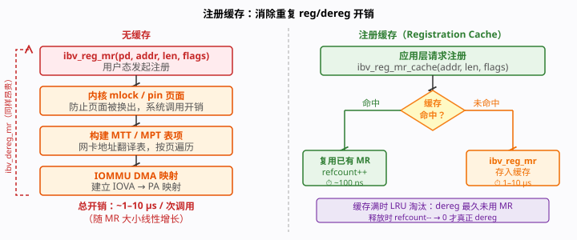

#### 问题：`ibv_reg_mr` 远不止"记一个指针"

很多人以为注册内存就是告诉网卡"喏，这块地址归你访问"，一瞬间的事。实际上它在背后
干了三件重活：

1. **mlock / pin 页面**：通过 `get_user_pages_fast` 把缓冲区涉及的所有物理页锁住
   （不可换出、不可压缩），免得网卡 DMA 到一半页面被内核搬走。
2. **构建 MTT（Memory Translation Table，内存翻译表）条目**：网卡的地址翻译硬件
   需要一张"虚拟地址 → 物理地址"映射表，`ibv_reg_mr` 会逐页遍历，把表项写进网卡
   内部的 MTT/MPT（Memory Protection Table，内存保护表）。一个 1 GB、4K 页的 MR，
   要写入 262,144 项。
3. **IOMMU DMA 映射**：若系统启用了 IOMMU，还得在 IOVA 空间建映射，保证 DMA 地址
   的安全与隔离。

所以注册是有"体重"的：小 MR（< 1 MB）约 **1–5 µs**；大 MR（1 GB）能到**数十毫秒**，
因为建 MTT 的耗时和页数成正比。`ibv_dereg_mr` 同样昂贵——要刷网卡 TLB/缓存、拆
IOMMU 映射、解 pin。如果你在每个请求里都 reg 一次、dereg 一次，这笔开销会直接钉死
在热路径上。

#### 解法：注册缓存

核心思路一句话：**把 `ibv_mr*` 缓存起来，相同地址/长度/权限的 MR 不重复注册。**
命中缓存约 100 ns，比真注册快上几个数量级。

```c
/* 注册缓存核心数据结构 */
typedef struct {
    void          *addr;
    size_t         len;
    int            access_flags;
} reg_cache_key_t;

typedef struct reg_cache_entry {
    reg_cache_key_t  key;
    struct ibv_mr   *mr;
    int              refcount;
    /* LRU 链表指针 */
    struct reg_cache_entry *lru_prev, *lru_next;
    /* 哈希桶链表 */
    struct reg_cache_entry *hash_next;
} reg_cache_entry_t;

#define CACHE_BUCKETS 256
typedef struct {
    reg_cache_entry_t *buckets[CACHE_BUCKETS];
    reg_cache_entry_t *lru_head, *lru_tail; /* 最近使用 → 最久未用 */
    int                count;
    int                max_entries;
    struct ibv_pd     *pd;
} reg_cache_t;

/* 查找或注册 MR */
struct ibv_mr *reg_cache_get(reg_cache_t *cache,
                             void *addr, size_t len, int flags)
{
    uint32_t h = hash(addr, len, flags) % CACHE_BUCKETS;
    reg_cache_entry_t *e = cache->buckets[h];
    while (e) {
        if (e->key.addr == addr && e->key.len == len &&
            e->key.access_flags == flags) {
            e->refcount++;
            lru_move_to_front(cache, e); /* 更新 LRU 顺序 */
            return e->mr;               /* 命中：~100 ns */
        }
        e = e->hash_next;
    }
    /* 未命中：真正注册 */
    if (cache->count >= cache->max_entries)
        reg_cache_evict_lru(cache);     /* LRU 淘汰最久未用的 MR */
    struct ibv_mr *mr = ibv_reg_mr(cache->pd, addr, len, flags);
    if (!mr) return NULL;
    reg_cache_insert(cache, addr, len, flags, mr); /* 存入缓存 */
    return mr;                          /* 未命中：1–10 µs */
}

/* 释放时只减引用计数 */
void reg_cache_put(reg_cache_t *cache, struct ibv_mr *mr)
{
    reg_cache_entry_t *e = reg_cache_find_by_mr(cache, mr);
    if (--e->refcount == 0 && cache->count > cache->max_entries / 2)
        reg_cache_remove_and_dereg(cache, e); /* 真正 dereg */
}
```

#### 适用场景与陷阱

- **短生命周期分配**：请求处理完就 free、随后又 malloc 的场景，地址很可能被复用，
  缓存 key 的碰撞要格外小心（同地址但长度不同，或权限标志变了）。
- **配合内存池**：固定大小的内存池天生适合注册缓存——地址稳定、权限不变，命中率高。
- **主要陷阱**：`addr` 相同但 `len` 或 `access_flags` 不同时，**必须当成不同的 key**；
  缓存满时 LRU 淘汰会调 `ibv_dereg_mr`，要确保被淘汰的 MR 引用计数已归零。

---

### 14.2 ODP（按需分页）：注册时一个页都不 pin

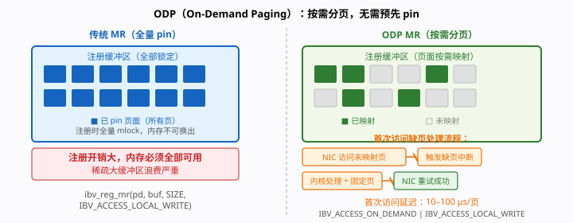

#### 问题：明明只访问一小块，却被迫 pin 整个大缓冲

设想你注册了一个稀疏的大缓冲区——名义上 1 GB，实际每次只碰其中几页。传统注册会把
1 GB 全部 pin 死，内存白白被锁住、注册还慢得要命。有没有办法"先注册个空壳，等真用
到哪页再 pin 哪页"？这就是 ODP。

#### 机理：免预先 pin，由 NIC 触发缺页

ODP（On-Demand Paging，按需分页）只要在 `ibv_reg_mr` 时多传一个
`IBV_ACCESS_ON_DEMAND` 标志，就告诉内核驱动：**注册时一个页都别 pin**。哪一页被
网卡真正访问到，才在那一刻 pin 并建立映射。它的页面故障处理流程是这样的：

1. NIC 发起 DMA，目标物理地址在网卡页表里没有映射。
2. NIC 内部触发"页面故障"信号，通过 PCIe 中断通知内核 RDMA 驱动（Mellanox 驱动
   里是 `mlx5_ib_pfault`）。
3. 内核 `ibv_umem_odp` 子系统接管：通过 MMU notifier 找到对应 VMA，调
   `get_user_pages` 固定那一页，更新网卡页表（相当于
   `mmu_notifier_invalidate_range` 的逆操作）。
4. 内核通知 NIC 重试，NIC 重发 DMA，这时映射已就位，操作正常完成。

整套首次访问的代价约 **10–100 µs/页**。所以 ODP 适合**稀疏访问**的场景，**不适合
延迟敏感的热路径**——热路径上每次缺页都是几十微秒的尖刺。

#### 代码：注册 + 预取

```c
/* ODP 注册：页面不会被立即 pin */
struct ibv_mr *mr = ibv_reg_mr(pd, buf, buf_len,
    IBV_ACCESS_ON_DEMAND  |
    IBV_ACCESS_LOCAL_WRITE |
    IBV_ACCESS_REMOTE_WRITE);
if (!mr) { perror("ibv_reg_mr ODP"); exit(1); }

/* 预取：提前告知驱动将要访问的范围，触发批量 pin，减少后续缺页 */
struct ibv_sge sg = {
    .addr   = (uint64_t)buf,
    .length = prefetch_len,
    .lkey   = mr->lkey,
};
/* ibv_advise_mr 相当于对 ODP MR 的 madvise(WILLNEED) */
ibv_advise_mr(pd, IBV_ADVISE_MR_ADVICE_PREFETCH_WRITE,
              IB_UVERBS_ADVISE_MR_FLAG_FLUSH, &sg, 1);
```

如果你预先知道接下来要访问哪片区域，可以用 `ibv_advise_mr` 提前预取——相当于对
ODP MR 做了一次 `madvise(WILLNEED)`，批量把那段页 pin 好，把缺页尖刺挪到你能接受
的时刻。

#### 传统 MR vs ODP MR

| 维度 | 传统 MR（全量 pin） | ODP MR（按需分页） |
|------|--------------------|--------------------|
| 注册耗时 | 1–10 µs（小）到数十 ms（大） | 极低（无 pin） |
| 首次访问延迟 | 正常 DMA 延迟 | +10–100 µs/页（缺页中断） |
| 内存用量 | 全部页面预先锁定 | 仅访问页面被锁定 |
| 稀疏大缓冲区 | 浪费（无论访问与否全部 pin） | 理想（只 pin 实际访问页） |
| 硬件要求 | 所有 RNIC | 需 ConnectX-4 及以上，且驱动支持 |

---

### 14.3 Memory Windows（内存窗口）：在大 MR 上开细粒度的"门禁"

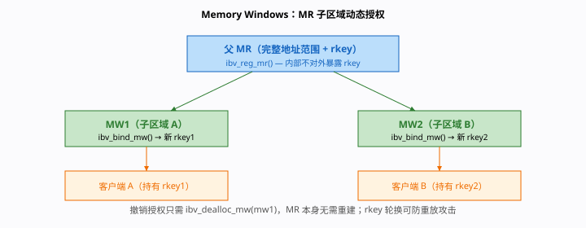

#### 问题：一块大 MR，想分别授权给不同客户端

服务端常有一块大 MR，想把它的不同子区域分给不同客户端访问。最省事的做法是把整块
MR 的 `rkey` 发给所有人——但这样有两个硬伤：

1. **权限过宽**：任一客户端拿到 rkey 就能读写整块 MR，越界访问无从拦截。
2. **无法撤销**：想收回某客户端的访问权，只能销毁并重建 MR，而我们刚学过，
   reg/dereg 代价极大。

Memory Window（内存窗口）就是为此而生：在大 MR 之上开一个个轻量级子区域窗口，每个
窗口有独立的 `rkey`，能按需绑定、按需撤销，像给大房间里的每个隔间单独配一把门禁卡。

#### Type 1 vs Type 2

**Type 1 MW**（`IBV_MW_TYPE_1`）：通过 `ibv_bind_mw` 在指定 QP 上显式绑定。

```c
/* 1. 分配 MW */
struct ibv_mw *mw = ibv_alloc_mw(pd, IBV_MW_TYPE_1);
if (!mw) { perror("ibv_alloc_mw"); exit(1); }

/* 2. 绑定到子区域 */
struct ibv_mw_bind bind_info = {
    .bind_info = {
        .mr           = mr,                    /* 底层 MR */
        .addr         = (uint64_t)sub_region_addr,
        .length       = sub_region_len,
        .mw_access_flags = IBV_ACCESS_REMOTE_WRITE,
    },
    .wr_id    = 42,
    .send_flags = IBV_SEND_SIGNALED,
};
int ret = ibv_bind_mw(qp, mw, &bind_info);
/* 绑定完成后 mw->rkey 更新为新 rkey，可传给客户端 */

/* 3. 使用完毕后撤销（无需销毁 MR） */
struct ibv_send_wr inv_wr = {
    .opcode     = IBV_WR_LOCAL_INV,
    .wr_id      = 43,
    .ex.invalidate_rkey = mw->rkey,
    .send_flags = IBV_SEND_SIGNALED,
};
struct ibv_send_wr *bad_wr;
ibv_post_send(qp, &inv_wr, &bad_wr);
```

**Type 2 MW**（`IBV_MW_TYPE_2`）：绑定动作作为一条 RDMA WRITE WR 的一部分原子执行，
省掉额外的往返。绑定和写入在网卡侧原子完成，适合对延迟极敏感的场景。

#### rkey 轮换：一项安全技术

每次授权后，撤销旧 MW、重新 `ibv_bind_mw`，客户端拿到的是一个全新的 rkey，旧 rkey
即刻失效。这能防住**重放攻击（rkey replay attack）**：哪怕攻击者截获了之前的 rkey，
也无法再拿它来访问内存。

---

### 14.4 大页、大 MR 与连续内存：让网卡 TLB 命中得更多

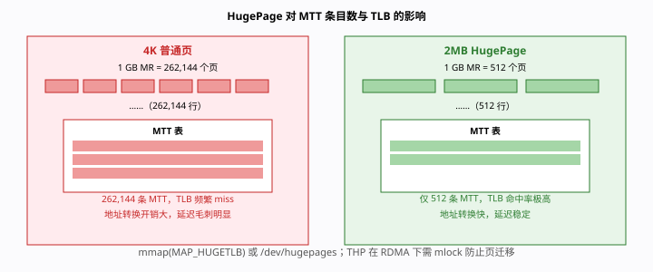

#### 问题：4K 页太碎，网卡 TLB 装不下

网卡做地址翻译的单位是物理页。页越小、页数越多，MTT 条目就越多，而网卡内部那块小
小的 TLB（典型 512 项）能缓存的映射就那么几条。一旦访问落到 TLB 没缓存的页上，就要
去查 MTT，徒增延迟、占用 PCIe 带宽。解法很直接：**用大页，把页数砍下来。**

#### MTT 条目的数学账

同样是一块 1 GB MR，换不同页大小，差距是 512 倍：

| 页大小 | 页数 | MTT 条目数 | NIC TLB 覆盖（512 项）|
|--------|------|------------|----------------------|
| 4 KB   | 262,144 | 262,144 | 512 × 4 KB = 2 MB    |
| 2 MB   | 512     | 512     | 512 × 2 MB = 1 GB    |
| 1 GB   | 1       | 1       | 全部                 |

4K 页模式下，网卡 TLB 满打满算只能覆盖 2 MB——访问超出这个范围就触发 TLB miss。
换成 2 MB 大页，同样 512 项 TLB 直接覆盖整个 1 GB MR，几乎不再 miss。

#### 分配方式：显式大页（推荐）

```c
#include <sys/mman.h>
#include <numaif.h>
#include <numa.h>

/* 分配 2MB 大页，MAP_HUGETLB 要求系统预先配置大页池 */
size_t buf_size = 1UL << 30; /* 1 GB */
void *buf = mmap(NULL, buf_size,
                 PROT_READ | PROT_WRITE,
                 MAP_PRIVATE | MAP_ANONYMOUS | MAP_HUGETLB,
                 -1, 0);
if (buf == MAP_FAILED) {
    perror("mmap hugepage"); exit(1);
}

/* mlock 防止 2MB 大页被拆分（compaction） */
if (mlock(buf, buf_size) != 0) {
    perror("mlock"); /* 非致命，但建议处理 */
}

/* NUMA 亲和：将内存绑定到 NIC 所在 socket，降低跨 NUMA 访问延迟 */
/* 查询 NIC NUMA node: cat /sys/class/infiniband/<dev>/device/numa_node */
int nic_numa_node = 0; /* 示例：NIC 在 node 0 */
unsigned long nodemask = 1UL << nic_numa_node;
if (mbind(buf, buf_size, MPOL_BIND, &nodemask,
          sizeof(nodemask) * 8, MPOL_MF_MOVE) != 0) {
    perror("mbind");
}

/* 注册 MR */
struct ibv_mr *mr = ibv_reg_mr(pd, buf, buf_size,
    IBV_ACCESS_LOCAL_WRITE |
    IBV_ACCESS_REMOTE_WRITE |
    IBV_ACCESS_REMOTE_READ);
```

**配置系统大页池**（运行前需 root 操作）：

```bash
# 配置 2MB 大页（持久化写入 /etc/sysctl.conf 则永久生效）
echo 512 > /proc/sys/vm/nr_hugepages

# 验证
cat /proc/meminfo | grep Huge
# HugePages_Total:     512
# HugePages_Free:      512
# Hugepagesize:       2048 kB
```

#### THP 警告：透明大页与 RDMA 到底冲不冲突？

这一节专门澄清一个流传很广的误解。

**澄清**：对于**普通注册的 MR**（非 ODP），`ibv_reg_mr` 内部已经通过
`get_user_pages` 把页 **pin 住**了，内核的 THP 合并/拆分、compaction、迁移**都不会
去动这些已 pin 的页**——这种情况下 DMA 是安全的。换句话说，"普通 pin 的 MR 不受 THP
迁移影响"，别再担心。

THP 的真正风险只出现在两类场景：

- **ODP MR**：页没有 pin，khugepaged 迁移页面会触发 MR 失效与重新缺页，带来延迟
  抖动甚至正确性边界问题。
- **fork() + COW**：子进程写时复制可能让父进程注册的页被换到新物理页（用
  `ibv_fork_init()` / `RDMAV_FORK_SAFE=1` 规避，见第 13 章 13.4）。

所以结论不是"THP 与 RDMA 不兼容"，而是：**只有 ODP 或 fork 场景下才需谨慎**；而当你
追求确定性的大页性能时，优先用显式 `MAP_HUGETLB`，别去依赖 THP 的自动合并。

正确做法：

```bash
# 关闭 THP（或至少关闭 compaction）
echo never > /sys/kernel/mm/transparent_hugepage/enabled
# 或仅关闭 compaction
echo never > /sys/kernel/mm/transparent_hugepage/defrag
```

#### NUMA 分配（libnuma 方式）

```c
#include <numa.h>

/* 使用 libnuma 接口，更清晰 */
void *buf = numa_alloc_onnode(buf_size, nic_numa_node);
if (!buf) { fprintf(stderr, "numa_alloc_onnode failed\n"); exit(1); }
/* 注意：numa_alloc_onnode 使用 mmap + mbind，页仍为 4K，
   若需大页须额外组合 MAP_HUGETLB 才能获得 2MB 页面 */
```

---

### 小结

> 五段式复习表，方便日后回顾本章。

| 特性 | 原理 | 关键 API | 性能收益 | 主要陷阱 |
|------|------|----------|----------|----------|
| 注册缓存 | 复用已 pin 内存，避免重复系统调用 | `ibv_reg_mr` / `ibv_dereg_mr` | 热路径省去 1–10 µs | 地址重用时 key 碰撞；释放顺序错误 |
| ODP | 按需 pin 页，NIC 触发缺页中断 | `IBV_ACCESS_ON_DEMAND`，`ibv_advise_mr` | 零预注册开销，适合稀疏大缓冲 | 首次访问延迟 10–100 µs/页 |
| Memory Windows | 大 MR 划分子窗口，独立 rkey | `ibv_alloc_mw`，`ibv_bind_mw`，`IBV_WR_LOCAL_INV` | 动态授权/撤销无需销毁 MR | 需 QP 支持；Type 2 需驱动版本匹配 |
| 大页 | 减少 MTT 项，提升 NIC TLB 命中率 | `MAP_HUGETLB`，`mlock`，`mbind` | 512× 更少 MTT 项，TLB 覆盖提升 512× | 普通 pin MR 安全；ODP/fork 下慎用 THP；优先显式 `MAP_HUGETLB` |

---

### 术语速查

| 术语 | 含义 |
|------|------|
| **MR** | 已注册内存区域，reg_mr 代价来自 pin + MTT + IOMMU |
| **MTT / MPT** | 内存翻译表 / 保护表；大页大幅减少 MTT 条目数 |
| **lkey / rkey** | 本端 / 对端引用 MR 的密钥 |
| **ODP** | 按需分页，`IBV_ACCESS_ON_DEMAND`，访问时缺页 pin |
| **MW** | 内存窗口，MR 子区域动态授权，可撤销 rkey |
| **IOMMU** | DMA 地址翻译单元，影响注册开销 |
| **PD** | 保护域，MR/MW/QP 的归属边界 |
| **NUMA** | 非一致内存访问，应分配 NUMA-local 内存 |

> 完整术语表见 [附录 A · 术语表与参考文献](appendix-附录.md#appendix-a)。

---

## 下一步

你已经理解了硬件为什么这样工作、性能从哪里来、规模怎么撑住。
[第三部分 · 专家](part3-专家.md#ch15)把 RDMA 放回真实系统里：怎么和 RPC / GPU /
存储生态集成、线上出问题怎么排、以及绕过抽象直接操作硬件的深水区。

- 上一站：[第一部分 · 入门](part1-入门.md)
- 下一站：[第三部分 · 专家](part3-专家.md)
- 随时查阅：[附录 A · 术语表](appendix-附录.md#appendix-a) · [附录 B · 示例索引](appendix-附录.md#appendix-b)
