# 第三部分 · 专家

> 原语本身不是终点。本部分先看真实系统怎么把 RDMA 拼成 RPC 框架、GPU 流水线与
> 存储底座，再练出一套线上排障的方法论，最后潜入 mlx5dv/DEVX、硬件门铃、DPU 卸载
> 与现代拥塞控制——那些文档稀少、但决定系统上限的地方。
>
> 全书导读见 [前言与导读](00-前言与导读.md)。

## 本部分目录

| 章 | 标题 | 你将学会 |
|----|------|----------|
| [第 15 章](#ch15) | 与上层系统集成 | 极简 RPC、GPUDirect、NVMe-oF/NCCL/UCX/SPDK 生态 |
| [第 16 章](#ch16) | 调试与可观测性 | 设备能力查询、计数器、抓包追踪、故障决策树 |
| [第 17 章](#ch17) | 专家深水区 | mlx5dv/DEVX、Doorbell/BlueFlame、DPU/DOCA、现代拥塞控制 |

---

<a id="ch15"></a>

## 第 15 章 · 与上层系统集成

> 到这里，你已经掌握了 RDMA 的全部原语：双边的 SEND/RECV、单边的 WRITE/READ、
> 立即数与原子操作，以及性能、可扩展、可靠性、内存管理这些工程维度。但原语本身
> 不是终点——真实世界里，RDMA 总是作为某个更大系统的「传输底座」存在：一套 RPC
> 框架、一条 GPU 训练流水线、一个分布式存储集群。本章带你看清楚：这些上层系统是
> **怎么把 RDMA 原语拼成一个可用产品的**。

---

### 本章你将遇到的术语（预览）

| 术语 | 一句话直觉 |
|------|-----------|
| **IMM（立即数）** | 写数据的同时捎带一个 32 位「便条」，让对端不用额外往返就知道发生了什么 |
| **SGE** | 描述一段内存的三元组 `{addr, length, lkey}`，拼请求/响应缓冲用 |
| **RC / UD** | 传输类型；RPC 要可靠所以用 RC，广播类控制可用 UD |
| **RoCE** | 在以太网上跑 RDMA，RoCEv2 封装在 UDP 4791 |
| **GID** | 全局标识符，类比 IPv6，跨节点寻址用 |
| **NUMA** | GPUDirect 要求网卡与 GPU 在同一 PCIe 拓扑/NUMA 节点，否则带宽腰斩 |
| **MR / rkey** | GPU 显存也能 `ibv_reg_mr` 注册（需 peer-memory 内核模块） |

---

### 引子：原语不是系统

想象你刚学会了「砌砖」这门手艺——会和水泥、会对齐、会留缝。但会砌砖不等于会盖
房子。盖房子要的是图纸：地基怎么打、承重墙在哪、水电怎么走。

RDMA 也一样。`ibv_post_send` 是一块砖；而一个 RPC 框架、一套 NVMe-oF 存储、一个
NCCL 集合通信库，才是房子。本章的三个小节分别回答三个「怎么盖」的问题：

1. 怎么用 RDMA 原语搭出一个**低延迟 RPC**？（§15.1）
2. 怎么让远端网卡直接读写**本地 GPU 显存**，把 CPU 彻底踢出数据路径？（§15.2）
3. 业界已经用 RDMA 盖了哪些「成品房子」，它们各自怎么用原语？（§15.3）

> 📌 没有 RDMA 硬件也不要紧——本章所有方案都能在 Soft-RoCE 上跑通功能验证。
> **环境搭建见[第 2 章](part1-入门.md#ch02)**，这里不再重复。

---

### 15.1 极简 RPC over RDMA

**问题引入**：RPC（远程过程调用）是分布式系统的命脉——客户端调一个函数，参数和
返回值在网络上往返一趟。传统 TCP RPC 每次往返要两次系统调用 + 走一遍内核协议栈，
RTT 普遍在 10–50 µs。在一个每秒要发百万次调用的系统里，这点延迟会被放大成灾难。
RDMA 能把它压到 1–3 µs，问题是：**怎么用原语拼出一个 RPC？**

**直觉/类比**：把一次 RPC 想成「往对方信箱里塞一封信，再戳一下门铃告诉他有信」。
TCP 的做法是把「信」和「门铃」捆在一起走协议栈；RDMA 的做法是把两件事**拆开**：

- **数据（信）**：用 RDMA WRITE（单边，对端 CPU 完全不参与）直接写进对端的环形缓冲。
- **通知（门铃）**：用 `WRITE_WITH_IMM`，在写数据的同一个操作里让对端产生一个
  recv CQE，`imm_data` 里捎上槽位索引——**省掉一次单独的 SEND 往返**。

> 💡 **IMM（立即数）** 首次出现：它是一个随 WRITE/SEND 携带的 32 位整数，对端在
> CQE 的 `wc.imm_data` 字段能读到。这里我们用它当「槽位号」，告诉对端「请求落在
> 第几格」。

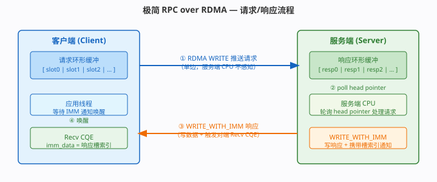

> 🛠 可运行示例：[examples/08-rpc/](../../examples/08-rpc/)
> ——一个最小的请求/响应 RPC：客户端发 `{op, seq, a, b}`，服务端算 ADD/MUL 后回
> `{seq, status, result}`，并压测平均往返延迟。该示例用**双边 SEND/RECV** 承载
> （结构最清晰，服务端 CPU 参与每次调用）；本节进一步讲解单边 `WRITE_WITH_IMM`
> 环形缓冲优化，可把 RTT 压到 ~1 µs。

**环形缓冲设计**：

```c
#define SLOT_SIZE  4096
#define RING_SLOTS 256

struct rpc_ring {
    char     slots[RING_SLOTS][SLOT_SIZE];
    uint32_t head;   // 消费者读指针（本端维护，不通过 RDMA 暴露）
};

// 客户端发送请求：写数据 + IMM 通知槽位号
void send_request(struct ibv_qp *qp, struct ibv_mr *local_mr,
                  uint64_t remote_addr, uint32_t remote_rkey,
                  int slot, void *req, size_t len) {
    struct ibv_send_wr wr = {
        .opcode       = IBV_WR_RDMA_WRITE_WITH_IMM,
        .imm_data     = htonl(slot),
        .send_flags   = IBV_SEND_SIGNALED,
        .sg_list      = &(struct ibv_sge){
            .addr   = (uint64_t)req,
            .length = len,
            .lkey   = local_mr->lkey,
        },
        .num_sge      = 1,
        .wr.rdma.remote_addr = remote_addr + slot * SLOT_SIZE,
        .wr.rdma.rkey        = remote_rkey,
    };
    struct ibv_send_wr *bad;
    ibv_post_send(qp, &wr, &bad);
}

// 服务端事件循环：poll recv CQE 得到槽位号，处理请求
void server_loop(struct ibv_cq *cq, struct rpc_ring *ring) {
    struct ibv_wc wc;
    while (ibv_poll_cq(cq, 1, &wc) > 0) {
        if (wc.opcode == IBV_WC_RECV_RDMA_WITH_IMM) {
            int slot = ntohl(wc.imm_data);
            handle_request(ring->slots[slot]);
            // 重新投递 recv WR
            repost_recv(cq, slot);
        }
    }
}
```

> ⚠️ 复用[第 6 章](part1-入门.md#ch06)的铁律：**响应的 recv 必须在对应请求发出
> 前预投递**。08-rpc 示例里，客户端在 connect 前投递第一个 recv，之后每收到一个
> 响应就补投递下一个，形成深度 1 的接收流水线，避免 RNR 错误。

**性能对比**：

| 方案 | 典型 RTT | CPU 开销 |
|------|---------|---------|
| TCP RPC（内核） | 10–50 µs | 高（系统调用 + 中断） |
| RDMA RPC（busy-poll） | 1–3 µs | 中（轮询 CQ） |
| RDMA RPC（event 模式） | 3–10 µs | 低（睡眠等待） |

可以看到，busy-poll 用 CPU 换延迟，event 模式（见[第 11 章](part2-进阶.md#ch11)
轮询 vs 事件）用延迟换 CPU——这是一对永恒的取舍。

---

### 15.2 GPUDirect RDMA

**问题引入**：在 AI 训练里，梯度数据本来就躺在 GPU 显存里。如果还要先把它从 GPU
拷回系统内存、再让网卡发出去，对端收到后又拷进它的 GPU——这一来一回的拷贝既吃
带宽又吃 CPU。能不能让网卡**直接读写 GPU 显存**？

**直觉/类比**：传统路径像「快递员只能到小区门口，住户得自己下楼取件再扛上楼」；
GPUDirect 则是「快递直接送货上门」——网卡通过 PCIe 点对点（P2P）直接 DMA 到 GPU
显存，**完全绕过系统内存和 CPU 拷贝**。

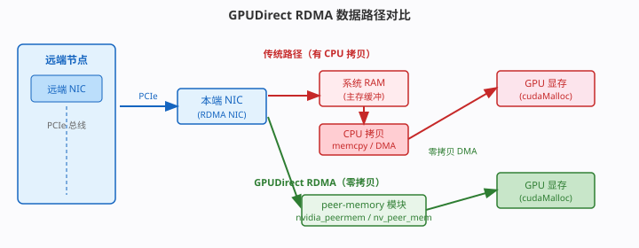

**传统路径**（有 CPU 参与）：
```
远端 NIC → PCIe → 本端 NIC → 系统 RAM → CPU memcpy → GPU 显存
```

**GPUDirect 路径**（零拷贝）：
```
远端 NIC → PCIe → 本端 NIC → PCIe P2P → GPU 显存
```

关键在于：**GPU 显存也可以被 `ibv_reg_mr` 注册成 MR**——只要内核里有 peer-memory
模块，网卡就能拿到 GPU 显存的 rkey，对端 RDMA WRITE 时直接落进显存。

**使用方式（伪代码）**：

```c
// 1. 分配 GPU 内存
void *gpu_buf;
cudaMalloc(&gpu_buf, buf_size);

// 2. 注册为 RDMA MR（需 nvidia_peermem 或 nv_peer_mem 内核模块）
struct ibv_mr *gpu_mr = ibv_reg_mr(pd, gpu_buf, buf_size,
    IBV_ACCESS_LOCAL_WRITE | IBV_ACCESS_REMOTE_WRITE);

// 3. 将 gpu_mr->rkey + gpu_buf 地址发给对端
// 4. 对端直接 RDMA WRITE 到 GPU 显存
rdma_post_write(id, NULL, src_buf, len, src_mr, IBV_SEND_SIGNALED,
                (uint64_t)gpu_buf, gpu_mr->rkey);
```

注意第 4 步的 `rdma_post_write` 和你在[第 7 章](part1-入门.md#ch07)里写过的
一模一样——**应用代码几乎不变，变的只是那块内存的物理归属**。

**前提条件**：
- 加载 `nvidia_peermem`（新驱动）或 `nv_peer_mem`（旧驱动）。
- NIC 与 GPU 需在同一 PCIe root complex 下，或通过支持 P2P 的 PCIe switch 连接。
- 在 `nvidia-smi topo -m` 中确认 GPU 与 NIC 的拓扑关系（NV# 表示支持）。
- 并非所有 NIC/GPU 组合支持；A100/H100 + ConnectX-6/7 是典型支持配置。

> ⚠️ 这就是 **NUMA / PCIe 拓扑** 在本章的实际意义：如果网卡和 GPU 挂在不同的
> PCIe root complex 下，P2P 走不通或要绕远路，带宽会断崖式下跌。先看
> `nvidia-smi topo -m` 再谈优化。

---

### 15.3 生态总览

**问题引入**：学完原语，你难免会问：「真有人在生产里这么用吗？」答案是——几乎所有
追求极致 I/O 的系统都建在 RDMA Verbs 之上，只是它们把 Verbs 藏在了更友好的 API
之下。认识这些「成品房子」，能帮你判断什么时候该自己砌砖、什么时候该直接拎包入住。

**直觉/类比**：Verbs 之于这些框架，就像 POSIX socket 之于 Nginx、Redis、Kafka——
底层是同一组系统调用，上层却长出了存储、通信、计算三个方向的参天大树。

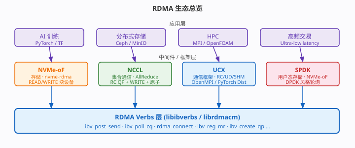

#### NVMe-oF（NVMe over Fabrics）

块存储协议，通过 RDMA 传输 NVMe 命令与数据，让远端 SSD「用起来像本地盘」：

```bash
# 加载内核模块（Target 端）
modprobe nvmet && modprobe nvmet-rdma
# 配置 namespace 并监听（通过 configfs）
# Initiator 端
modprobe nvme-rdma
nvme connect -t rdma -a <target_ip> -s 4420 -n nqn.xxx
```

- 延迟接近本地 NVMe（~10 µs vs ~100 µs TCP/IP NVMe-oF）。
- 内核态实现；用户态方案见下面的 SPDK。

#### NCCL（NVIDIA Collective Communication Library）

AI 训练中的集合通信库，AllReduce / AllGather 底层使用 RDMA：

- IB 传输主要用 RC QP + RDMA WRITE / WRITE_WITH_IMM 搬运数据（不依赖 RDMA
  原子）；ring/tree 算法的同步靠 flag/计数轮询而非硬件原子操作。
- `NCCL_IB_HCA` 环境变量指定使用哪张 RDMA 网卡。
- 与 §15.2 的 GPUDirect RDMA 结合，实现 GPU-to-GPU 零拷贝通信。

#### UCX（Unified Communication X）

传输无关的通信框架，被 OpenMPI、PyTorch Distributed、Apache Spark 采用：

```bash
ucx_info -d        # 查看可用传输（rc_verbs, ud_verbs, shared_mem 等）
ucx_perftest -t ucp_put_bw -m rdma  # 带宽测试
```

UCX 自动选择最优传输：同节点用共享内存，跨节点用 RC/UD，降级到 TCP——把
「选哪种语义」这个你在前面手动操心的问题自动化了。

#### SPDK（Storage Performance Dev Kit）

用户态 NVMe-oF Target，结合 DPDK 风格的轮询和 RDMA：

- 绕过内核，延迟 < 10 µs。
- `spdk_tgt` 配合 `bdev_nvme` + `nvmf_rdma` transport 使用。
- 适合超低延迟存储场景（AI 训练 Checkpoint、数据库）。

---

### 小结：原理 → API → 代码 → 性能 → 陷阱

| 维度 | 要点 |
|------|------|
| **原理** | RDMA RPC = WRITE（数据）+ IMM（通知）合一；GPUDirect 靠 PCIe P2P 绕开 CPU；各上层框架各有侧重（存储/通信/计算） |
| **API** | `IBV_WR_RDMA_WRITE_WITH_IMM`；`ibv_reg_mr(gpu_buf)`（需 peer-mem 模块）；NVMe-oF/UCX/SPDK 把 Verbs 封装成更高层 API |
| **代码** | RPC 环形缓冲槽位用 imm_data 传递；GPUDirect 仅伪代码参考，应用层代码几乎不变 |
| **性能** | RDMA RPC 比 TCP 快 5–10×；GPUDirect 消除 GPU←→CPU 拷贝（带宽 × 2）；NVMe-oF/SPDK 延迟逼近本地盘 |
| **陷阱** | GPUDirect 需确认 PCIe 拓扑（`nvidia-smi topo`）；NCCL 调参需匹配 QP 数与 GPU 数；RPC 别忘了预投递 recv 防 RNR |

---

### 术语速查

| 术语 | 含义 |
|------|------|
| **IMM** | 立即数，WRITE_WITH_IMM 实现 RPC 响应 + 通知合一 |
| **SGE** | Scatter/Gather 元素，构造请求/响应缓冲 |
| **RC / UD** | 传输类型，RPC 用 RC，广播控制可用 UD |
| **RoCE** | RDMA over Converged Ethernet，RoCEv2 用 UDP 4791 |
| **GID** | 全局标识符，跨节点寻址 |
| **NUMA** | GPUDirect 要求 NIC 与 GPU 同 PCIe 拓扑 / NUMA |
| **MR / rkey** | GPU 显存也可 `ibv_reg_mr` 注册（需 peer-memory）|

> 完整术语表见[附录 A · 术语表与参考文献](appendix-附录.md#appendix-a)。

---

> 下一章我们换个角色：从「搭系统的人」变成「修系统的人」——
> [第 16 章 · 调试与可观测性](#ch16)，建立一套完整的排障工具箱。

---

<a id="ch16"></a>

## 第 16 章 · 调试与可观测性

> 写得出 RDMA 程序是一回事，**修得了 RDMA 程序**是另一回事。RDMA 的故障往往
> 「沉默而致命」：连接建不起来却没有清晰报错、性能只有标称值的十分之一却找不到
> 瓶颈、偶发的 `WR_FLUSH_ERR` 像幽灵一样出现。本章把 RDMA 的可观测性拆成三层
> 工具——设备能力、运行计数器、实时抓包——再给你一套故障决策树，让你能独立排查
> 建链失败、完成错误与性能问题。

---

### 本章你将遇到的术语（预览）

| 术语 | 一句话直觉 |
|------|-----------|
| **GID** | 全局标识符，RoCE 建链先看它配没配对，`show gids` 查 |
| **LID** | 本地标识符，纯 InfiniBand 才用；RoCE 下恒为 0 |
| **QPN** | QP 编号，排查 QP 泄漏时按它点名 |
| **PSN** | 包序列号，抓包分析乱序/重传靠它 |
| **WC** | 工作完成，出错时 `ibv_wc_status_str` + `vendor_err` 是第一手线索 |
| **RNR** | 接收未就绪，对端 RQ 空了，最常见的「新手错误」 |
| **PFC / ECN / CNP** | 拥塞相关信号，对应一组 hw_counters |
| **DCQCN** | 标准拥塞控制，`np_cnp_sent` 是它开始降速的第一信号 |
| **RoCE** | RoCEv2 = UDP 4791，tcpdump 抓包按这个端口过滤 |

---

### 引子：沉默的故障

普通网络程序出错，你至少能 `perror` 或看 `errno`。RDMA 不一样——它把大量工作
卸载给了硬件，而硬件不会写日志。一个 rkey 填错，对端不会报「权限拒绝」给你看，
只会在某个 CQE 的 `status` 字段里塞一个 `REM_ACCESS_ERR`，如果你没去 poll、没去
打印，它就静静地消失了。

所以 RDMA 调试的第一原则是：**主动观测**。本章的四个小节，正好对应你排障时由表
及里的四个动作：

1. 设备到底什么状态、支持什么能力？（§16.1 设备能力查询）
2. 运行起来后，硬件计数器在告诉你什么？（§16.2 计数器与监控）
3. 线上到底发了什么包？（§16.3 抓包与追踪）
4. 把上面的线索串起来——按症状走决策树。（§16.4 故障决策树）

---

### 16.1 设备能力查询

**问题引入**：排障的起点永远是「先确认设备本身是好的」。网卡认出来了吗？端口
ACTIVE 吗？是 InfiniBand 还是 RoCE？这些问题不先回答，后面全是空中楼阁。

**直觉/类比**：就像电器不工作时先看插头通没通电——查设备能力就是 RDMA 的「插头
检查」。

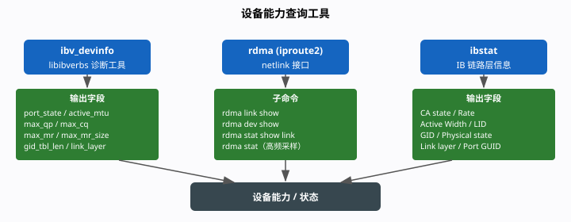

#### ibv_devinfo

最常用的设备信息查询命令，输出包含：

```
$ ibv_devinfo
hca_id: mlx5_0
  transport:            InfiniBand (0)
  fw_ver:               20.35.1012
  node_guid:            b8:ce:f6:ff:fe:12:34:56
  sys_image_guid:       ...
  vendor_id:            0x02c9
  vendor_part_id:       4119          # ConnectX-6
  max_mr_size:          0xffffffffffffffff
  max_qp:               131072
  max_qp_wr:            32768
  max_cq:               16777216
  max_cq_wr:            4194303
  max_mr:               16777216
  port:   1
    state:              PORT_ACTIVE (4)    # ← 必须是 ACTIVE
    max_mtu:            4096 (5)
    active_mtu:         4096 (5)
    link_layer:         Ethernet           # RoCEv2
    gid_tbl_len:        255
```

**关键字段**：`state` 必须为 `PORT_ACTIVE`；`link_layer: Ethernet` 表示 RoCEv2；
`active_mtu` 影响单包最大载荷。这三行解读不出问题，再往下查也是白费。

#### rdma 命令（iproute2）

```bash
rdma link show          # 所有 RDMA 链路状态一览
rdma dev show           # 设备列表（含 node_type）
rdma stat               # 实时流量统计（packets/bytes per port）
rdma res show qp        # 查看当前所有 QP（调试 QP 泄漏）
show gids               # 列出所有 GID（排查 RoCE GID 配置问题）
```

> 💡 `rdma res show qp` 是排查 **QP 泄漏**的利器：程序退出了 QP 数却不归零，说明
> 你漏了 `rdma_destroy_qp` / `ibv_destroy_qp`，对应[第 13 章](part2-进阶.md#ch13)
> 讲的资源生命周期。

#### ibstat（InfiniBand 专用）

```bash
$ ibstat mlx5_0
CA 'mlx5_0'
  CA type: MT4119
  Port 1:
    State: Active
    Physical state: Polling
    Rate: 100
    Base lid: 0          # RoCE 下 LID=0
    LMC: 0
    SM lid: 0
    Link layer: Ethernet
    Active width: 4X
```

**Rate: 100** = 100 Gbps；**Physical state: Polling** 表示物理层在寻找链路对端。
注意 **Base lid: 0**——这正是 RoCE 不用 LID 的体现。

---

### 16.2 计数器与监控

**问题引入**：设备没问题、程序也跑起来了，但延迟抖动、偶发丢包……这些「亚健康」
状态在哪儿看？答案是硬件计数器——网卡默默记录的每一项统计，是你判断链路质量和
拥塞的体检报告。

**直觉/类比**：计数器就像汽车仪表盘上的各种指示灯。平时不看，一旦出问题，先扫
一眼哪盏灯亮了，比盲目拆引擎高效得多。

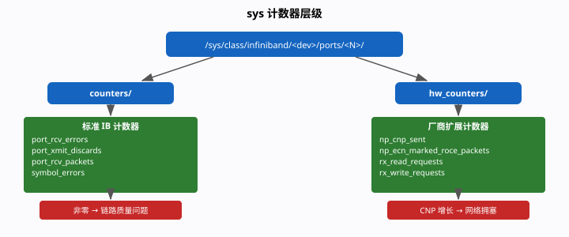

#### 标准 IB 计数器

```bash
ls /sys/class/infiniband/mlx5_0/ports/1/counters/
# port_rcv_errors       ← 接收错误（链路质量问题）
# port_xmit_discards    ← 发送丢弃（拥塞 / 缓冲区满）
# port_rcv_packets      ← 接收包数（流量监控）
# port_xmit_packets
# symbol_errors         ← 物理层符号错误（线缆/光模块问题）
# link_error_recovery   ← 链路错误恢复次数

cat /sys/class/infiniband/mlx5_0/ports/1/counters/port_rcv_errors
```

#### 硬件扩展计数器（NIC 私有）

```bash
ls /sys/class/infiniband/mlx5_0/ports/1/hw_counters/
# np_cnp_sent                  ← 发出的 CNP 数（本机检测到拥塞次数）
# np_ecn_marked_roce_packets   ← 收到 ECN 标记包数（被交换机标记为拥塞）
# rx_read_requests             ← 收到的 RDMA READ 请求数
# rx_write_requests            ← 收到的 RDMA WRITE 请求数
# roce_slow_restart            ← RoCE 慢启动次数（DCQCN 触发）
```

> 💡 这组 `hw_counters` 是 **DCQCN 的仪表盘**：`np_cnp_sent` 持续增长，说明本机
> 正不停发 CNP 让对端降速——这往往是拥塞的**第一信号**。对应[第 13 章](part2-进阶.md#ch13)
> 的拥塞控制。

#### perfquery（逐计数器查询）

```bash
perfquery -x mlx5_0 1   # 查询扩展计数器
perfquery -r mlx5_0 1   # 查询后重置（用于增量统计）
```

#### 监控告警建议

| 计数器 | 告警阈值 | 含义 |
|--------|---------|------|
| `port_rcv_errors` | > 0 | 链路质量问题，检查线缆/光模块 |
| `symbol_errors` | > 0 | 物理层误码，更换线缆 |
| `port_xmit_discards` | 持续增长 | 拥塞丢包，检查 PFC/ECN 配置 |
| `np_cnp_sent` | 高频增长 | 本机触发 DCQCN 降速，排查瓶颈 |
| `np_ecn_marked_roce_packets` | 高频增长 | 交换机 ECN 标记过多，调整 ECN 阈值 |

---

### 16.3 抓包与追踪

**问题引入**：计数器告诉你「有多少错」，但说不清「错在哪一个包」。当你怀疑乱序、
重传、或者某种 opcode 根本没发出去时，就得**把线上的包抓下来逐个看**。

**直觉/类比**：计数器是体温计，抓包是 CT。前者快速筛查，后者精确定位病灶。

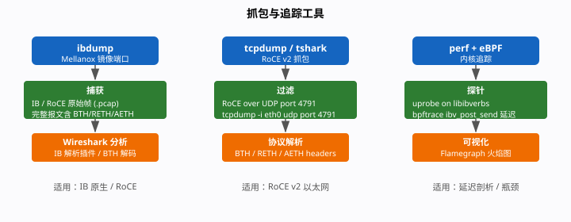

#### ibdump（Mellanox 专用）

```bash
# 抓取 RoCE 流量到 pcap（需 Mellanox NIC + special firmware）
ibdump -d mlx5_0 -i 1 -w rdma_capture.pcap
# 用 Wireshark 打开（InfiniBand / RoCEv2 dissector 自动识别）
wireshark rdma_capture.pcap
```

#### tcpdump / tshark（RoCEv2 = UDP 4791）

```bash
# RoCEv2 封装在 UDP port 4791
tcpdump -i eth0 udp port 4791 -w rdma.pcap

# 用 tshark 解码 RDMA 头部
tshark -r rdma.pcap -T fields \
  -e frame.number -e ip.src -e ip.dst \
  -e infiniband.bth.opcode   # BTH opcode: SEND/WRITE/READ/ACK

# 常见 BTH opcode（RC 传输，高 3 位 = 000）
# 0x04 = SEND Only
# 0x0a = RDMA WRITE Only
# 0x0b = RDMA WRITE Only WITH Immediate
# 0x0c = RDMA READ Request
# 0x10 = RDMA READ Response Only
# 0x11 = Acknowledge（RC ACK/NAK）
# 0x13 = CmpSwap   0x14 = FetchAdd（原子操作）
```

> 💡 看懂 BTH opcode 就能在抓包里「读懂」一次 RDMA 操作的全过程：例如一次 RDMA
> READ 应该是 `0x0c`（Request）→ `0x10`（Response）成对出现；只见 Request 不见
> Response，问题就在对端或链路上。

#### perf 与 eBPF

```bash
# 用 perf 追踪 RDMA tracepoints（需内核配置 CONFIG_INFINIBAND_USER_ACCESS）
perf list | grep rdma
perf stat -e "rdma:*" ./my_rdma_app

# 用 bpftrace 测量 ibv_post_send 延迟
bpftrace -e '
uprobe:/usr/lib/libibverbs.so:ibv_post_send { @start[tid] = nsecs; }
uretprobe:/usr/lib/libibverbs.so:ibv_post_send {
  @latency = hist(nsecs - @start[tid]); delete(@start[tid]);
}'

# flamegraph 分析 CPU 热点
perf record -F 99 -g ./my_rdma_app
perf script | stackcollapse-perf.pl | flamegraph.pl > flame.svg
```

#### rdma-core 调试日志

```bash
# 开启 libibverbs 调试输出
IBVERBS_DEBUG=1 ./my_rdma_app

# mlx5 provider 详细日志
MLX5_DEBUG_MASK=0xffffffff ./my_rdma_app

# fork 安全模式（同时保证 RDMA + fork 正确）
RDMAV_FORK_SAFE=1 ./my_rdma_app
```

---

### 16.4 常见故障决策树

**问题引入**：工具齐了，最后缺的是「拿到症状后该先查什么」的章法。下面把最常见
的四类故障各配一棵决策树——照着走，比凭直觉乱试快得多。

**直觉/类比**：这就像急诊分诊——不同症状走不同的检查流程，避免对每个病人都从头
做一遍全套检查。

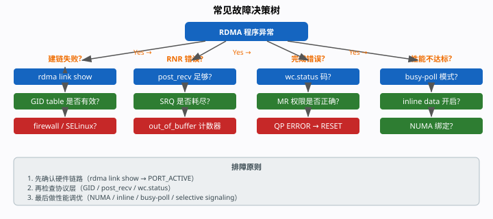

#### 建链失败

```
症状：rdma_connect / ibv_modify_qp(RTR) 返回错误，或超时无响应

排查步骤：
1. ibv_devinfo → port state = PORT_ACTIVE？（不是则检查线缆/交换机）
2. rdma link show → link 显示为 UP？
3. show gids → GID[0] 有效？（RoCE 需要 IP 层 GID，确认 IP 地址配置）
4. ping <对端 RDMA 网卡 IP>（基础网络连通性）
5. iptables / firewalld 是否放行 UDP 4791？（RoCEv2 端口）
6. SELinux：setenforce 0 测试（临时）
7. Soft-RoCE：确认 modprobe rdma_rxe 已执行，rdma link add 已绑定
```

#### RNR 错误（IBV_WC_RNR_RETRY_EXC_ERR）

```
症状：wc.status == IBV_WC_RNR_RETRY_EXC_ERR

原因：对端 RQ 无可用 WR（Receiver Not Ready）
排查：
1. 确认对端 post_recv 在 post_send 之前执行
2. 若使用 SRQ：检查 SRQ 未耗尽（ibv_post_srq_recv 足够多）
3. 增大 rnr_retry 到 7（无限重试）买时间排查
4. 检查 CQ 是否溢出导致对端卡住无法继续 post_recv
```

> 💡 RNR 几乎是新手最常踩的坑，根因永远是「该收的一方还没准备好接」。回到
> [第 6 章](part1-入门.md#ch06)的预投递铁律就能避开九成。

#### 完成错误（wc.status != IBV_WC_SUCCESS）

```c
// 调试代码：打印详细错误信息
if (wc.status != IBV_WC_SUCCESS) {
    fprintf(stderr, "WC error: %s\n", ibv_wc_status_str(wc.status));
    fprintf(stderr, "  opcode=%d, vendor_err=0x%x, qp_num=%u\n",
            wc.opcode, wc.vendor_err, wc.qp_num);
}
```

| 错误码 | 首选排查方向 |
|--------|------------|
| `RETRY_EXC_ERR` | 对端宕机？链路故障？增大 retry_cnt |
| `RNR_RETRY_EXC_ERR` | 对端 RQ 空，见上 |
| `LOC_LEN_ERR` | SGE length > MR 范围，检查 WR 构造 |
| `REM_ACCESS_ERR` | rkey 无效或权限不足（少了 REMOTE_WRITE/READ 标志） |
| `WR_FLUSH_ERR` | QP 已在 ERROR 态，批量忽略，找根因那条 |

> ⚠️ `WR_FLUSH_ERR` 成批出现时**不是**真正的错误——它是 QP 进入 ERROR 态后，队列
> 里所有未完成 WR 被「冲刷」出来的连带结果。真正的元凶是它们前面那条非 FLUSH 的
> 错误，找它。

#### 性能不达标

```bash
# 1. NUMA 亲和（跨 NUMA 访问带宽减半）
numactl --hardware
numactl --cpunodebind=0 --membind=0 ./my_app   # 绑定 NUMA node 0

# 2. PCIe 带宽（瓶颈排查）
lspci -vv | grep -A5 "Mellanox"   # 确认 PCIe x16 Gen4
cat /sys/bus/pci/devices/<bdf>/current_link_speed

# 3. 确认 busy-poll（非 event 模式）
# 去掉 ibv_get_cq_event / ibv_ack_cq_events，改用纯 ibv_poll_cq 循环

# 4. 检查 inline data 配置
ibv_devinfo | grep max_inline   # 确认 NIC 支持 inline

# 5. 选择性 signaling（每 N 个才 signaled 一次）
# 见第 11 章性能工程

# 6. 对比 perftest 基准
ib_send_lat -d mlx5_0            # 标准延迟基准
ib_send_bw -d mlx5_0             # 标准带宽基准
```

> 💡 性能排障的「低垂果实」是 NUMA 亲和——把 QP、MR 和工作线程绑到同一节点，常常
> 一步就能让带宽翻倍。其余优化手段的原理详见[第 11 章](part2-进阶.md#ch11)。

---

### 小结：原理 → API → 代码 → 性能 → 陷阱

| 维度 | 要点 |
|------|------|
| **原理** | 可观测性分三层：设备能力（ibv_devinfo）、运行计数器（/sys）、实时抓包（tcpdump/ibdump）|
| **API** | `ibv_wc_status_str()`；`perfquery`；`rdma res show qp`；`bpftrace uprobe` |
| **代码** | 每个 wc 必须打印 status_str + vendor_err；调试时开 IBVERBS_DEBUG=1；建链失败先查 port_state |
| **性能** | hw_counters 中 np_cnp_sent 是拥塞的第一信号；perf flamegraph 定位 CPU 热点；NUMA 亲和是性能翻倍的低垂果实 |
| **陷阱** | WR_FLUSH_ERR 批量出现不是真正错误；symbol_errors > 0 必须换线缆；ibdump 需要特殊 firmware，RoCE 场景优先用 tcpdump |

---

### 术语速查

| 术语 | 含义 |
|------|------|
| **GID** | 全局标识符，`show gids` 排查 RoCE 配置 |
| **LID** | 本地标识符，RoCE 下为 0 |
| **QPN** | QP 编号，`rdma res show qp` 排查 QP 泄漏 |
| **PSN** | 包序列号，抓包分析乱序/重传 |
| **WC** | 工作完成，`ibv_wc_status_str` + `vendor_err` 定位错误 |
| **RNR** | 接收未就绪错误，对端 RQ 空 |
| **PFC / ECN / CNP** | 拥塞相关，对应 hw_counters 指标 |
| **DCQCN** | 拥塞控制，`np_cnp_sent` 是降速第一信号 |
| **RoCE** | RoCEv2 = UDP 4791，tcpdump 抓包过滤 |

> 完整术语表见[附录 A · 术语表与参考文献](appendix-附录.md#appendix-a)。

---

> 工具箱备齐了，最后一章我们潜入最深处：
> [第 17 章 · 专家深水区](#ch17)——mlx5dv/DEVX、硬件门铃、DPU 卸载
> 与现代拥塞控制。

---

<a id="ch17"></a>

## 第 17 章 · 专家深水区

> 前置阅读：[第 10 章 · 硬件模型](part2-进阶.md#ch10)（MMIO/DMA/WQE/MPT-MTT）、
> [第 11 章 · 性能工程](part2-进阶.md#ch11)（inline / doorbell / 批处理）、
> [第 13 章 · 可靠性](part2-进阶.md#ch13)（DCQCN）、
> [第 16 章 · 调试与可观测性](#ch16)（计数器）。
>
> 本章是全书终章。我们将跨过 librdmacm / libibverbs 的舒适区，进入直接 verbs、
> 硬件门铃、DPU 卸载与现代拥塞控制——这一层，是把 RDMA 系统从「能用」做到
> 「极致」的分水岭。
>
> ⚠️ 与前面各章不同：本章大量代码是 **mlx5 厂商专属**（`mlx5dv` / DEVX），不可
> 移植，且依赖 PRM（Programmer's Reference Manual）结构布局。教学示例以**伪代码 +
> 关键结构**呈现，生产落地务必对照对应固件版本的 PRM。

---

### 本章你将遇到的术语（预览）

| 术语 | 一句话直觉 |
|------|-----------|
| **mlx5dv** | 掀开标准 verbs 对象，拿出裸硬件指针（SQ/CQ/dbrec/BF）自己干 |
| **DEVX** | 用 PRM 命令直接造硬件对象，几乎等于在用户态写驱动 |
| **PRM** | mlx5 硬件结构布局规范，DEVX 编程的「字典」 |
| **WQE ctrl segment** | WQE 的控制头：opcode、长度、signal/fence 位等 |
| **DB record (dbrec)** | 主机内存里的队列生产者索引，网卡 DMA 读它，是真相来源 |
| **BlueFlame (BF)** | WC 映射的门铃寄存器，小 WQE 能整条塞进去省一次 PCIe 读 |
| **DPU** | 网卡 + ARM 核 + 加速器，可把整条控制面下沉到网卡 |
| **DOCA** | BlueField DPU 的上层 SDK |
| **SF** | Scalable Function，比 VF 更轻量、可大规模实例化的虚拟功能 |
| **GGA** | DPU 上的通用加速器（regex/SHA/压缩） |
| **DCQCN** | RoCEv2 标准 CC，二元 ECN 信号，收敛慢、难调参 |
| **TIMELY** | 用 RTT 梯度做拥塞控制，纯端侧 |
| **HPCC** | 用在网遥测精确算速率，收敛最快、近零排队 |
| **Swift** | Google 的时延型 CC，把时延拆成 fabric + endpoint |
| **INT** | 在网遥测，交换机把队列深度等戳进包头 |
| **PCC** | 可编程拥塞控制，用受限 C 写算法跑在网卡上 |

---

### 引子：当抽象成为障碍

到目前为止，你享受着 librdmacm/libibverbs 带来的便利——`rdma_post_write` 一行
搞定，跨厂商通用，verbs 还帮你校验参数。这套抽象在 99% 的场景下都是恩赐。

但在那 1% 的极致场景里——亚微秒延迟的金融交易、要用标准 verbs 没暴露的硬件特性、
想把整个存储 target 从主机搬到网卡——抽象本身就成了天花板。本章四节，就是逐一
凿穿这四道天花板：

1. 怎么绕过 provider 的函数表分发，**直接操作硬件对象**？（§17.1 mlx5dv/DEVX）
2. 一次「敲门铃」在硬件层到底是怎样三步两屏障的精密舞蹈？（§17.2 Doorbell）
3. 怎么把控制面整体卸载到**网卡上的 ARM 核**？（§17.3 DPU/DOCA）
4. DCQCN 之后，业界用什么更精确的信号做**拥塞控制**？（§17.4 现代 CC）

---

### 17.1 直接 Verbs：mlx5dv / DEVX 绕过 libibverbs 抽象

**问题引入**：每一次 `ibv_post_send`，都要先经过 provider 函数表的间接分发，再由
provider 把你的 WR 翻译成硬件 WQE。这层翻译保证了可移植，却也在最热的数据路径上
加了开销。当你追求亚微秒延迟、或想用 DC 传输、UMR、高级流量分类这些标准 verbs
根本不暴露的特性时，怎么办？

**直觉/类比**：libibverbs 像一台自动挡汽车——好开、防呆、什么车都会开。mlx5dv/DEVX
则是手动挡 + 直接接管 ECU：换挡更快、能压榨出每一分性能，但挂错挡就熄火甚至损伤
发动机。

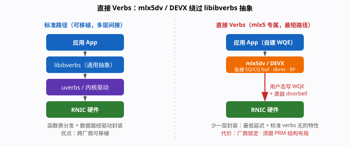

#### 为什么要绕过 libibverbs

libibverbs 是**可移植**的——同一份代码跑在 mlx5、irdma、bnxt_re 等不同 provider
上。代价是每个数据面调用（`ibv_post_send` / `ibv_poll_cq`）都要经过
**provider 函数表的间接分发**，再由 provider 把 WR 翻译成硬件 WQE。对追求亚微秒
延迟、或要用标准 verbs 没有暴露的硬件特性（DC 传输、UMR、高级流量分类）的系统，
这层抽象就成了障碍。

**两条直接通道：**

| 通道 | 用途 | 抽象层级 |
|------|------|---------|
| **mlx5dv（Direct Verbs）** | 取出标准 verbs 对象的**裸硬件指针**（SQ/CQ 缓冲、dbrec、BF 寄存器），在用户态手工拼 WQE | 仍复用 libibverbs 创建对象，只「下探」数据面 |
| **DEVX（`mlx5dv_devx_*`）** | 直接用 **PRM 命令**创建/操作硬件对象（QP、CQ、DC、流表项），完全不经标准 verbs | 最底层，几乎等同写驱动 |

> 💡 **PRM** 首次出现：Programmer's Reference Manual，是 mlx5 硬件每个结构体逐字段
> 布局的官方规范。DEVX 编程就是照着 PRM「填表格」，固件升级时这本「表格」可能变。

#### mlx5dv：取出裸缓冲指针

标准 verbs 创建 QP/CQ 后，`mlx5dv_init_obj` 把内部结构「掀开」，交出硬件级字段：

```c
#include <infiniband/mlx5dv.h>

struct mlx5dv_qp dvqp = {0};
struct mlx5dv_cq dvcq = {0};
struct mlx5dv_obj obj = {
    .qp = { .in = qp, .out = &dvqp },   /* qp 由 ibv_create_qp 创建 */
    .cq = { .in = cq, .out = &dvcq },
};

if (mlx5dv_init_obj(&obj, MLX5DV_OBJ_QP | MLX5DV_OBJ_CQ))
    die_rdma("mlx5dv_init_obj");

/* 现在拿到了硬件级指针： */
void     *sq_buf   = dvqp.sq.buf;      /* SQ 环形缓冲基址（直接写 WQE） */
uint32_t  sq_wqe_cnt = dvqp.sq.wqe_cnt;
uint32_t  sq_stride  = dvqp.sq.stride; /* 每个 WQE 槽位字节数（通常 64） */
__be32   *dbrec    = dvqp.dbrec;       /* DB record：SQ 生产者索引（主机内存） */
void     *bf_reg   = dvqp.bf.reg;      /* BlueFlame 门铃寄存器（MMIO WC） */
uint32_t  bf_size  = dvqp.bf.size;

void     *cq_buf   = dvcq.buf;         /* CQ 缓冲，可手工解析 CQE，跳过 ibv_poll_cq */
uint32_t  cqe_cnt  = dvcq.cqe_cnt;
uint32_t  cqe_size = dvcq.cqe_size;    /* 64 或 128 */
```

拿到 `sq.buf` + `dbrec` + `bf.reg` 三件套后，发一个 WQE 就**完全不调用
libibverbs**：自己往 `sq_buf` 里按 PRM 布局写 ctrl/data segment，更新 `dbrec`，
再敲 `bf_reg`（细节见 §17.2）。`ibv_poll_cq` 同理可被「手工解析 `cq_buf` 里的 CQE
owner bit」取代。

#### DEVX：用 PRM 命令直接造硬件对象

mlx5dv 仍借标准 verbs 创建对象；**DEVX 连创建都自己来**——把一段按 PRM 编码的
命令直接下发给固件：

```c
/* 以 PRM 命令创建一个硬件对象（如 DC target、流表 steering rule、计数器） */
uint32_t in[MLX5_ST_SZ_DW(create_qp_in)]   = {0};
uint32_t out[MLX5_ST_SZ_DW(create_qp_out)] = {0};

DEVX_SET(create_qp_in, in, opcode, MLX5_CMD_OP_CREATE_QP);
DEVX_SET(create_qp_in, in, qpc.st, MLX5_QPC_ST_DCI);   /* DC initiator */
DEVX_SET(create_qp_in, in, qpc.pd, pdn);
/* ... 逐字段按 PRM 填 qpc（QP context）... */

struct mlx5dv_devx_obj *qp_obj =
    mlx5dv_devx_obj_create(ctx, in, sizeof(in), out, sizeof(out));
if (!qp_obj) die_rdma("devx create_qp");

uint32_t qpn = DEVX_GET(create_qp_out, out, qpn);

/* 后续用 mlx5dv_devx_obj_modify() 推 QP 状态机 RST→INIT→RTR→RTS */
```

DEVX 是解锁高级能力的钥匙：**DC（Dynamically Connected）传输**（一个 DCI 连任意
DCT，省下 N² 个 QP，见[第 12 章](part2-进阶.md#ch12)）、**高级 steering**
（按五元组/VXLAN 把流量导向特定 QP/RQ）、**UMR**（用户态内存重注册，零拷贝重组
MR）等，标准 verbs 大多不暴露。

#### 权衡：能力 vs 锁定

| 维度 | libibverbs | mlx5dv / DEVX |
|------|-----------|---------------|
| 可移植性 | 跨厂商 | **仅 mlx5（厂商锁定）** |
| 延迟 | 多一层分发 | 最短路径，省间接调用 |
| 能力 | 标准子集 | DC / UMR / 高级 steering 等 |
| 维护成本 | 低 | **须跟 PRM 结构布局**，固件升级可能变更 |
| 出错代价 | verbs 会校验 | 写错 WQE 字节 → 静默数据损坏 / NIC 卡死 |

经验法则：**控制面**（建链、MR 注册）继续用 libibverbs / librdmacm；只把**最热的
数据面**（post + poll）下沉到 mlx5dv，必要时才动 DEVX。

---

### 17.2 Doorbell 机制深入：DB record、BlueFlame 与门铃批处理

**问题引入**：[第 11 章](part2-进阶.md#ch11)把 doorbell 当成「一次 MMIO 写」
一笔带过。但你既然已经拿到了 `dbrec` 和 `bf.reg`（§17.1），就必须知道真相：在
mlx5 上发一个 WQE，其实是**三步 + 两道内存屏障**的精密舞蹈，错一步就是数据损坏
或死锁。

**直觉/类比**：把发 WQE 想象成「写好一张订单（WQE）→ 在登记本上 +1（dbrec）→
按响柜台铃（BF）」。如果铃声比登记早到，店员按旧登记数去取订单，就会漏单——内存
屏障就是保证这三步的**严格先后**。

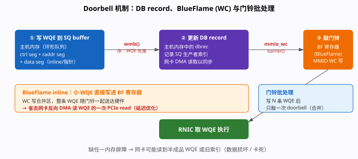

#### 三步门铃序列

```
① 写 WQE 到 SQ buffer（主机内存环形队列）
        │   wmb()         ← 保证 WQE 字节先于索引可见
② 更新 DB record（dbrec，主机内存中的生产者索引）
        │   mmio_wc barrier()   ← 保证 dbrec 先于 BF 写，且 WC 缓冲不乱序
③ 敲 BlueFlame（BF）寄存器（MMIO，写合并 WC 内存）
```

- **DB record（dbrec）**：一小块**主机内存**，存 SQ 的生产者索引。网卡通过 DMA
  读它来知道「队列里新增了多少 WQE」。它是**真相来源**——即使 BF 写丢了，网卡轮询
  dbrec 仍能发现新 WQE（BF 只是「催一下」的快路径）。
- **BlueFlame（BF）寄存器**：映射为 **write-combining（WC）** 的 MMIO 区域。普通
  doorbell 只写一个索引；BF 的特殊之处见下。

#### BlueFlame inline：把 WQE 直接「喷」进寄存器

普通流程里，网卡收到门铃后要**反向 DMA 读 SQ buffer** 把 WQE 取回——这是一次
PCIe 读往返（数百 ns）。BlueFlame 的杀手锏：**小 WQE 可以整条 inline 写进 BF
寄存器**。借助 WC 内存的写合并，整个 WQE 随门铃一次性推到网卡：

```
普通：  CPU 写 WQE 到内存 → 敲门铃 → 网卡 DMA 读 WQE 回来（PCIe read 往返）
BF inline：CPU 把 WQE 直接写进 BF 寄存器 → 网卡当场拿到 WQE
                                        ↑ 省去网卡反向 DMA 读 WQE 的一次 PCIe read
```

这与[第 11 章](part2-进阶.md#ch11)的 `IBV_SEND_INLINE` 是**两个不同层次**的
inline：前者把**用户数据**塞进 WQE 省一次数据 DMA；BlueFlame 把**整条 WQE**塞进
门铃省一次 WQE DMA。两者叠加，小消息延迟可压到极限。

#### 手工 post：屏障不能省

```c
/* 续 §17.1：sq_buf / dbrec / bf_reg 已由 mlx5dv_init_obj 取得 */

static unsigned sq_pi;   /* SQ 生产者索引（以 WQE 为单位） */

void post_write_raw(void *sq_buf, uint32_t stride, __be32 *dbrec,
                    void *bf_reg, /* ... WQE 内容 ... */)
{
    /* ① 在 sq_buf 的当前槽位按 PRM 拼 WQE（ctrl + raddr + data segment） */
    void *seg = (char *)sq_buf + (sq_pi % wqe_cnt) * stride;
    build_ctrl_seg(seg, MLX5_OPCODE_RDMA_WRITE, sq_pi, /*ds=*/3, /*signal=*/1);
    build_raddr_seg((char *)seg + 16, remote_addr, rkey);
    build_data_seg ((char *)seg + 32, local_addr, lkey, len);

    sq_pi++;

    /* ②③ 之间的屏障：WQE 必须先于 dbrec 落地 */
    udma_to_device_barrier();           /* == wmb() */
    dbrec[MLX5_SND_DBR] = htobe32(sq_pi & 0xffff);   /* 更新 DB record */

    mmio_wc_start();                    /* WC 屏障，保证 dbrec 先于 BF 写 */
    /* ③ 敲门铃：64 字节 WQE 可整条 inline 进 BF（此处简化为写 ctrl seg） */
    mmio_write64_be(bf_reg, *(uint64_t *)seg);
    mmio_flush_writes();                /* 强制 WC 缓冲刷出，门铃真正到达 NIC */
}
```

> 屏障语义（rdma-core 提供 `udma_to_device_barrier` / `mmio_wc_start` 等可移植
> 封装）：
> - **wmb（WQE → dbrec）**：若网卡先看到新索引却读到半成品 WQE → 执行垃圾。
> - **mmio_wc（dbrec → BF）**：WC 内存默认可乱序合并；不加屏障，BF 写可能在 dbrec
>   之前到达，网卡按旧索引取 WQE。
> - **结尾 flush**：WC 缓冲若不刷出，门铃滞留在 CPU 写合并缓冲，表现为「post 了但
>   网卡毫无反应」的诡异卡死。

#### WQE 二进制布局

一条 RDMA WRITE WQE 至少由三段 16 字节对齐的 segment 组成：

| segment | 内容 | 关键字段 |
|---------|------|---------|
| **ctrl segment** | 控制头 | opcode、qp_num、`ds`（data segment 数，决定 WQE 长度）、`fm_ce_se`（含 signal/fence 位）、`opmod_idx_opcode`（含 SQ 索引） |
| **raddr segment** | 远端寻址（仅单边操作） | `raddr`（对端虚拟地址）、`rkey` |
| **data segment** | 数据指针或 inline 数据 | `byte_count`、`lkey`、`addr`（或 inline 标志 + 内嵌字节） |

`ds` 字段尤其要小心：它以 16 字节为单位描述整条 WQE 的长度，**算错一格**网卡就会
把下一条 WQE 的字节误读成本条的 data segment。

#### 门铃批处理

把 N 条 WQE 连续写进 SQ buffer，**只在最后更新一次 dbrec、敲一次门铃**：dbrec 一次
跳 N 格，网卡批量取走 N 条 WQE。这是[第 11 章](part2-进阶.md#ch11)「链式 WR
一次 doorbell」在硬件层的真身。注意此时**不能**用 BlueFlame inline（BF inline 只
适合单条小 WQE），批处理走普通 doorbell 路径。

---

### 17.3 SmartNIC / DPU 卸载：BlueField、DOCA 与 host-offload 架构

**问题引入**：到目前为止，所有 RDMA 逻辑都跑在主机 CPU 上——即便数据面卸载给了
网卡，控制面（建链、MR 管理、存储 target 逻辑）仍占着主机 CPU。在云厂商那里，主机
CPU 的每一个核都是要卖钱的，被基础设施占用就是亏本。能不能把这些「杂活」整个搬到
网卡上去？

**直觉/类比**：普通网卡像「只会送货的快递员」；DPU 像「在你家楼下开了个分拣中心
的物流公司」——收发、分拣、安检都在楼下办完，你（主机 CPU）只管收成品。

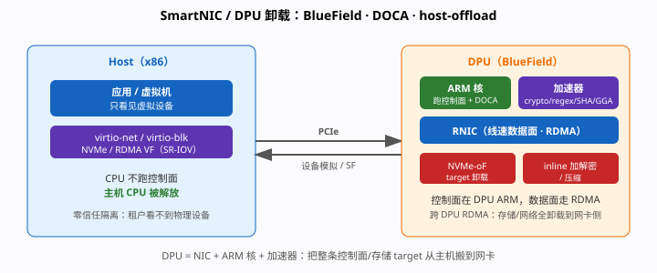

#### 从 NIC 到 DPU

普通 RNIC 卸载的是**传输层**（RDMA 引擎）。**DPU（Data Processing Unit，如 NVIDIA
BlueField）= RNIC + 一组 ARM 核 + 专用加速器**，它能跑一个**完整的 Linux**，因此
可以把整条**控制面**乃至**存储/网络服务**从主机搬到网卡侧：

```
传统：  Host CPU 跑 控制面 + 数据面协议栈 + 存储 target
DPU：   Host 只看到虚拟设备；控制面 / target 跑在 DPU 的 ARM 上
        Host CPU 100% 还给业务
```

#### DOCA 编程模型与设备表示

- **DOCA SDK**：BlueField 的上层框架，封装 Flow（硬件流表）、DMA、加解密、压缩、
  存储（NVMe-oF）、`doca_rdma` 等领域库。开发者在 ARM 侧写应用，调 DOCA API 驱动
  下面的加速器与 RNIC。
- **设备表示（device representation）**：
  - **SR-IOV VF**：传统虚拟化，每个 VF 是一个轻量 PCIe 功能，直通给虚拟机。
  - **SF（Scalable Function）**：比 VF 更轻量、可大规模实例化的虚拟功能，DPU 用它
    给成百上千租户提供隔离的虚拟设备。
  - 主机侧看到的 virtio-net / virtio-blk / NVMe 设备，背后由 DPU **模拟**——主机
    驱动以为在和真硬件说话，实际请求被 DPU ARM 截获处理。

#### 典型卸载场景

| 场景 | 卸载了什么 | 收益 |
|------|-----------|------|
| **NVMe-oF target 卸载** | 存储 target 跑在 DPU，主机磁盘 I/O 走 DPU | 存储节点主机 CPU 几乎零占用 |
| **inline 加解密 / 压缩** | 数据过网卡时硬件加速器在线处理 | 线速加密，主机无感 |
| **virtio-net/blk 模拟** | 网络/块设备由 DPU 模拟 + 后端卸载 | 裸金属也能软件定义 I/O |
| **零信任隔离** | 控制面/安全策略在 DPU，租户碰不到物理设备 | 主机被攻破也无法越权访问网络/存储 |

#### RDMA 专属玩法

- **跨 DPU RDMA**：两端 DPU 间直接用 RDMA 搬数据，主机完全不参与——存储复制、
  GPU 训练梯度交换的常见拓扑。
- **GGA（Generic Global Accelerator）+ RDMA 合一**：数据 RDMA 落到 DPU 内存后，
  顺手过 regex / SHA / 压缩加速器，再写出——「搬运 + 计算」一次过，省去回主机绕一圈。
- **架构铁律**：**控制面在 DPU ARM，数据面走 RDMA 线速通道，主机只见虚拟设备**。
  控制面的灵活性（软件）与数据面的极致性能（硬件）由此解耦。

#### 与本书的关系

本书示例都是**主机侧 RDMA**。迁到 DPU 时，`server.c` / `client.c` 这类
target/控制逻辑会编译进 DPU ARM 的 Linux 运行，数据面 verbs 调用直接驱动 DPU 上的
RNIC——代码几乎不变，**改变的是它运行的位置**。这正是 DPU 卸载「对应用透明」的精髓。

---

### 17.4 现代拥塞控制：超越 DCQCN（HPCC / TIMELY / Swift / 可编程 CC）

**问题引入**：[第 13 章](part2-进阶.md#ch13)讲的 DCQCN 是 RoCEv2 的事实标准，
但用过的人都知道它有结构性短板：信号粗、收敛慢、参数难调。在超大规模数据中心里，
这些短板会被放大成稳定性问题。学术界和工业界用什么更好的算法替代它？

**直觉/类比**：DCQCN 像只有「红绿灯」两种状态的路况播报——只告诉你堵不堵，不告诉
你堵到第几个路口。现代 CC 则像实时导航——精确到每条路的拥堵程度，让你能算出恰好
不排队的车速。

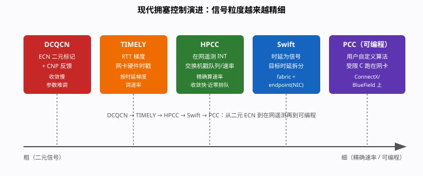

#### DCQCN 的天花板

[第 13 章](part2-进阶.md#ch13)讲的 DCQCN 是 RoCEv2 的事实标准，但它有结构性
短板：

- **ECN 是二元信号**：交换机只能说「拥塞 / 不拥塞」，给不出「拥塞多严重」。发送端
  只能盲目按固定步长降速、再缓慢探测加速。
- **收敛慢**：基于概率标记 + 速率慢启动，从拥塞恢复要多个 RTT。
- **参数地狱**：`Kmin/Kmax/Pmax`、`g`、`Rai/Rhai`、timer——一组参数对一种流量谱
  系最优，换业务就要重调，跨数据中心几乎无法统一。

后续算法的共同方向：**用更精细的信号**（精确时延、精确链路利用率）替代二元 ECN。

#### TIMELY：RTT 梯度

用**网卡硬件时戳**精确测量 RTT，关键洞察是**用 RTT 的梯度（变化率）而非绝对值**
做决策：RTT 在上升说明队列在堆积，提前降速；RTT 下降则加速。比 ECN 提前感知拥塞，
且不依赖交换机配合。

#### HPCC：在网遥测（INT），最精确

HPCC（High Precision Congestion Control）跳出端到端猜测，让**网络自己上报状态**：

```
数据包穿过每一跳交换机时，交换机把【出口队列深度 / 已发字节 / 链路带宽 / 时戳】
用 INT（In-Network Telemetry）戳进包头；
        │
ACK 把这串遥测带回发送端；
        │
发送端按每条链路的【精确利用率】算出恰好填满而不排队的速率（inflight 字节目标）。
```

效果：**收敛极快、近零排队、几乎无需调参**——因为它拿到的是链路利用率的真值，而非
二元信号。代价：需要**交换机支持 INT**（P4 可编程交换机或厂商 ASIC 特性），部署门槛高。

#### Swift（Google）：时延拆分

Swift 以**端到端时延为唯一信号**，但把目标时延拆成两部分分别控制：

- **fabric 时延**：网络中转产生（队列/链路），反映网络拥塞。
- **endpoint 时延**：网卡/主机内部产生（NIC 处理、PCIe、incast 时的目标端排队），
  反映端侧拥塞（尤其 incast）。

分别设目标、分别调速，使 Swift 在大规模 incast 下仍稳定。优点：**纯端侧、不需要
交换机改造**，工程上比 HPCC 易部署。

#### 可编程 CC（PCC）：把算法写进网卡

NVIDIA ConnectX/BlueField 支持**用户可编程拥塞控制**：用**受限 C** 写一段 CC 算法，
编译后**运行在网卡固件的 CC 引擎里**。算法可消费硬件时戳、CNP、RTT 等事件，输出
速率决策——既享受硬件级反应速度，又能按业务自定义策略（甚至直接实现 Swift/HPCC 风格
逻辑）。这是「算法灵活性」与「硬件性能」的合流点，呼应 §17.3 的可编程网卡趋势。

#### 横向对比

| 算法 | 信号类型 | 信号粒度 | 收敛速度 | 硬件要求 | 部署门槛 |
|------|---------|---------|---------|---------|---------|
| **DCQCN** | ECN（二元）+ CNP | 粗 | 慢 | 交换机 ECN + NIC | 低（RoCEv2 标配） |
| **TIMELY** | RTT 梯度 | 中 | 中 | NIC 硬件时戳 | 中（纯端侧） |
| **HPCC** | 在网遥测 INT | **最精确** | **最快** | **交换机 INT** + NIC | 高（需 P4/特殊 ASIC） |
| **Swift** | 端到端时延（拆分） | 细 | 快 | NIC 硬件时戳 | 中（纯端侧） |
| **PCC** | 可编程（任意信号） | 取决于算法 | 取决于算法 | 可编程 CC 的 NIC | 中（需 ConnectX/BlueField） |

> 观测落地：[第 16 章](#ch16)的 `hw_counters`（`np_cnp_sent` /
> `np_ecn_marked_roce_packets` / `roce_slow_restart`）是 DCQCN 的「仪表盘」。换到
> HPCC/Swift/PCC 时，监控重点转向**实测 RTT 分布**与**队列深度**，而非 CNP 计数。

---

### 小结：原理 → API → 代码 → 性能 → 陷阱

| 节 | 原理 | 核心 API / 机制 | 代码示例 | 性能收益 | 常见陷阱 |
|----|------|----------------|---------|---------|---------|
| 17.1 | 绕过 provider 函数表分发，直取硬件对象 | `mlx5dv_init_obj` · `mlx5dv_devx_obj_create` · `DEVX_SET/GET` | 取 `sq.buf/dbrec/bf` + DEVX 建 DC | 省间接调用 + 解锁 DC/UMR/steering | 厂商锁定；PRM 字段写错 → 静默损坏 |
| 17.2 | 三步门铃 + 两道屏障；BF 把 WQE inline 进寄存器 | `dbrec` 写 · `mmio_wc_start` · BlueFlame BF 寄存器 | `post_write_raw` 手工 WQE | 省网卡反向 DMA 读 WQE 一次 PCIe read | 漏 wmb/mmio_wc → 损坏或卡死；`ds` 算错 |
| 17.3 | DPU=NIC+ARM+加速器，控制面下沉网卡 | DOCA SDK · SF/VF · 设备模拟 · `doca_rdma` | NVMe-oF/crypto 卸载 · 跨 DPU RDMA | 主机 CPU 几乎清零 | 误把数据面也搬上 ARM（ARM 算力有限） |
| 17.4 | 用精确信号（时延/INT）替代二元 ECN | TIMELY/HPCC/Swift 算法 · PCC 可编程引擎 | INT 遥测回算速率 · 受限 C 写 CC | 近零排队、收敛快、少调参 | HPCC 需交换机 INT；DCQCN 参数地狱 |

---

### 术语速查

| 术语 | 含义 |
|------|------|
| **mlx5dv** | mlx5 Direct Verbs，取出标准 verbs 对象的裸硬件指针（SQ/CQ/dbrec/BF） |
| **DEVX** | `mlx5dv_devx_*`，用 PRM 命令直接创建/操作硬件对象（DC、steering 等） |
| **PRM** | Programmer's Reference Manual，mlx5 硬件结构布局规范 |
| **WQE ctrl segment** | WQE 控制头：opcode、qp_num、`ds`（长度）、signal/fence 位、SQ 索引 |
| **DB record (dbrec)** | 主机内存中的 SQ 生产者索引，网卡 DMA 读取以同步队列，真相来源 |
| **BlueFlame (BF)** | WC 内存映射的门铃寄存器，小 WQE 可整条 inline 进去省一次 PCIe read |
| **DPU** | Data Processing Unit，NIC + ARM 核 + 加速器，可下沉整条控制面 |
| **DOCA** | BlueField DPU 的上层 SDK（Flow/DMA/crypto/storage/doca_rdma 等库） |
| **SF** | Scalable Function，比 SR-IOV VF 更轻量、可大规模实例化的虚拟功能 |
| **GGA** | Generic Global Accelerator，DPU 上 regex/SHA/压缩等通用加速器 |
| **DCQCN** | RoCEv2 标准 CC，基于 ECN 二元信号 + CNP，收敛慢、参数难调 |
| **TIMELY** | 基于 RTT 梯度的 CC，用网卡硬件时戳，纯端侧 |
| **HPCC** | High Precision CC，用在网遥测 INT 精确算速率，收敛最快、近零排队 |
| **Swift** | Google 的时延型 CC，目标时延拆分为 fabric + endpoint，纯端侧 |
| **INT** | In-Network Telemetry，交换机把队列深度/链路利用率戳进包头 |
| **PCC** | 可编程拥塞控制，用受限 C 写算法跑在 ConnectX/BlueField 网卡上 |

> 完整术语表见[附录 A · 术语表与参考文献](appendix-附录.md#appendix-a)。

---

### 尾声：你已从小白走到专家

还记得[第 1 章](part1-入门.md#ch01)吗？那时我们刚刚问出「为什么 TCP 不够快」。
一路走来，你建立了核心对象的心智模型（第 3–8 章），掌握了立即数与原子操作
（第 9 章），啃下了硬件数据路径、性能工程、可扩展架构、可靠性与高级内存管理
（第 10–14 章），学会了把 RDMA 嵌进真实系统、独立排障（第 15–16 章），最后在
本章潜入了 mlx5dv/DEVX、硬件门铃、DPU 卸载与现代拥塞控制的深水区。

从「会砌砖」到「会盖楼」，再到「会设计承重结构」——你已经走完了这条由浅入深的路。
RDMA 仍在快速演进：DPU 把控制面卷向网卡，可编程 CC 把算法卷进固件，CXL 正在重新
定义内存语义……保持好奇，下一个边界等你去推。

接下来：
- 随时翻[附录 A · 术语表与参考文献](appendix-附录.md#appendix-a)查术语、按图索骥读论文。
- 用[附录 B · 示例索引](appendix-附录.md#appendix-b)把每个概念对应到可运行的代码。
- 加入社区与规范：
  - **rdma-core**（libibverbs/librdmacm 与示例）：<https://github.com/linux-rdma/rdma-core>
  - **perftest**（性能基准标准实现）：<https://github.com/linux-rdma/perftest>
  - **InfiniBand Architecture Specification（IBTA）**：<https://www.infinibandta.org/ibta-specification/>
  - **Linux 内核 RDMA 子系统文档**：<https://www.kernel.org/doc/html/latest/infiniband/>

愿你写出又快又稳的 RDMA 系统。

---

- 上一站：[第二部分 · 进阶](part2-进阶.md)
- 随时查阅：[附录 A · 术语表](appendix-附录.md#appendix-a) · [附录 B · 示例索引](appendix-附录.md#appendix-b)
- 回到起点：[前言与导读](00-前言与导读.md)
